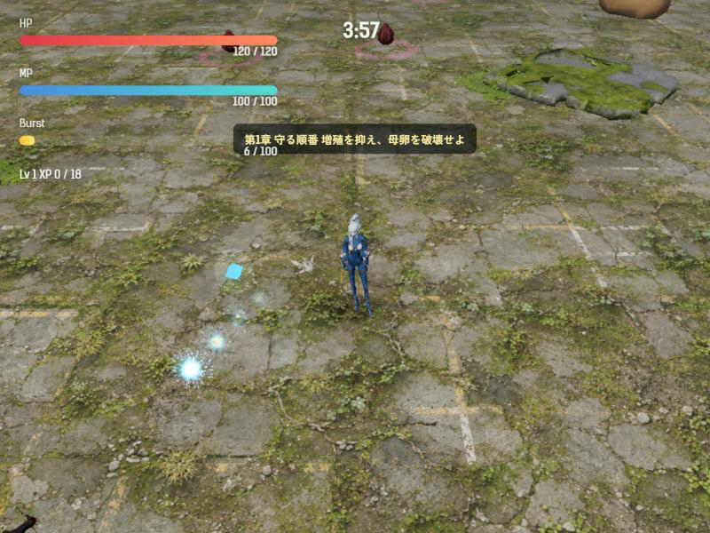
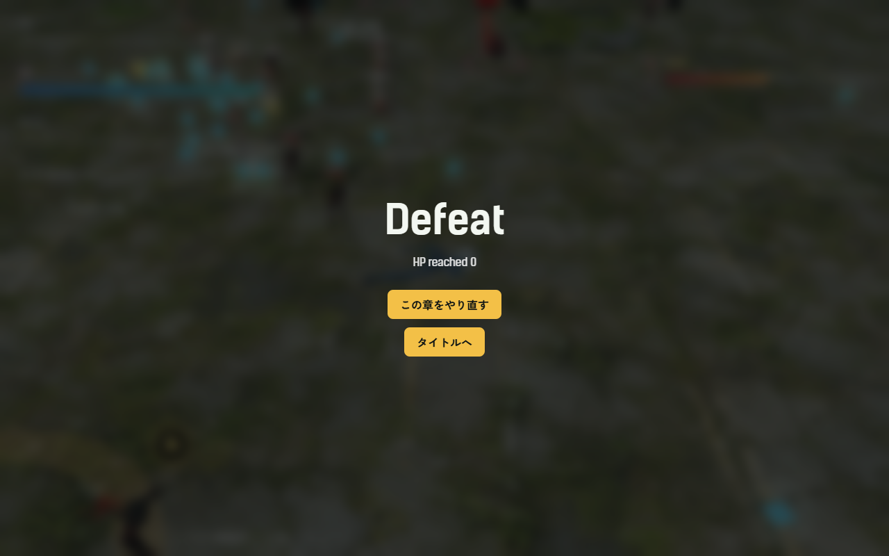
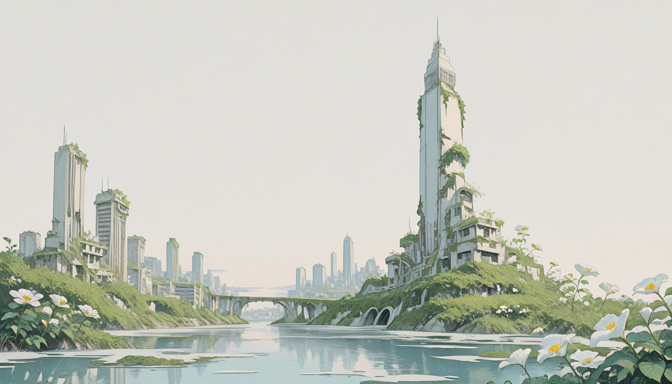

# 2026-10-21（サイクル 1）

## 今日やったこと
- A: **A1 自動プレイボットと計測**を実装（`scripts/bot-play.mjs`）。
  - `check-story.mjs` と同じく、テスト時の `src/main.js` の応答にだけ状態参照を足す。製品コードは変更なし。
  - ボットの動き: 9m 以内の敵から距離の二乗に反比例して離れる／最寄りの卵へ向かう（母卵が出たら人間形態は 9m の距離を保つ）／MP が 70% 以上で周囲 15m に卵が 3 個以上なら鳥へ、MP 20% 未満で人へ戻る／バーストが溜まったら使う／強化はランダム。移動は画面のスティックと同じ `setTouchMovement` を使う。
  - 時間を速める: 1 回の描画ごとに 1/30 秒の更新を `--speed` 回行う。4分ステージ1回が実時間 11〜19 秒で終わる。
  - 出力: `tmp/bot/bot-<キャラ>-stage<章>-<時刻>.json`（勝敗、撃破時間、死亡時刻、被ダメージ、母卵出現後の被ダメージ、卵の壊し方の内訳、レベル推移と強化の履歴、卵と敵の最大数、鳥形態の時間、10秒ごとの記録、描画FPS）。
- B: 水曜＝イラスト。B0 を優先し、**B0-4 の Forge の API 起動**を確認し、**B4-1 の画風比較**を1回だけ行った（ゲームへの採用はなし）。
  - 起動用 `scripts/assets/start-forge-api.bat`、生成用 `scripts/assets/forge-txt2img.mjs` を追加（B0-2 の一部）。
  - 同じプロンプト・シードで 3 モデルを比較。下の画像を参照。

## 確認結果
- npm test / build: 19 件すべて成功／ビルド成功
- プレイ確認: 内蔵ブラウザで第1章を開始し、戦闘画面が正常に出ることを確認（製品コードの変更はなし）
  
  ボットの1回目の終了画面:
  
- 数値（第1章、`--speed 6`、各キャラの勝率はすべて 0）:

  | キャラ | 回数 | 死亡時刻(秒) | 平均被ダメージ | 平均到達Lv | 卵の最大数 | 敵の最大数 |
  |---|---|---|---|---|---|---|
  | ツキミ | 5 | 200.8〜214.1 | 220.6 | 10.2 | 78〜84 | 96〜108 |
  | アカメ | 3 | 214.2〜221.1 | 279.7 | 10.7 | — | — |
  | キイチゴ | 3 | 201.9〜208.0 | 201.3 | 11.3 | — | — |

  - ツキミ 5 回の内訳（最初の計測）: 180 秒の母卵出現までは HP がほぼ減らず、**被ダメージの約半分は母卵出現後の 20〜40 秒に集中**して死亡。卵は 110 秒以降に急増（21→78 個）。卵の壊し方は鳥の急降下 23〜31、特殊弾 7〜13、バースト 5〜14。
  - 単純なボットなので「難しすぎる」とはまだ言えない。A2 で中身（何に当たって死んだか）を確かめる。
  - 同じシードでも結果が少しずれる（乱数の固定がボット開始後で、初期配置と描画タイミングの影響が残るため）。比較は複数回の平均で見る。
  - 描画FPS（60〜110）は高速化中の値で、実際の遊びのFPSではない。

### イラストの比較（B4-1、すべて seed 2101、1344×768）
| softsketchIllustrious_v125 | bluePencilXLLCM_v200（LCM 8 steps） | juggernautXL_ragnarokBy |
|---|---|---|
|  |  |  |

- 背景は **juggernautXL が `assets/promo/world-awakening.png` に最も近い**（描き込みの密度、白い塔と蔦）。ただし既存絵の暖かい逆光と霧の厚みが足りない。softsketch は線画寄りで余白が多く、bluePencil はぼやけて平坦。どれも不採用。
- 霧と逆光を足した2枚目（juggernaut、seed 2102）は、同時に別のチャットの音声一括生成（`search_survive_promo/meibuki-intro/tools/tts_batch.py`）が GPU を使い始めて VRAM が尽き、1 step 100 秒まで遅くなったので中止した。そのプロセスには触れていない。

## 判断待ち（ユーザーへ）
- 敗北画面の文言が、死亡演出を経由すると英語の「HP reached 0」、即死時は「HPが尽きました」と食い違っている（`src/main.js` の `finish(false, 'HP reached 0')`）。日本語にそろえてよいか。よければ次のサイクルで直す。
- 定期タスクと別のチャットの生成作業が同時に GPU を使うと、どちらも極端に遅くなる。生成ツールを動かすチャットが重ならないよう、時間帯を分けるか、どちらかが待つかを決めてほしい。

## 次にやること
- A: E1（母卵の衝撃波を地面だけに、鳥形態なら回避）。ボットの数値で「母卵出現後に死ぬ」状況が変わるかを見る。ボットに鳥形態で衝撃波を避ける動きを足す。
- B（木・3D）: B0-1 の棚卸しのうち 3D に関係する部分、または B1-1 の元絵づくり。
- イラストの続き（次の水曜）: juggernaut で逆光と霧を足した背景、キャラクター向けに softsketch と LoRA（Flat_style など）の比較。
