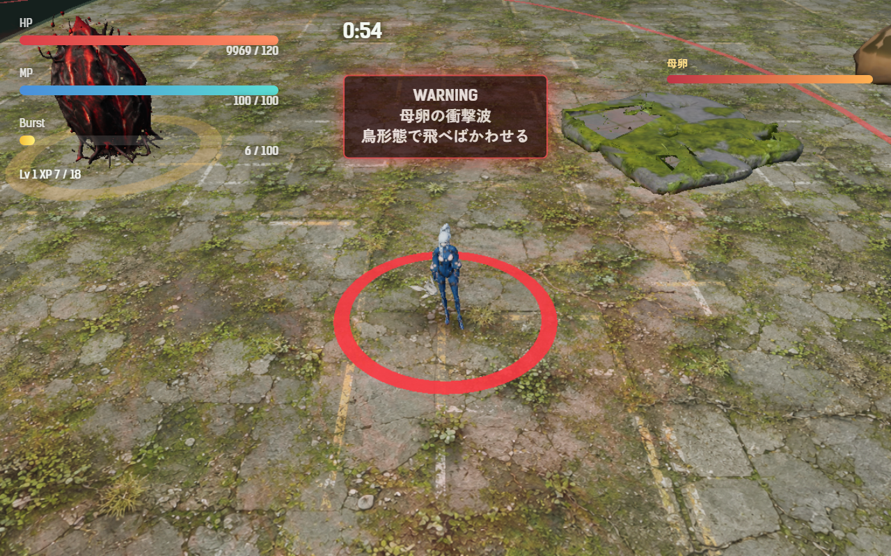
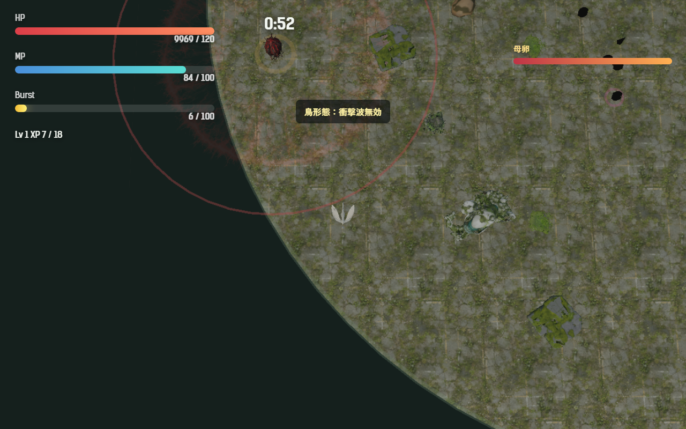
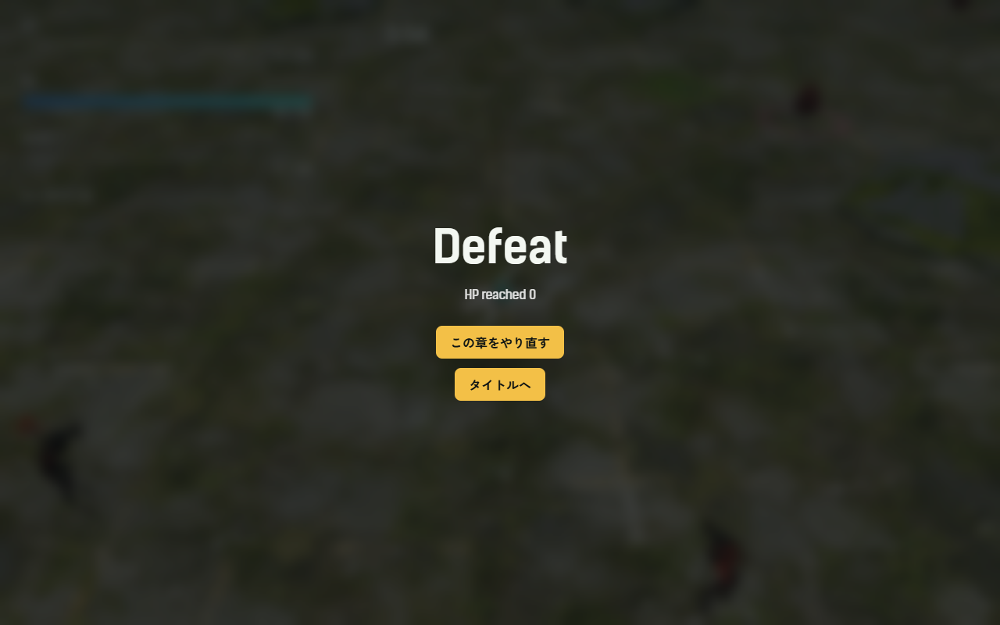

# 2026-10-23（サイクル 2）

## 今日やったこと
- A: **E1 母卵の衝撃波**。
  - 「地面を走る波は鳥形態なら無効」という処理は既に入っていた（`spawnMotherShockwave` の `player.form === 'bird'` の分岐）。足りなかったのは、それをプレイヤーに伝える予兆の見た目。
  - 予兆（1.6 秒）に次の3つを追加。`Config.egg.motherShockwaveTimingRing: false` で元に戻る。
    - 衝撃波が届く範囲（半径 24m）の赤い縁取り。鳥形態の広いカメラで見える。
    - 人間形態で範囲内にいるときだけ、足元に赤い輪を出し、波が放たれる瞬間に縮みきるようにした（人間形態のカメラは近く、縁取りが画面外になるため）。
    - 警告の文に一行足した。人間形態なら「鳥形態で飛べばかわせる」、鳥形態なら「飛んでいれば地を這う波は届かない」。
  - ボット（A11 の一部）: 予兆中に母卵から 26m 以内なら鳥へ変身し、波が通り過ぎるまで人に戻らない動きを追加。衝撃波の発射・到達・回避の回数を記録。`--dodge 0` で以前の動きに戻る。
- B: 金曜＝音声。**B3-1 アカメ・キイチゴの戦闘開始と死亡の声**を追加し、ゲームに組み込んだ。
  - 生成用 `scripts/assets/irodori-batch.py`（B0-2 の音声部分）と台詞ファイル `scripts/assets/voices/2026-10-23-b3-1.json` を追加。
  - 声質の指定文とシードは紹介動画で決めたもの（アカメ 2202、キイチゴ 3303）を使い、台詞ごとの演技指定を足した。各台詞3シードずつ、12本を 2 分 16 秒で生成。
  - Whisper で文字起こしして、全候補が台詞どおり（一致率 0.71〜1.00）であることを確かめた。採用は基準シードの4本。
    | キャラ | 場面 | 台詞 | ファイル |
    |---|---|---|---|
    | アカメ | 戦闘開始 | 前は、私が引き受ける。 | `assets/audio/voice/akame/battle_start_01.mp3` |
    | アカメ | 死亡 | ……まだ、終わって……ない…… | `assets/audio/voice/akame/death_01.mp3` |
    | キイチゴ | 戦闘開始 | さーて、ひと暴れしよっか！ | `assets/audio/voice/kiichigo/battle_start_01.mp3` |
    | キイチゴ | 死亡 | うそ……ここまで、かぁ…… | `assets/audio/voice/kiichigo/death_01.mp3` |
    | ツキミ | 戦闘開始／死亡 | 倒してやる！／もうダメ（既存の .wav を mp3 化） | `assets/audio/voice/tsukimi/battle_start_01.mp3`、`death_01.mp3` |
  - 無音を削り、既存の声（-13.6〜-16.6 LUFS）に合わせて -15 LUFS にそろえた。
  - 再生: 出撃直後に戦闘開始の声、倒れたときの叫び（既存の `dying`）の 1.8 秒後に死亡の声。`Config.audio.battleVoices: false` で元に戻る。
  - 候補の元ファイルは `assets_src/voice/2026-10-23/`（git 対象外）。

## 確認結果
- npm test / build: 19 件すべて成功／ビルド成功
- プレイ確認: 内蔵ブラウザで第1章を開始し、エラーなく戦闘画面が出ることを確認。予兆の見た目は Playwright で母卵の出現まで時間を進めて撮影した。
  - 人間形態の予兆（足元の赤い輪、右上に範囲の縁取り、警告文の3行目）:
    
  - 鳥形態で波をやり過ごしたところ（範囲の縁取りと「鳥形態：衝撃波無効」）:
    
  - 3キャラとも、戦闘開始の声 → 叫び（約1.0秒後に被弾で死亡）→ 死亡の声（その約1.8秒後）の順で再生され、音声ファイルの読み込みエラーもなし。敗北画面:
    
- 数値（ツキミ・第1章・`--speed 6`・5回、勝率はすべて 0）:

  | ボット | 死亡時刻(秒) | 平均被ダメージ | 衝撃波 命中／回避 | 平均到達Lv |
  |---|---|---|---|---|
  | 回避なし（`--dodge 0`） | 200.8〜212.5（1回は時間切れ） | 161 | 7／2 | 10.2 |
  | 回避あり（予兆中だけ鳥。波の途中で人に戻る不具合あり） | 215.7〜224.6（1回は時間切れ） | 217 | 4／7 | 11.2 |
  | 回避あり（修正後） | 215.5〜236.7 | 181.6 | **0／13** | 11.6 |

  - 鳥形態で衝撃波を全部避けられることを確認。死亡は平均 約 207 秒 → 約 224 秒に延びたが、まだ勝てない。
  - 回避ありでも死ぬ原因は、母卵出現（180 秒）後に敵が 100 体以上に増え、鳥形態のまま囲まれること（死亡前の記録: 敵 48〜114 体）。母卵の HP は 18〜151 残っていた。A2 の診断で詳しく見る。
  - 被ダメージは生き延びた時間が違うので、回数どうしで単純に比べられない。

## 判断待ち（ユーザーへ）
- 新しい声（アカメ・キイチゴの戦闘開始と死亡）を一度聞いてほしい。特に、既存の被弾・叫び・バーストの声と同じ人に聞こえるか。合わなければ、既存の声も同じ声質指定で作り直す（B3-4）。台詞は短い掛け声として私が書いたもの（物語の台詞ではない）。差し替えたい言い回しがあれば教えてほしい。
- 水中で魚形態のときは衝撃波を受ける（鳥形態だけ無効）。水没ステージで「潜れば避けられる」にしてよいか（A13）。
- 前回の判断待ち（敗北画面の「HP reached 0」を日本語にそろえる A12／生成ツールを使うチャットの時間帯を分ける件）は、まだ回答がないので保留のまま。

## 次にやること
- A: E2（擬態卵、第3章から）。ただし「母卵出現後に敵が 100 体以上に増えて囲まれる」問題は E のどれより効くので、A2 の診断を先にするかを次回の最初に判断する（backlog の順番は変えていない）。
- B（土・動画/SNS）: B6-1 プレイ動画の自動撮影。今日の Playwright 撮影の手順（母卵出現まで時間を進める）が使える。

## 追加の対応（同日、ユーザーの指示）
- 死亡時に、新しい死亡の声が既存の叫び声と重なっていた。時間で鳴らすのをやめ、叫び声が鳴り終わってから 0.35 秒後に鳴らすようにした（`Config.audio.deathVoiceGap`）。
- 「前の音声と今の音声で結構違う」ので、既存の声（3人の被弾2種・叫び・バースト、ツキミの戦闘開始と死亡）を、今日の声と同じ声質の指定で全部作り直した。42 本の候補から 14 本を採用し、平均音量を -16 dB にそろえた。台詞と採用シードは `asset-ledger.md` の「既存の声の作り直し」。
  - ツキミの戦闘開始を「倒してやる！」→「倒してみせます。」、死亡を「もうダメ」→「……どうして……」に変えた（丁寧語と「どうして」で止まる癖に合わせた。前の死亡の声は叫び声と同じ内容だった）。ほかの台詞は前と同じ。
  - 聞き比べはまだしていない。気になる声があれば、候補（`assets_src/voice/2026-10-23-remake/`）から差し替えられる。
