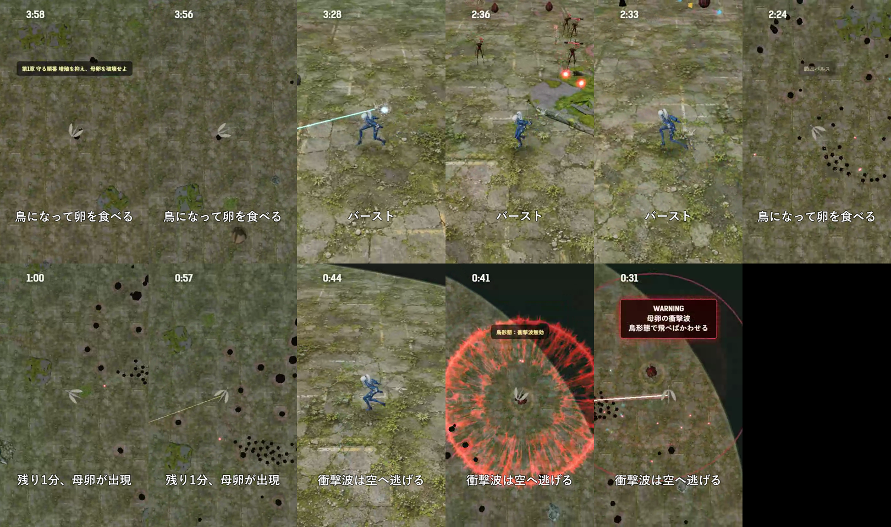
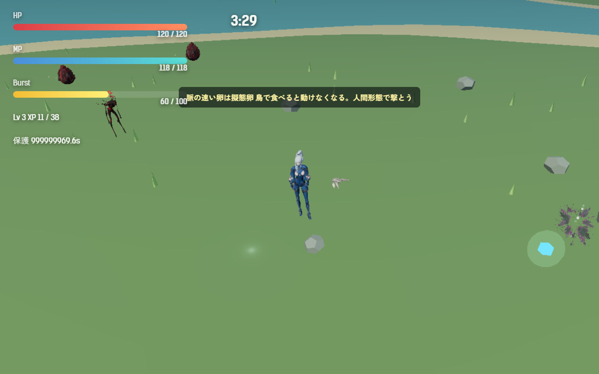
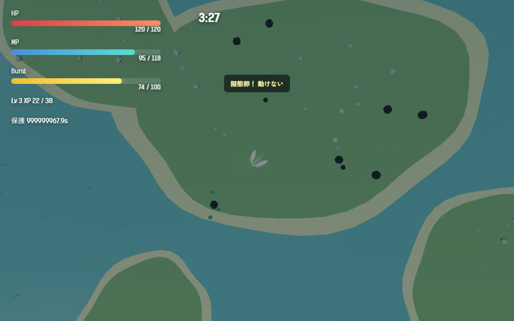
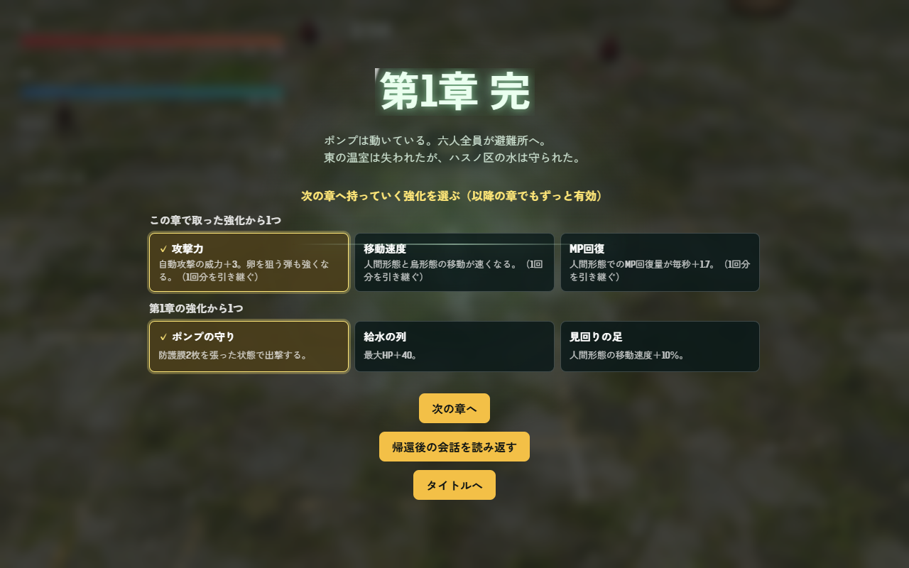
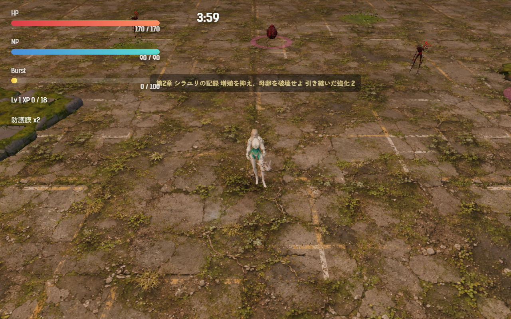

# 2026-10-24（サイクル 3）

## 今日やったこと
- A: **E2 擬態卵**（第3章から）。設定は `Config.egg.mimic`。`enabled: false` で無効（第1・2章はもともと出ない）。
  - 第3章以降、陸の卵が生まれるとき 14% の確率で擬態卵になる。水中の卵（魚形態でしか壊せない）は対象外。
  - 見分け方は脈の速さだけ（設計どおり「ほぼ同じ見た目」）。第3章以降はすべての卵がゆっくり脈打ち（0.8 Hz、±3%）、擬態卵だけ速く大きく脈打つ（2.1 Hz、±6%）。第1・2章の卵は前と同じで脈打たない。
  - 鳥形態で食べると弾けて、1.5 秒間「動けない・変身できない・次の急降下もできない」。回復と MP の補給はなく、アイテムも落とさない（経験値とバーストのたまりは入る）。紫の輪と粒、画面の揺れ、「擬態卵！ 動けない」の表示。
  - 人間形態の射撃やバーストなら、普通の卵と同じように安全に壊せる。
  - 擬態卵が初めて画面近くで育ったとき、一度だけ「脈の速い卵は擬態卵 鳥で食べると動けなくなる。人間形態で撃とう」を出す。
  - ボットの結果に硬直の回数（`mimicStuns`）を足した。
- B: 土曜＝動画・SNS。**B6-1 プレイ動画の自動撮影**。
  - `scripts/bot-play.mjs --record <フォルダ>`: ボットを実時間で遊ばせ、WebM と見どころの時刻（母卵出現、バースト、急降下、衝撃波の回避、擬態卵の硬直）を記録する。
  - `scripts/promo/cut-highlights.mjs`: その記録から場面を選んで、字幕付きの 30 秒動画を縦 9:16 と横 16:9 で書き出す。手順と注意は `asset-pipeline.md` の「動画・SNS素材」。
  - 第1章・ツキミで1本撮影（233 秒）し、ハイライトを作った。
    - 縦: `promo/2026-10-24/highlight-9x16.mp4`（1080×1920、29.8 秒、音なし）
    - 横: `promo/2026-10-24/highlight-16x9.mp4`（1280×720）
    - 投稿文の案: `promo/2026-10-24/post.md`（**投稿はしていない**）
    - 縦動画のコマ（2.6 秒ごと）:
      

## 確認結果
- npm test / build: 19 件すべて成功／ビルド成功
- プレイ確認: 開発サーバーを起動し、Playwright で第3章を開いて確認（内蔵ブラウザのプレビュー起動は自動実行のため許可されず、Playwright で代わりに撮影）。撮影のときだけ擬態卵の確率を上げ、無敵にしている。
  - 擬態卵の説明が出たところ:
    
  - 鳥形態で擬態卵を食べて硬直したところ。鳥形態のカメラは遠く、紫の輪がほとんど見えない（A14 に追加）:
    
  - 説明文の改行（`\n`）は画面では空白になる。読めるのでそのままにした。
- 数値（ツキミ・第3章・`--speed 6`・5回、勝率はすべて 0）:
  - 死亡 201〜226 秒、平均被ダメージ 187.6、平均到達 Lv 8。
  - 擬態卵の硬直は5回で計3回（鳥の急降下 計 63 回のうち）。ボットは擬態卵を見分けないので、遊ぶ人が気をつければもっと少なくなる。擬態卵を入れる前の第3章の数値は取っていないので、難しさへの影響は比べられていない。
  - 録画した第1章の1回（seed 3、実時間）: 233 秒で敗北、Lv 11、衝撃波は 2 回とも回避、60fps。

## 判断待ち（ユーザーへ）
- 擬態卵の強さ: 硬直 1.5 秒、出現率 14% にした。軽すぎ／重すぎの感想があれば `Config.egg.mimic` で変える。硬直中も被弾するので、敵が多い終盤は重く感じるかもしれない。
- 擬態卵の初回説明の文言（「脈の速い卵は擬態卵 鳥で食べると動けなくなる。人間形態で撃とう」）は遊び方の案内として私が書いた。物語の台詞ではないが、言い回しを変えたければ教えてほしい。
- ハイライト動画を一度見てほしい（`promo/2026-10-24/`）。ボットの動きなので狙いが機械的。トレーラーにするなら、手動プレイの録画を使うか、このままボットの録画で作るか。
- 前回までの判断待ち（新しい声の聞き比べ、水中で衝撃波をかわせるようにするか A13、敗北画面の文言 A12、生成ツールを使う時間帯）は回答がないので保留のまま。

## 次にやること
- A: E3（章ごとにボスの種類を切り替える仕組み）。A14（硬直の印）は小さいので余裕があれば一緒に。
- B（日）: このサイクルで初めての日曜なので、B5-1 動くアバターの試用から始める（次の日曜は素材の手直し）。週の振り返りも書く。

## 追加の対応（同日、ユーザーの指示）
- 「声質の指定はプロンプトでは安定しないので、手本の声を参照させたい」→ B3-3 を前倒しした。
  - `scripts/assets/irodori-batch.py` を参照音声に対応させた。台詞ファイルのキャラクターに `refs`（手本の WAV のパス）を書くと `--ref-wavs` で渡し、無ければ従来どおり `--no-ref`。
  - 手本の候補を3人×7本作った（各 6〜10 秒、今の声と同じ指定文とシード、Whisper の一致率 0.86〜1.00）。場所: `assets_src/voice/2026-10-24-ref-candidates/`。台詞ファイルは `scripts/assets/voices/2026-10-24-ref-candidates.json`。
  - ツキミの手本3本を参照して2台詞を作り、参照モードが動くことを確かめた（採用はしない）。
  - **判断待ち**: 各キャラ 2〜4 本、「この人の声」と思うものを選んでほしい。選んだ手本でゲーム内の声を作り直し、聞き比べてもらってから差し替える。
- ユーザーが合わない手本を消した → 残った手本（ツキミ 04・06、アカメ 02・04・05・06、キイチゴ 01・04・06・07）を参照して、ゲーム内の声 3人×6本を作り直した。
  - 指定文は使わず、台詞ごとの演技の指定だけを渡した。各3シード 54 本から、文字起こしと長さで1本ずつ選んだ（台帳の「手本の声を参照したゲーム内の声」）。参照なしのときに多かった「後ろに余計な語が付く」候補はなかった。
  - 置き場所は `assets/audio/voice_ref/`。前の声（`assets/audio/voice/`）は残してあり、`Config.audio.voiceSet: 'caption'` で戻る。
  - 確認: テスト 20 件とビルドが成功。開発サーバーで 18 本すべての読み込みと再生用のデコードを確かめ、アカメで第1章を始めたとき、新しいフォルダの声だけが読み込まれ、エラーがないことを確かめた（音そのものは私には聞けない）。
  - **判断待ち**: 新しい声を聞き比べてほしい（`voiceSet` を `'caption'` にすると前の声）。気になる声があれば、候補 `assets_src/voice/2026-10-24-ref-remake/` のほかのシードと差し替える。
- ユーザーが聞いて「新しい声でよい。前の声とツキミの古い .wav は消して」→ 前の声（`assets/audio/voice/` の mp3 18 本）とツキミの古い .wav 9 本を消し、新しい声を `assets/audio/voice/` に移した。切り替えの `Config.audio.voiceSet` も外し、`src/` は切り替えを入れる前と同じ形に戻した。B3-5 は完了。
  - 確認: テスト 20 件とビルドが成功（ビルドに入る mp3 は 18 本）。開発サーバーでキイチゴの第1章を始め、`voice/` の 18 本が読み込まれ、長さが新しい声と一致することを確かめた。

## 追加の対応（同日、ユーザーの指示）
- 「擬態卵は後半に出てくるタイプの敵」→ 出現を第3章から第5章へ移した（`Config.egg.mimic.fromChapter: 5`）。第5章のボス「渇きの母」の卵の取り合いと組み合わせる。設計書の章ごとの表も更新し、第3章の新種は空きにした。
- **A16 章をまたいで引き継ぐ強化**を実装した（`Config.carryOver.enabled: false` で無効）。
  - 章をクリアすると、結果画面で「この章で取った強化から1つ」と「その章の強化3つから1つ」を選ぶ。2つ選ぶまで「次の章へ」は押せない。
  - 選んだ分は、以降のすべての章の開始時にかかり、積み重なる。開始時の表示に「引き継いだ強化 N」を足した。
  - 保存は `searchSurvive.carryOver`（`src/campaign.js`）。章を始めるとき、その章以降で選んだ分（やり直す前の選択）は消える。別のキャラで始めると全部消える。「つづきから」でも戻る。
  - 章ごとの強化は各章3つ、計15種（`src/config.js` の `ChapterRewards`）。名前は仮、強さは未調整。
  - 確認: テスト 20 件（引き継ぎの保存のテストを1件追加）とビルドが成功。Playwright でアカメの第1章を始め、強化を3回取ってからクリア扱いにし、「攻撃力」と「ポンプの守り」を選んで第2章へ進んだ。第2章の開始時に防護膜2枚、自動攻撃の威力 15（基本 12＋3）になっていることを確かめた。ページのエラーはなし。
    
    
  - まだ: ボットでの強さの比較と、スマホ幅での見え方（A17）。
