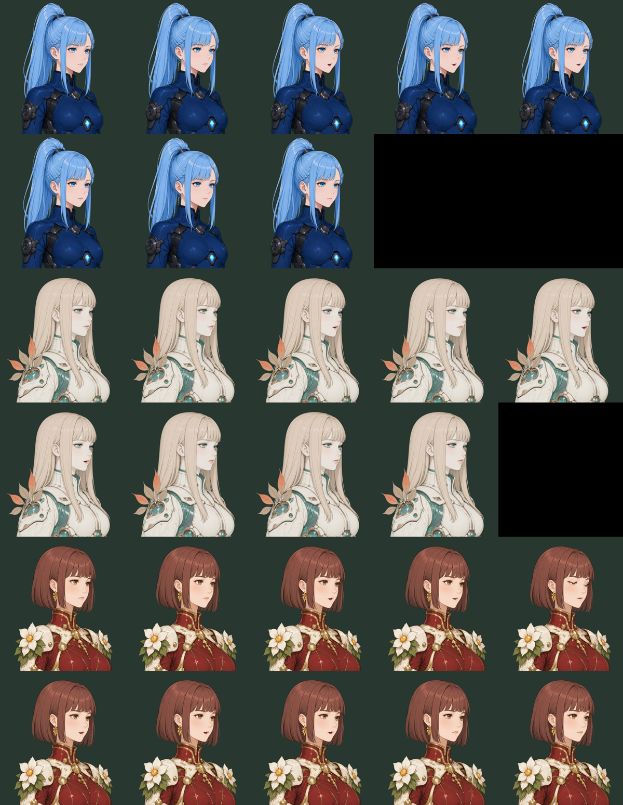
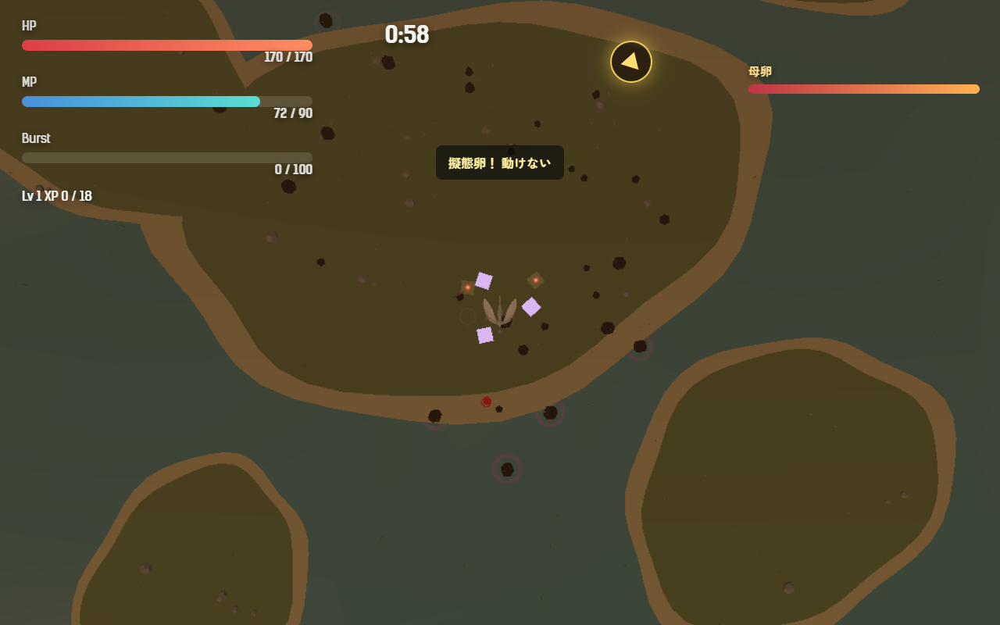

# 2026-10-25（サイクル 4）

## 今日やったこと
- A: **E3 章ごとにボスの種類を切り替える仕組み**。
  - `src/bosses.js` を追加し、ボスの種類を登録する表 `BOSS_TYPES` を作った。今あるのは母卵（`motherEgg`、衝撃波）だけ。
  - `src/campaign.js` の `STAGES` の各章に `boss` を足した。第1章は `motherEgg`。第2〜6章には設計書の予定の名前（`pursuer` 追い手、`floodgateMother` 水門の母、`swarmMother` 群れの母、`thirstMother` 渇きの母、`whiteLotusCore` 白蓮の核）を書いた。まだ作っていない種類は母卵の動きで戦うので、**見た目と遊びは今までと同じ**。
  - 母卵（`Egg` の `isMother`）は、毎フレームの動きを `bossType.update()` に任せる形にした。次の E4（渇きの母）からは、`bosses.js` に1種足すだけで、その章のボスの動きが変わる。
  - HUD の名前は今までどおり `motherName`（第6章だけ「白蓮の核」、ほかは「母卵」）。ボスの表示名を章ごとに変えるかは、各ボスを作るときに判断待ちに出す。
  - テストを2件追加（全章にボスの指定があること、作っていない種類は母卵になること）。
- A（追加）: **A14 擬態卵の硬直の印**。硬直の間、プレイヤーの頭上に紫の結晶3つを回す。遠い鳥形態のカメラでも見えるように大きめにし、霧で色がくすまないようにした。硬直が解けると同時に消える。`Config.egg.mimic.stunMarker: false` で前の見た目に戻る。文言が上書きされる問題は A19 として残した。
- B: 日曜（このサイクル初の日曜なので動くアバター）。**B5-1 動くアバターの評価**。
  - 3人のアバター（10/20 に作成済み、`mesh-avatar-studio/projects/meibuki-*`）に、10/24 に作り直した声（戦闘開始の一言）を合わせて口パク動画を作った。
  - 動画: `promo/2026-10-25/avatar-tsukimi-talk.mp4`・`avatar-akame-talk.mp4`・`avatar-kiichigo-talk.mp4`（768×826、声つき、git 対象外）
  - コマ一覧（上からツキミ・アカメ・キイチゴ、0.4 秒ごと）:
    
  - 評価:
    - **口パク**: 声に合わせて口が開き、開いた口の中（赤み・歯）も絵として崩れていない。口元を拡大しても境目のにじみは見えなかった。
    - **まばたき**: キイチゴの5コマ目のように、閉じた目がきれいに描ける。アカメは横顔に近いが、閉じた目に黒目は残っていない（10/20 の調整が効いている）。
    - **首振り・呼吸**: 小さく、立ち絵の印象を壊さない。
    - **弱いところ**: 口の形は音量だけで決まる（あ・い・お の区別はない）。アカメの「行けっ！」（0.3 秒）のような短い叫びは、ほとんど口が開かない。描き分け画像があると良くなる（B5-4）。
    - **重さ**: 1人あたり約 1MB（PNG 10 枚）。今の立ち絵とそれほど変わらない。
  - 結論: **会話画面の立ち絵の置き換えに使える品質**。次の日曜（隔週の交代で素材の手直しの週）ではなく、その次の日曜に B5-2（会話画面での試作、設定で静止画に戻せる形）を進める予定。使い方の要点は `asset-pipeline.md` に追記した。

## 確認結果
- npm test / build: 22 件すべて成功／ビルド成功
- プレイ確認: 開発サーバー（5183）を起動し、Playwright（Edge）で確認（内蔵ブラウザのプレビューは自動実行では使えないため、前回と同じく Playwright で撮影）。第5章・アカメで、撮影のときだけ無敵にし、時間を進めて母卵を出し、鳥形態で硬直させた。
  - 第5章のステージ設定は `boss: 'thirstMother'`、出てきた母卵の動きは `motherEgg`（まだ作っていないので母卵になる）、表示名は「母卵」。ページのエラーなし。
  - 鳥形態で硬直したところ（頭上の紫の結晶）:
    
  - 硬直が解けたあと、印が消えて効果の数が 0 に戻ることを確かめた。
- 数値（ツキミ・第1章・`--speed 6`・5回）: 勝率 0、平均被ダメージ 205、平均到達 Lv 9.6、死亡 218.2／218.2／214.5／96.1／227 秒、衝撃波は 7 回すべて回避、FPS 90〜138。
  - 10/21 の調整後（第1章、平均被ダメージ 209.4）とほぼ同じ。第1章は今回の変更で動きが変わらない想定どおり。
  - 1回だけ 96 秒で倒れた（被ダメージ 118、Lv 5）。ボットの死因の内訳がまだ無いので原因は分からない。A18 として残した。

## 週の振り返り（サイクル 1〜4、10/21〜10/25）
- **できたこと**
  - 計測の土台: 自動プレイボット（A1）と、その録画からハイライト動画を切り出す仕組み（B6-1）。
  - ボス・敵: 衝撃波を鳥でかわす予兆（E1）、擬態卵（E2、ユーザーの意見で第5章から）、ボスの種類の切り替え（E3）。
  - ユーザーの要望: 章をまたいで引き継ぐ強化（A16）、被ダメージを少し下げる調整。
  - 声: 手本の声を参照する作り方に切り替え、3人×6本を作り直して採用。声の分析スクリプトも作った。
  - アバター: 口パクの品質を確認し、使えると判断（B5-1）。
- **うまくいかなかったこと・気づき**
  - ボットはまだ一度も勝てない（勝率 0）。ボットの腕の問題か、難しさの問題かを分けられていない。A2（診断）と A11（死因の内訳）が先に要る。
  - 内蔵ブラウザのプレビューは自動実行で使えず、毎回 Playwright で代わりに撮っている。撮影用のスクリプトを毎回書き捨てているので、`scripts/` に共通のものを置くと楽になる。
  - 判断待ちが溜まっている（下記）。返事がないものは止めずに、関係しない作業を先に進めている。
- **来週の方針**
  - A は E4（渇きの母）から。「卵の取り合い」が面白いかが、このゲームならではのボスになるかの分かれ目。
  - A17（引き継ぎ強化の強さ）と A2（診断）は、ボットが勝てる状態に近づけてから数値で見る。

## 判断待ち（ユーザーへ）
- ボスの表示名: 今は第1〜5章がすべて「母卵」、第6章が「白蓮の核」。各章のボスを作るとき、HUD の名前を「追い手」「水門の母」などに変えてよいか（台本ではどう呼ぶかも含めて）。
- アバターの口パク動画を一度見てほしい（`promo/2026-10-25/avatar-*-talk.mp4`）。会話画面の立ち絵をこれに置き換える試作（B5-2）に進めてよいか。口の形を良くするための描き分け画像（あ・い・お、閉じた目）を Codex で作るなら、依頼文とマスクを用意する（B5-4）。
- 前回までの判断待ち（擬態卵の強さと説明の文言、ハイライト動画の使い方、水中で衝撃波をかわせるようにするか A13、敗北画面の文言 A12、生成ツールを使う時間帯）は回答がないので保留のまま。

## 次にやること
- A: E4 渇きの母（第5章のボス）。`bosses.js` に `thirstMother` を足し、周りの卵を吸って回復する動きを作る。
- B（月）: 3Dモデル。B0-1（モックの棚卸し）が未着手なので、まずそれを短く済ませ、B1-1（拾うアイテム）の元絵づくりから。
