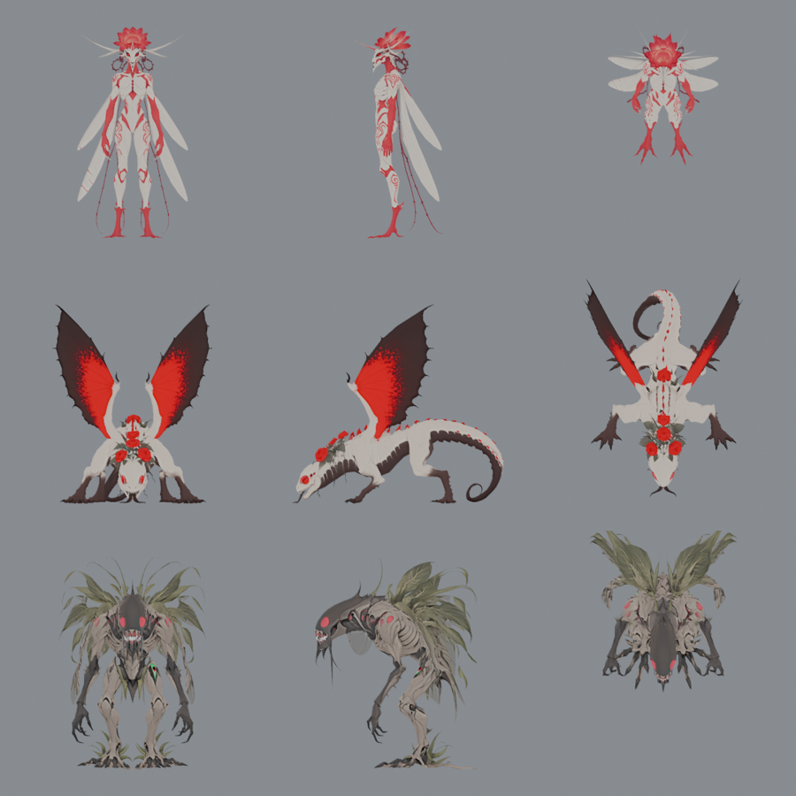
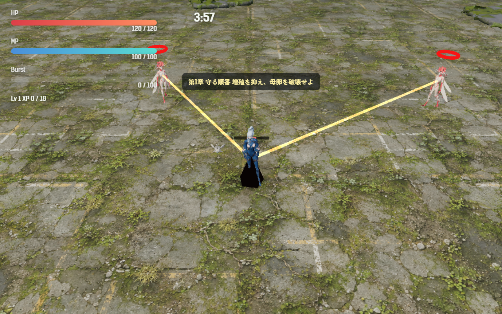
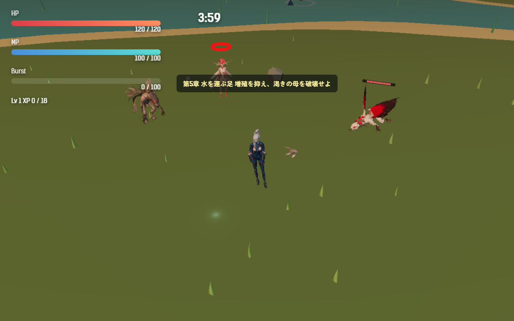
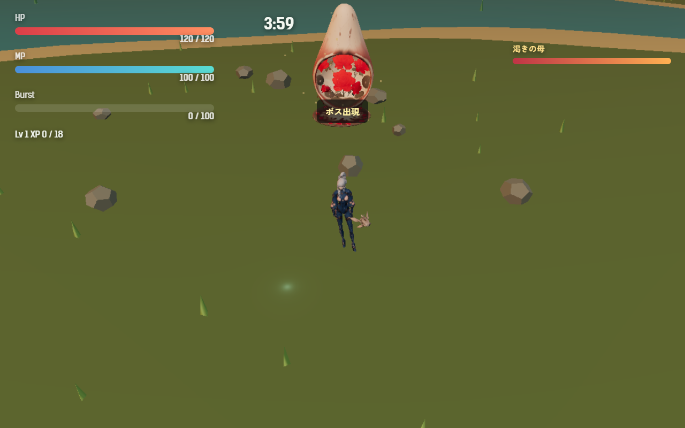

# 2026-10-26 敵の3D化（Tripo）

ユーザーの指示「enemy_draft/turnarounds の敵を Tripo で3D化し、今のゲームに合うか判断して適材適所で実装する」。ブランチ `claude/enemy-3d-implementation-0a21a1`（daily-dev に Blender の敵アニメのブランチを合わせたもの）。

## 見た目の判断と役の割り当て
- 三面図10枚は、赤・骨の白・黒、トゲと花という配色と模様が、キービジュアル（`assets/promo/invasive-source.png`）と同じ。ゲームに合う。
- 専用のモデルが無い敵から順に当てた（スナイパーは射撃の敵の色違い、水辺の飛ぶ敵・跳ねる敵は円錐、ボスは全員が母卵と同じ体だった）。
  - 04 白骨のトンボ人形 → スナイパー（細身で、遠くから狙う役に合う）
  - 10 赤い翼の獣 → 水辺の飛ぶ敵 `dragonfly`（翼が大きく、上からでも飛んでいると分かる）
  - 01 葉を背負った甲殻獣 → 水辺の跳ねる敵 `frog`（重そうな体と長い腕が、跳びかかりに合う）
  - 05 薔薇の繭 → 第5章のボス「渇きの母」の体
- 保留: 07 は細い脚が上からの視点で見えにくいので不採用。02・06 はまだ無い敵（鳴き・吸水根・水門の母）、08 は 06 と輪郭が似ている、09 は手・影法師、03 は守護者の別形の候補。

## やったこと
- Tripo Studio（Smart Mesh P2.0、Multiview、Quad 2000 面、テクスチャあり）で4体を生成。480 クレジット（残り 2720）。
  
- Blender で骨とモーション（idle / walk / attack / hit / die）を付けた3体分のスクリプトを追加。`enemy_anim_lib.py` に、骨を線分として距離でウェイトを付ける `distance_weights` を足した。
- ゲームへの組み込み:
  - `src/main.js` の `GAMEPLAY_MODELS` に4体を追加。
  - 飛ぶ敵は `hoverHeight` で宙に浮かせ、死ぬと地面に落ちてから沈む。触れたときに attack を再生。
  - 跳ねる敵は跳び始めに attack（跳びかかり）を再生。
  - HP バーの高さを敵ごとに `hpBarHeight` で決められるようにした（背の高いモデルで頭に重なるため）。
  - ボスの種類に `modelKey` を足し、渇きの母は薔薇の繭の体を使う。モデルが無ければ母卵に戻る。
- テスト2件を追加（飛ぶ敵が浮いて死体が落ちる、跳ねる敵が跳ぶときに attack を再生）。

## 確認結果
- npm test: 52 件すべて成功。npm run build: 成功。
- プレイ確認: 開発サーバー（5183）を Playwright（Edge）で開き、敵を近くに出して撮影。ページのエラーなし（アバターの口・目の画像と FBX のウェイトの警告は前からあるもの）。
  - 第1章のスナイパー（プレイヤーとの距離を保って狙撃している）:
    
  - 第5章の飛ぶ敵（右）・跳ねる敵（左）・スナイパー（奥）:
    
  - 渇きの母（薔薇の繭）:
    
  - 倒すと、飛ぶ敵は地面に落ち、3体とも die の姿勢で残ってから沈むことを確認。

## 判断待ち（ユーザーへ）
- 見た目と大きさ（飛ぶ敵 1.7、跳ねる敵 2.0、スナイパー 2.05）でよいか。飛ぶ敵は速いので、群れると翼でプレイヤーが隠れる。
- 残りの三面図（02・03・06・08・09）を作るかどうか。作るなら、先にその敵の種類をゲームに足す必要がある。
- Tripo の生成物の利用条件は、生成したときのプランで変わる。台帳のライセンスの節に「要確認」で載せた。
