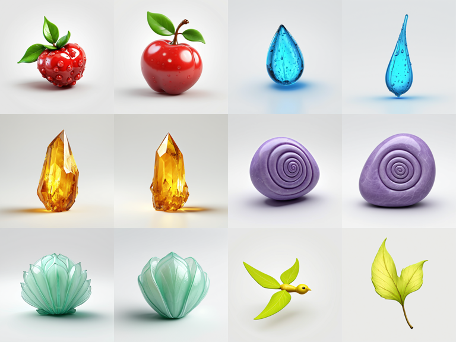
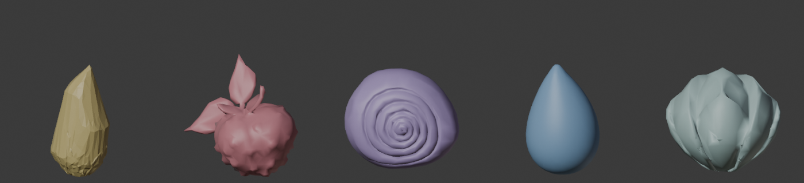
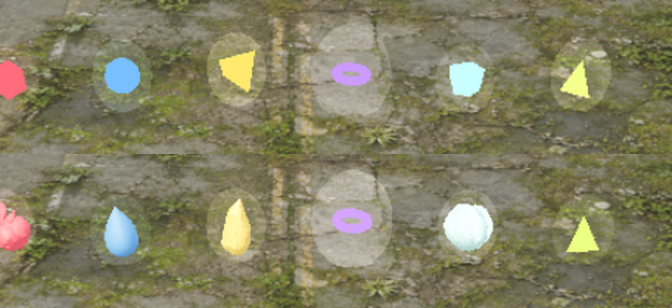
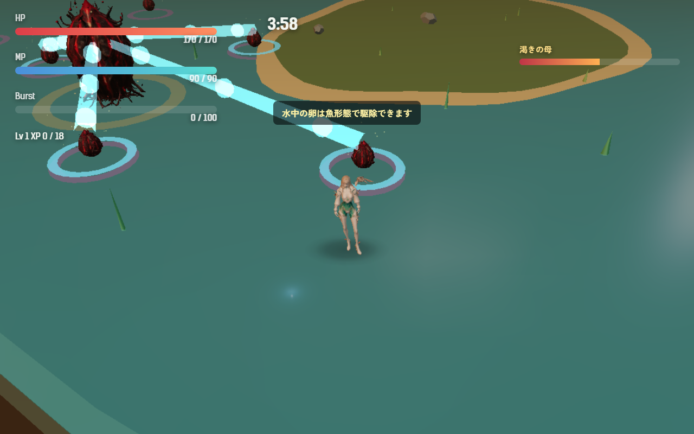
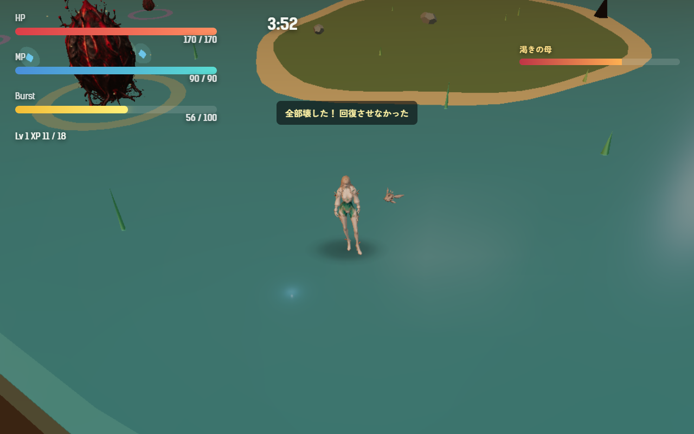

# 2026-10-26（サイクル 5）

## 今日やったこと
- A: **E4 渇きの母（第5章のボス）**。
  - `src/bosses.js` に `thirstMother` を足した。画面の名前は「渇きの母」（10/25 のユーザー承認どおり、開始時の表示と HUD のボス名が変わる）。
  - 動き: 衝撃波（第1章の母卵と同じ）はそのまま。加えて、出現から 7 秒後と以後 12 秒ごとに、近くの卵（22m 以内、近い順に4つ）を水色の光の管でつなぐ。管の中をしずくが母へ流れ、卵の足元に縮む輪が出る。**3.4 秒後に残っている卵1つにつき最大HPの 3.5% 回復**し、その卵は経験値もアイテムも落とさず消える。吸い終わる前にプレイヤーが壊した卵は、その場で管が消えて回復に数えない。
  - 最初の1回だけ「渇きの母が卵を吸っている／吸われる前に壊せば回復させない。鳥や魚で先に食べよう」と説明を出す。終わりに「渇きの母が回復した（卵 N 個）」か「全部壊した！ 回復させなかった」を出す。
  - 第5章は水辺のステージで、母卵の周りの卵はほとんど水中の卵だった（最初は陸の卵だけを吸う作りにしたら、一度も吸わなかった）。そのため**水中の卵も吸う**ようにした。陸の卵は鳥、水中の卵は魚で先に食べる取り合いになる。
  - 調整値は `Config.boss.thirstMother`。無効にするには `src/campaign.js` の第5章の `boss` を `motherEgg` に戻す。
  - ボットの結果に、吸った回数・吸われた卵・阻止した卵・回復量を足した（`thirst`）。
  - テストを2件追加（卵の選び方、壊した卵は回復に数えないこと、第5章の名前）。
- B（月・3Dモデル）:
  - **B0-1 モックの棚卸し**: Primitive で描いているもの、足りない効果音・声を `asset-ledger.md` の「置き換え候補」に優先度つきで一覧にした。優先度が高いのは拾うアイテムと水辺の装飾（葦・草・岩）。
  - **B1-1 拾うアイテムの3Dモデル（4種を置き換え）**: Forge で元絵12枚 → Hunyuan3D（形状のみ）→ Blender で約 1200 三角形に削減 → ゲームに組み込み。
    - 元絵（上から HP・MP、バースト・吸引石、防護膜・加速。各2シード）:
      
    - Hunyuan3D の形（色は確認用）: 左から バースト・HP・吸引石・MP・防護膜
      
    - ゲーム内の比較（上: 今までの多面体、下: 新しいモデル。左から HP・MP・バースト・吸引石・防護膜・加速）:
      
    - 採用: HP（赤い実）・MP（水のしずく）・バースト（琥珀の結晶）・防護膜（つぼみ）。吸引石は上から遠いカメラだと渦巻きが見えず、ただの球に見えたので元の輪のまま。加速は元絵が立体に向かない（鳥の顔が出た、薄い葉）ので作り直し。
    - 光を受けない単色のマテリアルのままだと形が影絵になるので、モデルにしたものは陰影が出るマテリアル（発光は弱め）にした。
    - `Config.pickups.models.enabled: false` で元の多面体に戻る。大きさは `Config.pickups.models.size`。
    - Hunyuan3D の API サーバーの起動用 `scripts/assets/start-hunyuan-api.bat`、呼び出し `scripts/assets/hunyuan-img2glb.mjs`、整形 `scripts/assets/blender/prep-pickups.py` を追加。1個 4〜7 秒で、思ったよりずっと速い。手順は `asset-pipeline.md` に追記した。

## 確認結果
- npm test / build: 25 件すべて成功／ビルド成功（GLB 4つがビルドに含まれることも確認）
- プレイ確認: 開発サーバー（5183）を起動し、Playwright（Edge）で確認（前回までと同じく、内蔵ブラウザのプレビューは自動実行では使わず）。ページのエラーなし。
  - 第5章・アカメで、撮影のときだけ無敵にし、母卵を出して近くに卵を置いた。設定は `boss: 'thirstMother'`、HUD の名前は「渇きの母」。
  - 卵を吸っているところ（水色の管としずく、卵の足元の輪）:
    
  - 1回目は放置 → 卵4つを吸われ、HP 217.5 → 278.4（+60.9 = 435 × 3.5% × 4）。2回目は吸われる卵4つをすべて壊した → 回復 0、「全部壊した！ 回復させなかった」。
    
  - 拾うアイテムは第1章・ツキミで、新旧の設定で6種を並べて撮影した（上の比較画像）。読み込みの警告なし。
- 数値（ツキミ・**第5章**・`--speed 6`・5回）: 勝率 0、平均被ダメージ 203.6、平均到達 Lv 8.4、死亡 216.3／109.5／189.7／145／180.2 秒。母卵まで生き残ったのは1回目だけで、吸い上げは2回（卵3つを吸われたが、母卵が無傷で満タンだったので回復 0）。擬態卵の硬直は 0〜4 回。
  - 第5章はボットにはまだ難しすぎて、渇きの母との戦いまでほとんど届かない。取り合いの面白さはボットではまだ測れない（A20）。

## 判断待ち（ユーザーへ）
- **渇きの母を一度遊んでみてほしい**（第5章。タイトルで F2 を押すと章を選べる）。特に、(1) 光の管で「この卵が狙われている」と分かるか、(2) 鳥・魚で先に食べに行くのが楽しいか、忙しすぎるか、(3) 回復量（卵1つで最大HPの 3.5%、最大4つ）。
- **Hunyuan3D の利用条件**: 台帳のライセンスの節にあるとおり、Hunyuan3D の生成物は EU・英国・韓国での使用・配布が禁止されている。今日のアイテム4種は Hunyuan3D 製。世界向けに公開する予定があるなら、公開前に MIT などの3D生成（TRELLIS など）に切り替えるのが安全。どこで公開する予定か教えてほしい（切り替えるなら、次の木曜に TRELLIS が動くか試す）。
- 前回までの判断待ち（擬態卵の強さと文言、ハイライト動画の使い方、水中で衝撃波をかわせるようにするか A13、敗北画面の文言 A12、生成ツールを使う時間帯）は回答がないので保留のまま。

## 次にやること
- A: E5 朝の孵化予報（出撃前会話の最後の一枚）。文面は設計書の言い方に合わせ、新しい台詞が要るなら判断待ちに出す。
- A（気づいたこと）: 渇きの母の最初の説明が、人間形態で水中の卵を撃ったときの「水中の卵は魚形態で駆除できます」ですぐ上書きされた。A19（大事なメッセージを優先する仕組み）でまとめて直す。
- B（火・効果音）: B2-1 の足りない音から。渇きの母の吸い上げの音も候補に入れた。
- B（木・3D）: B1-1 の続き（吸引石と加速を、上から輪郭で分かる形で作り直す）。
