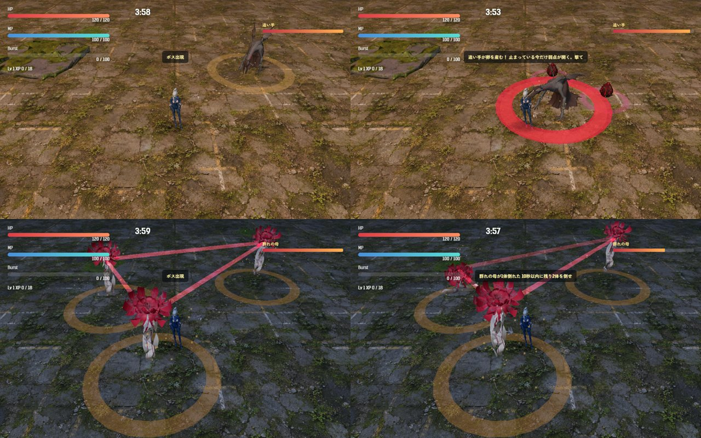
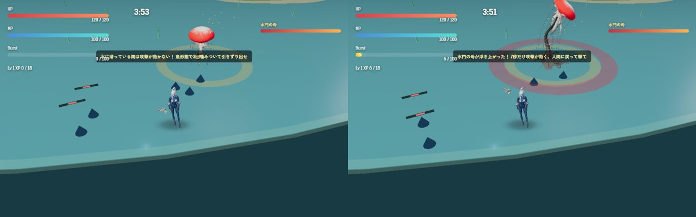

# 2026-10-27 第2章「追い手」と第4章「群れの母」を作った

ユーザーの指示「一枚目を群れの母に　２枚目を追い手に　tripoとblenderで作って実装して」（一枚目は三面図 16 浮遊する彼岸花、二枚目は 20 黒衣の長首翼獣）。

- モデル: Tripo Studio（Smart Mesh P2.0、Multiview、Quad 2000 面、テクスチャあり）で2体、240 クレジット（残り 2480）。骨とモーションは Blender 5.1 のスクリプト（`scripts/blender/build_bat_neck_beast_animations.py`、`build_spider_lily_animations.py`）。
- Tripo が色を読めなかった所は灰色になる。追い手の頭の左右のひげは灰色の板だけだったので消し、彼岸花の花びらの裏と触手は赤と骨の白で塗り直した。この処理は `enemy_anim_lib.py` に足した。
- **追い手**（`bosses.js` の `pursuer`）: プレイヤーを追い、5.5 秒ごとに 3 秒立ち止まって背後に卵を2つ産む。止まっている間だけ足元に赤い輪が出て、ダメージが通る（それ以外は 30%）。初めて止まったときに「止まっている今だけ弱点が開く。撃て」と出す。触れると 22 ダメージ。
- **群れの母**（`swarmMother`）: 宙に浮く彼岸花3体を赤い光の糸でつなぐ。HP バーは3体の合計で、矢印は一番近い立っている体を指す。1体倒れると「10秒以内に残り2体を倒せ」。間に合わないと倒れた体が HP 60% で起き上がる。衝撃波は3体が順番に出す。
- 体が複数あるボスのために、ボスを `game.bossEggs` に並べ、自動照準・鳥の急降下・ビームが倒れていない体だけを狙うようにした。
- ゲームでの見え方（左上: 追い手が追ってくる、右上: 立ち止まって卵を産む、左下: 群れの母の3体、右下: 1体が倒れて糸が弱まる）:
  
- 確認: `npm test`（54 件）と `npm run build` が通る。ゲームでは、第2章は追う→止まる→卵2つ→また追う、第4章は1体倒す→10 秒後に復活→3体倒すと勝ち、まで動かした。実際に遊んだときの難しさ（HP、間隔）はまだ見ていない。調整は `Config.boss.pursuer`・`Config.boss.swarmMother`。
- 追記: ユーザーの指示「二つとも２倍くらいの大きさにしたい」で、追い手は高さ 3.2→6.4、群れの母は 3.4→6.8 にした。合わせて追い手の止まる距離・触れる距離・卵を置く距離、3体の間隔（8→12）、足元の輪、弱点の輪、糸の太さを広げた。群れの母は背が高くなったぶん浮く高さを 1.2→0.9 に下げた。カメラが近いので、画面の上のほうにいる彼岸花は花の部分が画面の外に出る（1.5 倍でも同じ）。
- 追記: 群れの母は2倍だと花が画面の外に出やすいので、ユーザーの指示「群れの母は1.15倍くらいならどうかな？」で元の 1.15 倍（高さ 3.9）にした。間隔 9、浮く高さ 1.2。追い手は2倍のまま。

## 第3章「水門の母」

ユーザーの指示「これを水門の母にしよう」（三面図 06 茎の生えたクラゲ）。

- モデル: 最初の生成は、体の周りの細い垂れ糸が円柱の壁になって使えなかった。糸を消した絵（`scripts/assets/strip-hanging-strings.py`）で作り直すと、傘・触手・茎・根が分かれて出た（3247 三角形）。2回とテクスチャで 220 クレジット（残り 2260）。ユーザーから「ボスなので 8000 までは可」と言われたが、形は足りていたので 2000 面のままにした。
- 骨とモーション: `scripts/blender/build_jellyfish_stalk_animations.py`。傘のふちの4本の骨で脈打たせ、茎は3本。根は地面に固定。idle・attack（傘を縮めて吐く）・hit（噛まれる）・surface（引きずり出される）・stun（気絶のループ）・die。
- 動き（`bosses.js` の `floodgateMother`）: 水の中に出る。ふだんは 1.7 沈んで傘だけ水面に出し、攻撃が効かない（灰色の火花と「魚形態で3回噛みついて引きずり出せ」）。10 秒ごとにプレイヤーへ向かってオタマジャクシ5匹の列を流す。魚形態で近づくと自動で噛み、3回で 7 秒浮き上がって気絶し、足元に赤い輪が出てダメージが通る。
- ボスの種類に足した任意の設定: `modelLift`（上下）、`baseClip`（ふだんのアニメ）、`spawnFilter`（出現場所）、`guardHint`（効かないときの説明。追い手もこれに移した）、`onFishBite`・`biteReach`（魚の噛みつき）。
- ゲームでの見え方（左: 沈んでいて攻撃が効かない、右: 3回噛まれて浮き上がった）:
  
- 確認: `npm test`（55 件）・`npm run build`。ゲームでは、沈む→列を流す→撃っても効かない→魚の噛みつき（プレイヤーの `tryFishBite`）が数えられる→浮いてダメージが通る、まで動かした。実際に遊んだときの難しさはまだ見ていない。
