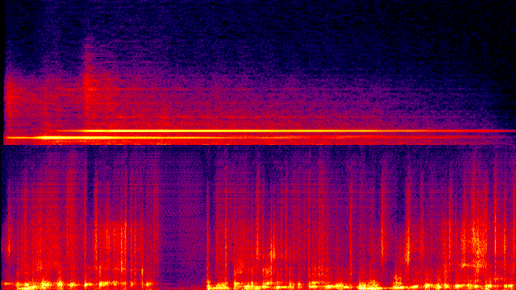
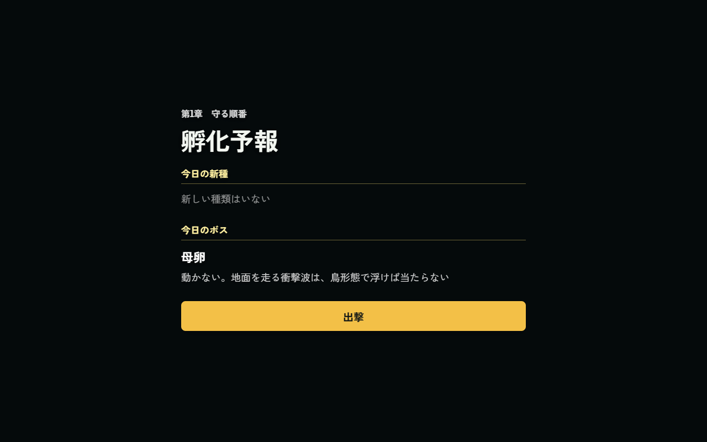
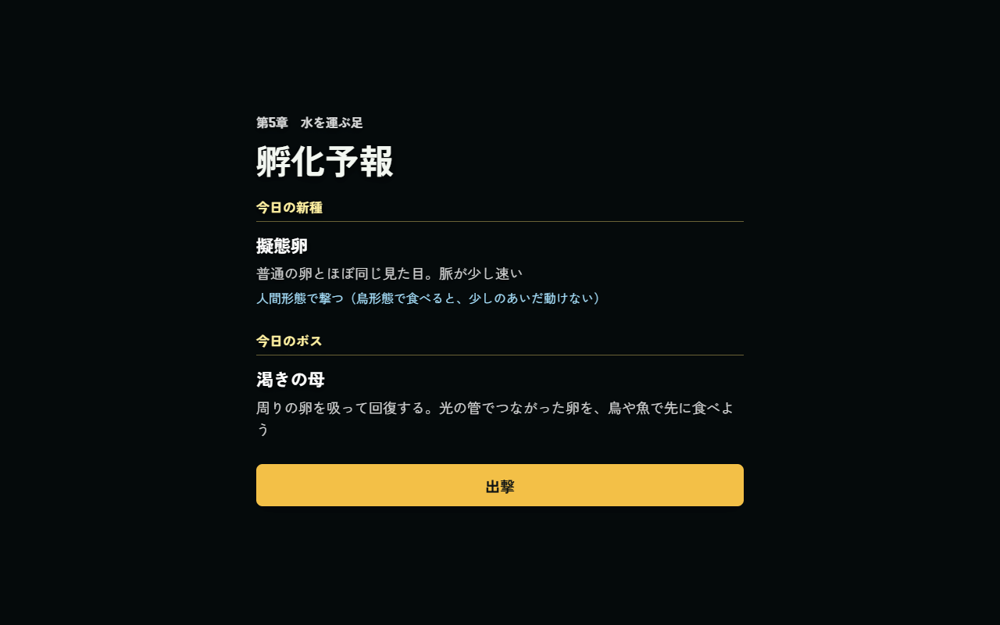

# 2026-10-27（サイクル 6）

## 今日やったこと
- A: **E5 朝の孵化予報**。
  - 出撃前会話が終わると「孵化予報」の一枚が出て、「出撃」を押すと戦闘が始まる（`src/forecast.js`）。キーボードの Enter・ゲームパッドの決定でも進む。
  - 中身は設計書の3項目のうち2つ。
    - **今日の新種**: その章で初めて出る新種だけ。名前・一行の特徴・有効な形態。今は第5章の擬態卵だけ（第1〜4章と最終章は「新しい種類はいない」）。
    - **今日のボス**: 画面に出るボスの名前と一言。一言は `src/bosses.js` の各種類の `forecast` に書いた（母卵「動かない。地面を走る衝撃波は、鳥形態で浮けば当たらない」、渇きの母「周りの卵を吸って回復する。光の管でつながった卵を、鳥や魚で先に食べよう」）。まだ作っていないボスの章は母卵の一言を出す（実際に母卵の動きで戦うので）。
    - **卵が覚えたこと**は E6（卵は学ぶ）がまだ無いので出さない。記録ができたら渡すだけで表示される作りにした。
  - 「予報で必ず先に教える」の原則に合わせ、**まだ作っていない新種やボスは予報しない**（予報と実際が食い違わないように）。
  - 物語の台詞は足していない。設計書では観測係（リンドウかヒルギ）が出す一枚なので、話者を付けるかは判断待ちにした。
  - `Config.forecast.enabled: false` で、会話から直接戦闘に入る元の流れに戻る。
  - テスト3件を追加。`scripts/check-story.mjs` と `scripts/bot-play.mjs` は、会話を飛ばしたあと「出撃」を押すようにした。
- B（火・効果音）: **B2-1 のうち2つ**。
  - アイテム取得 `assets/audio/sfx/item_pickup.wav`（0.9 秒）: 今は経験値と同じ `xp_pickup` を使っていたので、回復・バーストなどのアイテムを拾ったときだけ澄んだ2音の上がる音にした。
  - 渇きの母の吸い上げ `assets/audio/sfx/thirst_drain.wav`（2.9 秒）: これまで `motherCharge`（母卵の衝撃波の溜め）を流用していたので、管で水を吸い上げる低いゴボゴボという音にした。
  - 上: アイテム取得（2音が上がる）、下: 吸い上げ（低い音が途切れず続く）
    
  - `Config.audio.newSfx: false` で元の流用に戻る。生成・選んだ理由は `asset-ledger.md`。
  - Stable Audio の一括生成スクリプト `scripts/assets/stable-audio-batch.py` を追加（B0-2 の効果音の分）。
  - **失敗と対処**: 1.2 秒で作った4本は、すべて振り切れた白色雑音だった。2 秒以上なら正常なので、長めに作って後から切る。`asset-pipeline.md` に書いた。

## 確認結果
- npm test / build: 28 件すべて成功／ビルド成功（新しい wav 2つがビルドに含まれる）
- 物語の結合テスト `scripts/check-story.mjs`: すべて成功（会話を飛ばしたあと、予報の「出撃」ボタンにフォーカスがあることも確認）
- プレイ確認: 開発サーバー（5183）を起動し、Playwright（Edge）で確認（前回までと同じく自動実行では内蔵ブラウザのプレビューを使わず）。ページのエラーなし。
  - 第1章（新種なし・母卵）
    
  - 第5章（擬態卵・渇きの母）
    
  - スマホ幅（390×844）でも収まる: [スクリーンショット](img/2026-10-27-forecast-ch5-mobile.png)
  - 効果音: 第5章でアイテムを拾うと `itemPickup`、吸い上げの開始で `thirstDrain` が鳴る（呼び出しと読み込みを確認）。**耳では聞いていない**。
- 数値（ツキミ・第1章・`--speed 6`・5回）: 勝率 0、平均被ダメージ 236.8、平均到達 Lv 12、死亡 229.5／227.2／230.5／227.5／238.9 秒。衝撃波は 9 回すべて回避。ボットは予報の画面を通って問題なく戦闘に入れた。今回は早く倒れる回（A18）は出なかった。

## 判断待ち（ユーザーへ）
- **孵化予報を見てほしい**（どの章でも、出撃前会話のあと）。(1) 観測係（リンドウ・ヒルギ）を話者として付けるか（顔と一言の台詞が要る。台詞の案を出してよいか）、(2) 設計書にある「ボスのシルエット」の画像を水曜のイラストで作るか、(3) 毎回出るのが煩わしくないか（章の初回だけにする案もある）。
- **新しい効果音2つを聞いてみてほしい**（アイテム取得、渇きの母の吸い上げ）。自動のサイクルでは音を聞けず、波形と周波数で選んだ。合わなければ候補が `assets_src/sfx/2026-10-27/` に残っている。
- 前回までの判断待ち（渇きの母の手応え、Hunyuan3D の利用条件と公開地域、擬態卵の強さと文言、ハイライト動画の使い方、A13 水中で衝撃波をかわせるか、A12 敗北画面の文言、生成ツールを使う時間帯）は回答がないので保留のまま。

## 次にやること
- A: E6 卵は学ぶ（その日の戦い方を記録し、翌日の章で対策の敵を少し増やす）。対策用の敵（群れ鳥・割れ殻・足跡）はまだ無いので、まず記録と「卵が覚えたこと」の表示を作り、反映は擬態卵の割合など今ある仕組みから小さく始める。
- B（水・イラスト）: B4-1 画風の基準の続き。予報のボスのシルエットは判断待ちの回答を見てから。
- B（木・3D）: B1-1 の続き（吸引石と加速を作り直す）。
