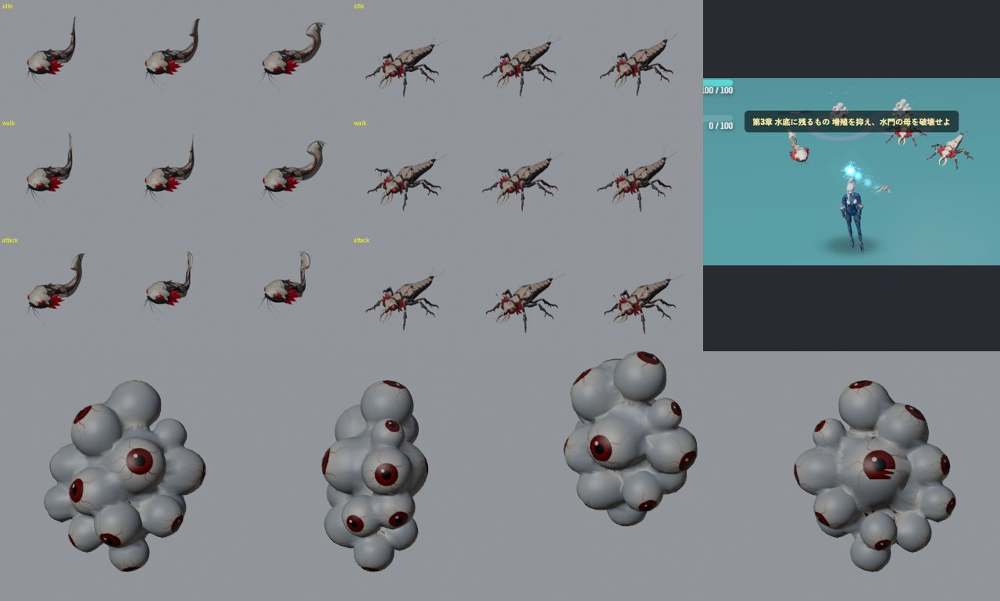

# 2026-10-28 オタマジャクシ・ヤゴ・水中の卵を Tripo で作り直した／母卵の拍動

ユーザーの指示「オタマジャクシ、ヤゴ、水中の卵で3000ポリゴンくらいでtripoで作って実装してほしい。水中の卵も食べたら回復するように」（水の生き物の三面図3枚）。作業の途中で「母卵系には動作を入れていなかったけど、収縮する動きが欲しい。技を出すとき動きが激しくなる」。

- モデル: Tripo Studio（Smart Mesh P2.0、Multiview、Quad 1500 面 ≒ 3000 三角形）。3体で 340 クレジット（残り 1920）。
  - オタマジャクシ（3028 三角形）: 赤いえら・口ひげ・上へ巻く尾。骨は体・ひげ・尾4本・えら左右（`scripts/blender/build_tadpole_animations.py`）。idle / walk は尾を左右に振って泳ぐ（根元から先へ遅れて曲がる）、attack は S 字に縮めて頭から突っ込む、die は腹を上にしてひっくり返る。
  - ヤゴ（3130 三角形）: 6本脚と大あご。骨は胸・頭・下あご・腹3本・脚左右3対×2（`build_dragonfly_nymph_animations.py`）。walk は三脚歩行、attack は身を沈めて下あご（仮面）を前へ突き出す、die はひっくり返って脚を縮める。
  - 水中の卵（3177 三角形）: Tripo のテクスチャ生成が error.11000（サーバーの 500 エラー）で通らなかった（ページを読み直しても同じ）。形は良かったので色なしで書き出し、Blender で目を描いた（`scripts/blender/paint_eye_eggs.py`）。球が全部くっついた一つの塊だったので、頂点の「位置の差 / 法線の差」から球ごとの中心と半径を出し（17 個）、球ごとに塊の外向きへ赤い虹彩と黒い瞳を描いた。
- ゲーム: `GAMEPLAY_MODELS` に `tadpoleEnemy`（高さ 1.0）・`larvaEnemy`（0.8）・`aquaticEgg`（1.8）。読めないときは元の円錐・黒い種の卵に戻る。成長するとカエル・トンボになるのは前のまま。
- 回復: 魚形態で水中の卵を噛んで食べると、鳥形態で食べたときと同じだけ回復する（HP 3.5% + 卵が割れた分 5% = 8.5%、MP 10%）。`Player.feedOnEgg()` を鳥と魚で共用。強化「根の誓い」の説明を「鳥形態・魚形態で卵を食べたときの回復が2倍になる。」にした。
- 母卵の拍動: アニメの無い母卵（第1章の母卵と、まだ作っていないボスの章、渇きの母の繭）は、ドクン・ドクンと縮んで膨らむ。ふだんは 1 秒に 0.9 拍・±3%、衝撃波の予告中と渇きの母が卵を吸っている間は 3.6 拍・±7〜9%、衝撃波を放つ瞬間（渇きの母は吸い終わって回復した瞬間）に大きく膨らむ。調整は `Config.egg.motherBeat`。
- 見え方（上: オタマジャクシとヤゴの idle / walk / attack、右上: ゲーム内、下: 水中の卵を4方向から）:
  
- 確認: `npm test`（56 件）と `npm run build` が通る。ゲーム（第3章）で、オタマジャクシ・ヤゴにアニメ5種が付く、水中の卵がこのモデルになる、魚で噛むと HP が 8.5% 戻る、を確かめた。第1章で母卵の横の縮み幅が ふだん 0.97〜1.03、予告中 0.91〜1.07 になるのを確かめた。実際に遊んで大きさ・拍動の強さが合っているかはまだ見ていない。
