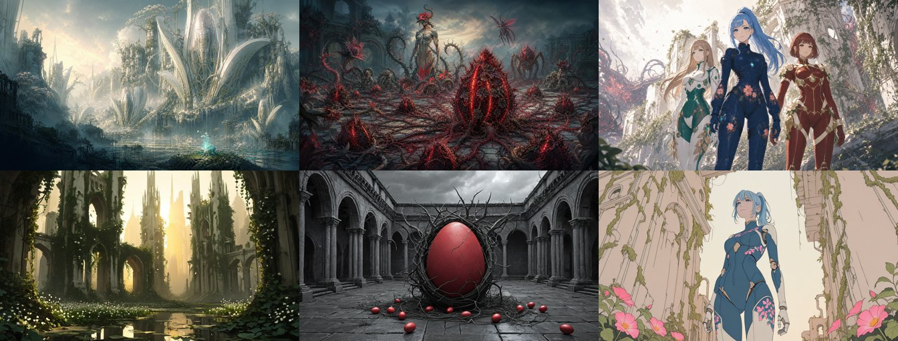
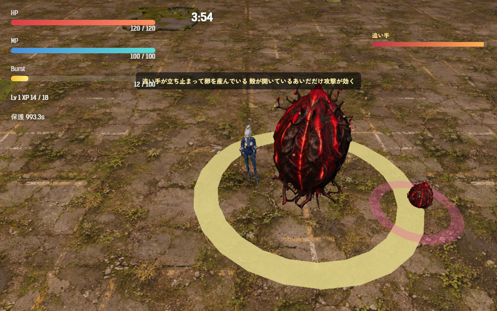

# 2026-10-28（サイクル 7）

## 今日やったこと
- A: **E7 追い手（第2章のボス）**。
  - 第2章のボスが母卵の動きから「追い手」に替わった（`src/bosses.js` の `pursuer`、画面の名前も「追い手」）。
  - 衝撃波は出さない。プレイヤーをゆっくり追う（速さ 2.5。人間形態は 6.7 なので歩いて逃げられる）。建物に当たったら横に滑ってよける。
  - 6.5 秒ごとに 2.8 秒立ち止まり、**プレイヤーと反対側に卵を1つ産む**。設計書の「卵を産ませたい場所へ誘導する」に合わせて、逃げる向きで卵の場所が決まるようにした。
  - 立ち止まっている間だけ**殻が開く**: 足元の輪が金色に光って脈打ち、攻撃が 1.8 倍効く。歩いている間は 0.3 倍で、当てると灰色の火花が出る。
  - 触れると 20 ダメージ（1.1 秒ごと）。鳥形態で浮いていれば当たらない。
  - 初めて立ち止まったとき一度だけ「追い手が立ち止まって卵を産んでいる／殻が開いているあいだだけ攻撃が効く」と出す。
  - 産む卵は卵の上限（90個）を超えても出す。上限のままだと、ボスが出る 3 分の時点で場が埋まっていて1つも産めなかった（ボット1回目で発見）。
  - 調整は `Config.boss.pursuer`。元に戻すには第2章の `boss` を `motherEgg` にする。孵化予報（今は無効）の一言も足した。
  - テスト1件を追加（追う・壁で滑る・止まる・開く・触れたら痛い・鳥なら当たらない）。ボットの結果に産卵の回数を出すようにした。
- B（水・イラスト）: **B0-3 画風の基準**（B4-1 の続きを兼ねる）。
  - `assets/promo` の3枚を見て、ゲームの絵を「世界」「敵」「人物」の3系統に分け、色・光・形の表と共通プロンプトを `asset-pipeline.md` の「画風の基準」に書いた。見比べの3点（逆光か、彩度の置き方、厚塗りか）も決めた。
  - その共通プロンプトで Forge で5枚試した。**すべて不採用**。上段が手本、下段が今日の生成:
    
    - 世界: 逆光と霧は 10-21 の青空より手本に近づいた。ただ黄色すぎ、塔がゴシックの尖塔になる。
    - 敵: juggernaut だとつるっとした写真のような卵になり、光る筋も棘も出ない。
    - 人物: softsketch は線画寄りの淡い塗りで、手本の艶のあるセル塗りと違う。
  - 次に直すプロンプトの言葉は `asset-pipeline.md` に書いた。生成物は `assets_src/illust/2026-10-28/`、台帳にも記録した。
  - Forge は API の起動に約2分、5枚で3分13秒（1枚目はモデルの読み込みで59秒、以降は25〜53秒）。使い終わってから止めた。

## 確認結果
- npm test / build: 48 件すべて成功／ビルド成功
- プレイ確認: 開発サーバー（5183）を起動し、Playwright（Edge）で第2章に入って確認（内蔵ブラウザのプレビューは自動実行では起動が許可されなかったので、前回までと同じ方法）。確認用にボスを早く出して近くに置いた。ページのエラーなし。
  - 立ち止まって殻が開いたところ（金色の輪、右に産んだ卵、初回の説明、右上の名前「追い手」）:
    
  - 同じ 10 ダメージで、殻が開いているときは 18、閉じているときは 3 減った。
- 数値（ツキミ・**第2章**・`--speed 6`・3回、卵の上限を超えて産む修正のあと）: 勝率 0、平均被ダメージ 240、平均到達 Lv 10、死亡 222.9／226.8／216.3 秒。追い手はボスの出現から倒れるまでの約40秒で4〜5回産卵し、4〜5個産んだ。
  - ボットは立ち止まった瞬間を狙わない（母卵と同じく距離を取って撃ち続ける）ので、撃破時間はまだ測れない。A22 に残した。

## 判断待ち（ユーザーへ）
- **追い手を第2章で遊んでみてほしい**。気になる点: (1) 速さ 2.5 は遅すぎないか（今は歩いて振り切れる）、(2) 殻が閉じているとき 0.3 倍は「効かない」と分かるか（灰色の火花だけ。数字や音で示すか）、(3) 触れたときの 20 ダメージ。
- 画風の基準（`asset-pipeline.md` の表）の3系統の分け方で合っているか。特に人物は Forge での生成より、立ち絵を参照にした img2img か、Codex（GPT Image）でユーザーが作る方がそろいやすい。人物の絵を Forge で作り続けるか、背景と敵だけを Forge の担当にするか決めてほしい。
- 前回までの判断待ち（新しい効果音2つの試聴、E6 卵は学ぶを進めるか、渇きの母の手応え、Hunyuan3D の利用条件と公開地域、擬態卵の強さと文言、ハイライト動画の使い方、A13 水中で衝撃波をかわせるか、A12 敗北画面の文言、生成ツールを使う時間帯）は回答がないので保留のまま。

## 次にやること
- A: E8 足跡（第2章の新種。プレイヤーが通った道を数秒遅れでなぞる敵）。E6 が保留のままなら、その次は E9 水門の母。
- B（木・3D）: B1-1 の続き（吸引石と加速を作り直す）。
- B（来週の水・イラスト）: B4-1 の続き。世界は色と塔の形、敵は質感のプロンプトを直して再挑戦。
