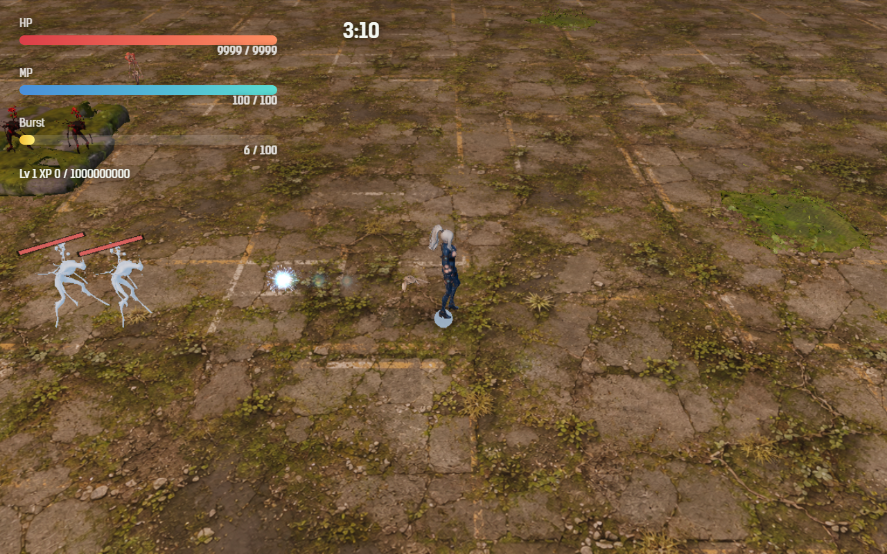

# 2026-10-29（サイクル 8）

## 今日やったこと
- A: **E8 足跡（第2章の新種）**。
  - 新しい敵の種類 `footprint`。第2章から、卵から孵る敵の 16% が足跡になる（ステージ開始 30 秒以降、同時に6体まで）。
  - ゲームがプレイヤーの通った道を 14 秒分記録する（`src/footprints.js`）。足跡は孵ると一番近い道の地点まで歩き、そこから道をなぞる。遅れが 2.6 秒になるまでは 1.3 倍で早めになぞり、追いついたら同じ速さで歩く（速さの上限は 7.6。人間形態は 6.7〜7.3 なので、まっすぐ逃げれば少しずつ詰められる程度）。
  - **同じ所で止まっていると 2.6 秒後に足跡が来る**。円を描いて逃げると、前の周の足跡に挟まれる。
  - **鳥形態で飛んだ区間は道が途切れる**。そこまで来た足跡は道を見失い、体が薄くなって、速さ 1.6 でゆっくり寄りながら半径 6 以内の道を探す。
  - 見た目は既存の追跡型（ene_001）を青白く透けさせたもの。足跡が場にいる間だけ、プレイヤーの足元に薄い楕円の印を残す（3.4 秒で消える。足跡がなぞる道が見える）。
  - 初めて孵ったときだけ「足跡が孵った。あなたの通った道を遅れてなぞってくる／同じ所を回らず、鳥で飛べば道が途切れる」を出す。孵化予報（今は無効）の新種にも登録した。
  - 調整・無効化は `Config.enemy.footprint`（`enabled: false` で出なくなる）。テスト3件を追加（道の補間と切れ目、古い記録を捨てる、遅れてなぞって切れ目で見失う）。ボットの結果に足跡の数・見失った回数・触れた回数を出すようにした。
- B（木・3D）: **B1-1 の続き。吸引石と加速を作り直して置き換え**（これで拾うアイテム6種がすべて 3D モデルになった）。
  - Forge で元絵を8枚（輪・馬蹄形・矢じり・翼のある種×2シード）→ Hunyuan3D で5個を立体に → Blender で 1200 三角形に削った。
  - 吸引石: **馬蹄形の紫の石**。ゲームのカメラから U の字に見える。輪の形はきれいに出たが、元の輪の多面体と見分けが付かないので不採用。
  - 加速: **矢じり形の木の実**を横に寝かせて速く回す。翼のある種は 10-26 に続き、2枚とも目のある鳥になった（不採用）。
  - ゲーム内の比較画像は、同日のうちに Hunyuan3D の利用条件のため削除した（ユーザーの判断「Hunyuan3D はライセンスの問題があるのでやめておこう。Tripo にして」。6種のモデルもゲームから外し、元の多面体に戻した）。
  - 所要時間: Forge の起動約3分、8枚で約6分（1枚目は読み込み込みで159秒、以降は約25秒）。Hunyuan3D の起動約2分、5個で31秒。Blender は1個約25秒。使い終わってからそれぞれ止めた。
  - `scripts/assets/start-hunyuan-api.bat` のログの書き先が古い `search_survive_daily` のままだったので、このフォルダに直した。

## 確認結果
- npm test / build: 51 件すべて成功／ビルド成功
- プレイ確認: 開発サーバー（5183）を起動し、Playwright（Edge）で第2章に入って確認。確認用に時間を 40 秒に進め、プレイヤーの近くに足跡を3体出して、まっすぐ歩いてから止まった。ページのエラーなし。
  - 止まったプレイヤーへ、歩いてきた道（左）をなぞって足跡が来るところ:
    
  - そのあと鳥形態で飛ぶと、3体とも道を見失った（見失った回数 3、追跡中 0）。
- 数値（ツキミ・**第2章**・`--speed 6`・3回）: 勝率 0、平均被ダメージ 203.3、平均到達 Lv 11.7、死亡 223.6／221.6／219.8 秒（前回 10-28 は被ダメージ 240、Lv 10、死亡 216〜227 秒）。足跡は1回あたり 12〜18 体孵り、見失いは 20／56／15 回、触れたのは計2回だけ。
  - ボットはいつも動き回り、敵から離れる向きに逃げるので、足跡にほとんど追いつかれない。人が遊ぶと止まって撃つことが多いので、もっと当たるはず。手応えの確認は A23 に残した。

## 判断待ち（ユーザーへ）
- **足跡を第2章で遊んでみてほしい**。気になる点: (1) 2.6 秒の遅れは短すぎ・長すぎないか、(2) 足元の薄い印は見えるか・邪魔でないか、(3) 出る割合 16%（第2章の後半は場の敵が多いので、目立たないかもしれない）。
- 追い手（10-28）と足跡はどちらも「プレイヤーを追う」敵なので、第2章が「止まると危ない章」になった。これで良いか、どちらかを弱めるか。
- `C:\out\` というフォルダを作ってしまった（Blender の確認画像が相対パスで書き出された）。中身は今日の確認画像5枚の写しだけで、`assets_src` にコピー済み。消してよいが、安全確認のため自分では消せなかったので、手で消してほしい。
- 前回までの判断待ち（追い手の速さと「効かない」表示、画風の3系統と人物の担当、新しい効果音2つの試聴、E6 卵は学ぶ、渇きの母の手応え、Hunyuan3D の利用条件と公開地域、擬態卵の強さと文言、ハイライト動画の使い方、A13 水中で衝撃波をかわせるか、A12 敗北画面の文言、生成ツールを使う時間帯）は回答がないので保留のまま。

## 次にやること
- A: E9 水門の母（第3章のボス。潜っている間は攻撃が効かず、魚形態で3回噛むと浮上して気絶する）。
- B（金・音声）: B3-2 母卵出現・レベルアップ・残り1分の一言（3人分）を、手本の声（`assets_src/voice/refs/`）で作る。
- B（次の月・3D）: B1-3 鳥形態の代替表示か B1-4 弾の見た目。
