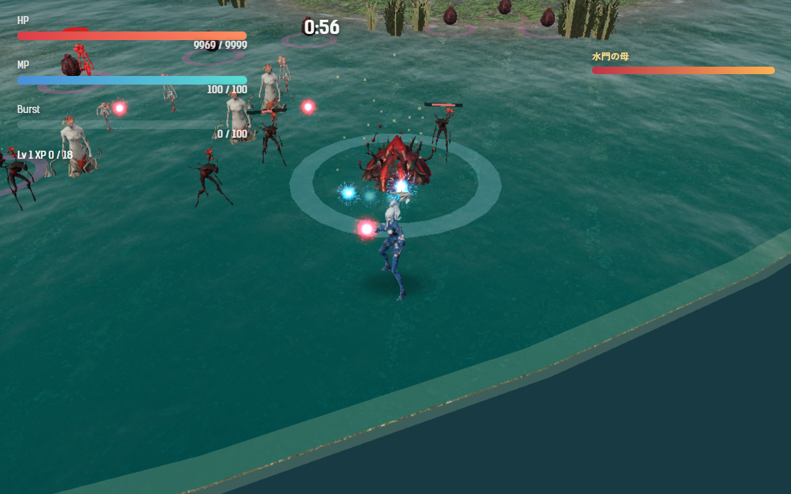
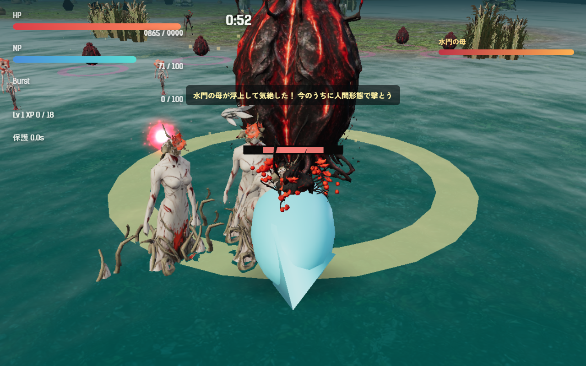

# 2026-10-30（サイクル 9）

## 今日やったこと
- A: **E9 水門の母（第3章のボス）**。
  - 新しいボスの種類 `floodgateMother`（`src/bosses.js`）。画面の名前は「水門の母」。第3章は前から `boss: 'floodgateMother'` を指定してあったので、今日から母卵の動きではなくこのボスで戦う。
  - 出る場所: 水没マップの**岸から離れた水の中**（魚形態で近づける所）。
  - **潜っている間は攻撃が効かない**（0 倍）。体は水面から頭だけ出し、足元の輪は青。撃つと灰色の火花と「潜っていて効かない。魚形態で噛みつこう」（4 秒に1回まで）。
  - 潜っている間、7.5 秒ごとに**オタマジャクシ5匹の列**をプレイヤーへ向けてまっすぐ流す（速さ 5.5、触れると 9 のダメージ）。列は敵の上限（120 体）を無視して出し、8 秒ほどで消える（カエルには育たない）。最初の列のときに「水に潜っていて攻撃が効かない／魚形態で3回噛みつくと浮上する」を出す。
  - **魚形態でボスに噛みつく**（届く距離は卵より 2.4 長い。噛みつきの間隔は 0.8 秒）と「噛みついた 1/3」。噛むたびに足元の輪が明るく大きくなる。
  - **3回目で浮上して 7 秒気絶**。体が水面から出て揺れ、輪は金色。気絶の間は攻撃が 1.6 倍。7 秒たつとまた潜り、数え直し。
  - 衝撃波は出さない（設計書どおり、列と潜水だけ）。
  - 調整・無効化は `Config.boss.floodgateMother`（第3章の `boss` を `'motherEgg'` にすれば元の母卵に戻る）。テスト2件を追加（潜水→3回で浮上→気絶中は噛めず列も出ない→また潜る、列の並び）。孵化予報（今は無効）のボス名と一言も入った。
  - ボット（`scripts/bot-play.mjs`）: 水門の母が潜っている間は寄って魚形態に変わり、浮上したら人間に戻って 4.5 の距離から撃つ動きを足した。結果に噛んだ回数・浮上・列の数を出す。
- B（金・音声）: **B3-2 ボス出現・レベルアップ・残り1分の一言（3人分）**。
  - ボスは章ごとに違うので、「母卵」と名指ししない台詞にした（判断待ちに一覧）。手本の声（10-24 にユーザーが選んだもの）を指定して Irodori-TTS 4.1 で各3シード、計 27 本 → 文字起こし → 声の高さと画像で1本ずつ選び、前後の余分な音を切って -15 LUFS の mp3 に。
  - ゲームでは、ボスが現れたとき・レベルアップのとき（戦闘時間 25 秒に1回まで）・残り1分になったときに、選んだキャラの声が鳴る。`Config.audio.cueVoices: false` で鳴らない。
  - 選んだシードと理由は `asset-ledger.md`。手本の声がこのフォルダに無かった（git 対象外）ので、以前の worktree からコピーした（`asset-pipeline.md` に追記）。
  - 所要時間: 生成約4分、文字起こしと分析それぞれ2〜3分。使い終わって GPU は空いている（298MiB）。

## 確認結果
- npm test / build: 53 件すべて成功／ビルド成功
- プレイ確認: 開発サーバー（5183）を起動し、Playwright（Edge）で第3章に入って確認。確認用に時間を 180 秒に進めてボスを出し、プレイヤーをボスの近くの水に置いた。ページのエラーなし。
  - 潜っている水門の母（頭だけ見える。撃っても灰色の火花）。列が1本流れた:
    
  - 魚形態で3回噛むと浮上して気絶（金色の輪、「水門の母が浮上して気絶した！」）:
    
  - 人間に戻って撃つと HP が 360→321 に減り、約 7 秒後にまた潜った。
  - 新しい声9本はすべてブラウザで読み込めた（長さ 0.95〜2.63 秒、404 なし）。音そのものは聞いて確かめられないので、試聴をお願いしたい。
- 数値:
  - ツキミ・**第3章**・`--speed 6`・3回: **1回勝ち（215.3 秒で撃破）**、2回は 221／217 秒で死亡。平均被ダメージ 231、平均 Lv 9.3。噛んだ回数 9／6／6、浮上 3／2／2、列 2〜4 本（10〜20 匹）。
    - 直す前の1回目は噛みつき 0・列のオタマジャクシ 0 匹だった（敵の上限が埋まって列が出ない、ボットが鳥のまま近づく）。列は上限を無視するようにし、ボットは鳥から人間→魚に切り替えるようにした。
    - 気絶の 7 秒で人間形態の射撃が削れるのは 35 前後（HP 360 の 1 割）。自動射撃は雑魚を狙うので、ボスへの当たりが少ない。勝った回はバーストが当たった。A24 に残した。
  - ツキミ・第1章・`--speed 6`・5回（README の定例）: 勝率 0、平均被ダメージ 193.8、平均 Lv 10.6、死亡 219.6〜230.5 秒。衝撃波は 7 回すべて避けた。

## 判断待ち（ユーザーへ）
- **水門の母を第3章で遊んでみてほしい**。気になる点: (1) 気絶の 7 秒で削れる量が少ない（人間の自動射撃は雑魚を狙う）。気絶中はボスを優先して撃つようにするか、気絶を長くするか、倍率を上げるか、(2) オタマジャクシの列は小さく暗くて見えにくい。水しぶきの線などで列を示すか、(3) 噛みつき3回は多すぎ・少なすぎないか。
- **新しい一言9本の試聴**（`assets/audio/voice/<キャラ>/boss_appear_01.mp3`・`level_up_01.mp3`・`last_minute_01.mp3`）。台詞は自分で決めたので、口調に合うか見てほしい（物語の台詞ではなく戦闘中の掛け声）:
  - ツキミ: 「来ました……大きいのが。」「まだ、強くなれる。」「あと一分。落ち着いて。」
  - アカメ: 「大物だ。私が行く。」「体が軽い。」「あと一分。押し切る。」
  - キイチゴ: 「うわ、でっかいの来た！」「いいね、いいね！」「ラスト一分、がんばろっ！」
  - レベルアップの声は 25 秒に1回までにした。うるさければ `Config.audio.levelUpVoiceCooldown` を長くするか、レベルアップだけ外す。
- 前回までの判断待ち（足跡を第2章で遊ぶ・第2章が「止まると危ない章」でよいか・`C:\out\` の削除、追い手の速さと「効かない」表示、画風の3系統と人物の担当、新しい効果音2つの試聴、E6 卵は学ぶ、渇きの母の手応え、擬態卵の強さと文言、ハイライト動画の使い方、A13 水中で衝撃波をかわせるか、A12 敗北画面の文言、生成ツールを使う時間帯）は回答がないので保留のまま。

## 次にやること
- A: E10 鳴き（第4章の新種。動かず、数秒ごとに周りの卵の孵化を早める。鳴く前に体が膨らむ）。
- B（土・動画/SNS）: B6-2 週の進捗素材（追い手・足跡・水門の母のスクリーンショット比較、縦動画、投稿文の案）を `promo/2026-10-31/` に。投稿はしない。
- B（次の月・3D）: Tripo に渡す元絵（B1-3 鳥形態の代替表示か B1-4 弾）。
