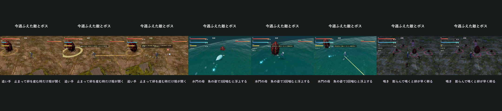
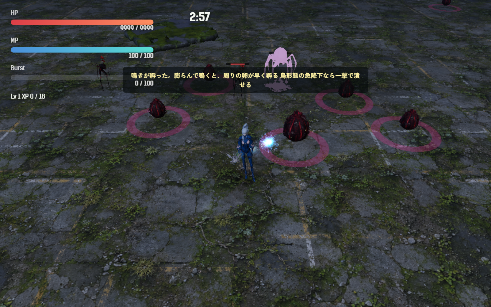
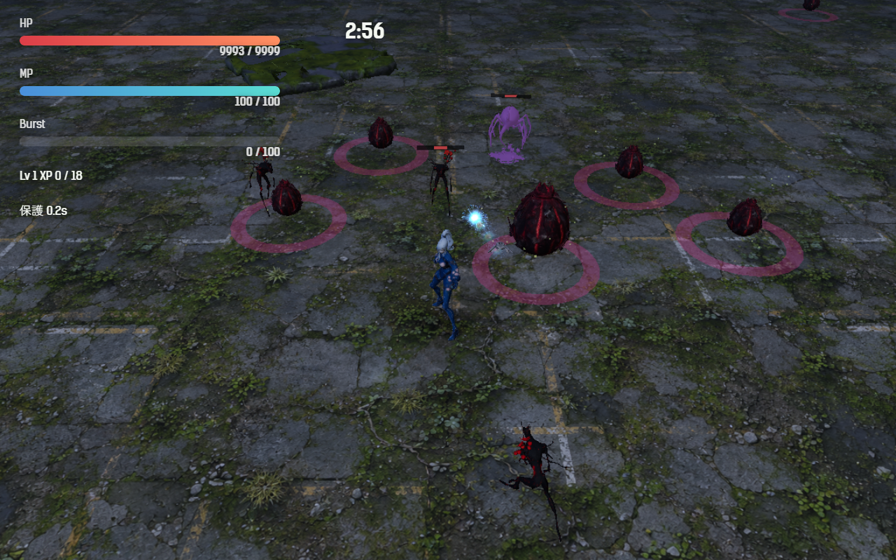
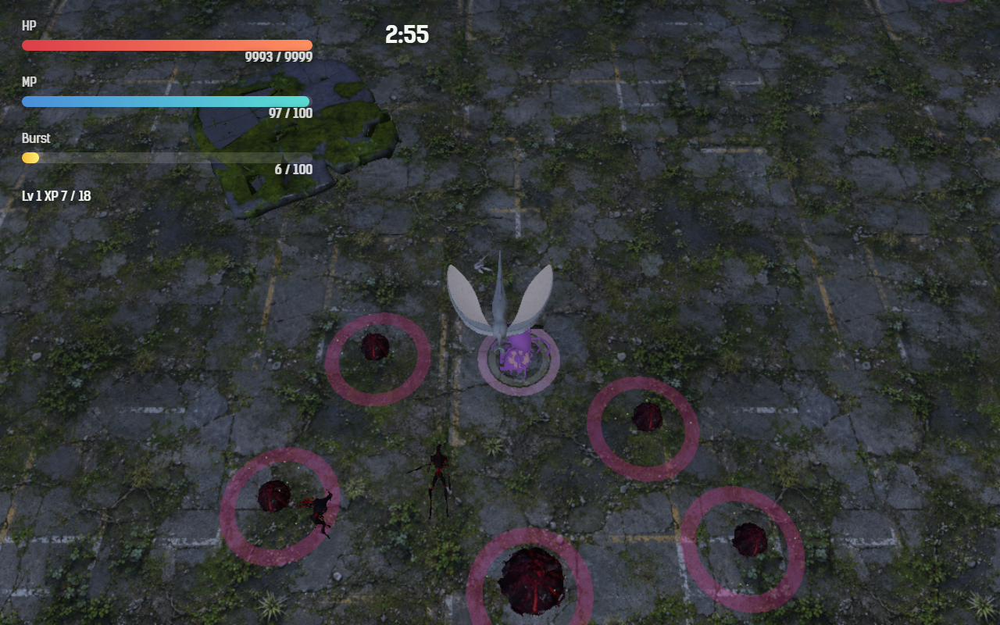

# 2026-10-31（サイクル 10）

## 今日やったこと
- A: **E10 鳴き（第4章の新種）**。
  - 新しい敵の種類 `crier`（`src/entities.js`）。設計書どおり「産卵獣の亜種」なので、産卵獣の体をくすんだ紫に塗った。
  - 出る条件: 第4章から、戦闘 40 秒以降に卵から孵る敵の 10% が鳴きになる（同時に3体まで）。
  - **動かない**。6 秒ごとに 1.4 秒かけて体が膨らみ（最大 1.5 倍、紫の光が強まる）、同時に届く範囲（半径 9）の薄い輪が出る。膨らみきると**鳴いて**、範囲内の卵の孵化を 3 秒早める（まだ若い卵は 4 秒育つ）。ボスの卵は対象外。卵には紫の火花、鳴いた所には紫と白の輪。音は今は `motherRelease` の流用（小さめ、距離 40 以内だけ）。
  - **鳥形態の急降下は、近くの卵より鳴きを先に狙う**（ボスがいればボスが先）。急降下が当たれば一撃で潰せる。
  - 初めて孵ったとき一度だけ「鳴きが孵った。膨らんで鳴くと、周りの卵が早く孵る／鳥形態の急降下なら一撃で潰せる」。孵化予報（今は無効）の新種にも登録。
  - 調整と無効化は `Config.enemy.crier`（`enabled: false` で出なくなる）。テスト1件を追加（動かない、膨らんでから鳴く、間隔ごとに繰り返す）。
  - ボット（`scripts/bot-play.mjs`）: 結果に鳴きの数・鳴いた回数・早めた卵の数・急降下で潰した数を出す。録画の見どころに「鳴いた時刻」（`crierCry`）を足した。**`--start <秒>`** で戦闘の時計を先に進められるようにした（ボスの直前から録る・確かめる用）。
- B（土・動画/SNS）: **B6-2 週の進捗素材（1回目）** を `promo/2026-10-31/` に。投稿はしていない。
  - 今週ふえた敵とボス4種（追い手・足跡・水門の母・鳴き）の並べ画像 `weekly-grid.png`。作り方は `scripts/promo/weekly-grid.py`（devlog のスクリーンショットを 16:10 に切って2列に並べ、名前と一言を付ける）。
  - 縦動画 20 秒 `promo/2026-10-31/weekly-9x16.mp4`（1080×1920、音なし。動画は git に入れない）。追い手（第2章）・水門の母（第3章）・鳴き（第4章）の3場面。作り方は新しい `scripts/promo/montage.mjs`（録画と秒と一言を並べて渡すと、16:9 の画面を縦の真ん中に置き、上に見出し、下に一言を付けてつなぐ）。真ん中だけを縦に切り取る方法（`cut-highlights.mjs`）では、画面の端にいるボスが切れてしまったので使わなかった。
  - 第2・3章はボットに `--start 172` を付けて録画。第4章はボットが鳴きから逃げるので画面に入らず、確認用の台本で鳴きと卵を置いて録った。
    
  - 並べ画像:
    （※ promo の画像は git に入らないので、ローカルでだけ見える）
  - 投稿文の案3つ（`promo/2026-10-31/post.md`）。

## 確認結果
- npm test / build: 54 件すべて成功／ビルド成功
- プレイ確認: 開発サーバー（5183）を起動し、Playwright（Edge）で第4章に入って確認。確認用に時間を 60 秒に進め、プレイヤーの前に卵5つと鳴きを置いた。ページのエラーなし。
  - 膨らんだ鳴き（上の紫に光る体）と、初めて孵ったときの説明:
    
  - 鳴いたあと（体が元の大きさに戻る）。鳴き声の処理を直接呼んで確かめると、範囲内の卵4つは孵化までの残りが 3 秒ずつ減り（11.11 → 8.11 秒）、範囲外（距離 15）の卵は 10.71 のままだった:
    
  - 鳥形態にして鳴きの近く（1.7）に置くと、卵より先に鳴きへ急降下し、一撃で潰した（`diveKills: 1`）:
    
  - 気になった点: 鳴いたときの半径 9 の輪が、スクリーンショットでは見えにくい（撮った時刻が輪の消えかけだった可能性もある）。A26 で見る。
  - 第4章は「夜」の章のはずだが、画面は他の章とほぼ同じ明るさに見えた（今日の変更とは関係ない。気づいたことだけ書く）。
- 数値（ツキミ・**第4章**・`--speed 6`・各3回）:
  - 鳴きあり: 全敗（240 秒で時間切れ1回、221.8／217.6 秒で死亡）。平均被ダメージ 182、平均 Lv 11.3。鳴き 4／5／7 体、鳴いた回数 77／21／64、早めた卵 延べ 396／10／360、急降下で潰した 0／0／2。
  - 鳴きなし（`enabled: false` にして比較、終わったら戻した）: 全敗（234.5／225.1／226.9 秒で死亡）。平均被ダメージ 199、平均 Lv 10.3。
  - 差ははっきりしない。第4章はボットにはまだ難しい（ボス撃破 0）。ボットは鳥形態の急降下の範囲（4.5）に鳴きが入ることが少なく、鳴きを狙いに行く動きもないので、鳴きは鳴き続けている。人が遊んだときに「見つけて潰しに行く」流れになるかを見たい（A26）。

## 判断待ち（ユーザーへ）
- **鳴きを第4章で遊んでみてほしい**。気になる点: (1) 出る割合 10%・同時3体は多い／少ないか、(2) 鳴き1回で卵の孵化が 3 秒早まるのは強すぎ／弱すぎか、(3) 膨らむ予兆（1.4 秒、光が強まる）が見えるか、(4) 見た目は今は産卵獣の色違い。専用の見た目（膨らむ喉袋のある体など）を Tripo の元絵の候補に入れるか。
- **週の進捗素材**（`promo/2026-10-31/`）。投稿に使うかどうか、使うなら案A〜Cのどれか。並べ画像には確認用の HUD の値（HP 9999 など）が写っているので、気になるなら縦動画の方を。
- 前回までの判断待ち（水門の母の手応えと新しい一言9本の試聴、足跡を第2章で遊ぶ・第2章が「止まると危ない章」でよいか・`C:\out\` の削除、追い手の速さと「効かない」表示、画風の3系統と人物の担当、新しい効果音2つの試聴、E6 卵は学ぶ、渇きの母の手応え、擬態卵の強さと文言、ハイライト動画の使い方、A13 水中で衝撃波をかわせるか、A12 敗北画面の文言、生成ツールを使う時間帯）は回答がないので保留のまま。

## 次にやること
- A: E11 手（第4章の新種。近づくと腕を伸ばして掴みかかり、掴まれると遅くなる。鳥形態に変身すると振りほどける）。
- B（日・隔週）: 前々回の日曜（10-25）が動くアバターだったので、明日は素材の手直し・統一の番（B2-2 効果音の音量そろえなど）。週の振り返りも書く。
- B（次の月・3D）: Tripo に渡す元絵（B1-3 鳥形態の代替表示か B1-4 弾）。鳴きの専用の見た目も候補。
