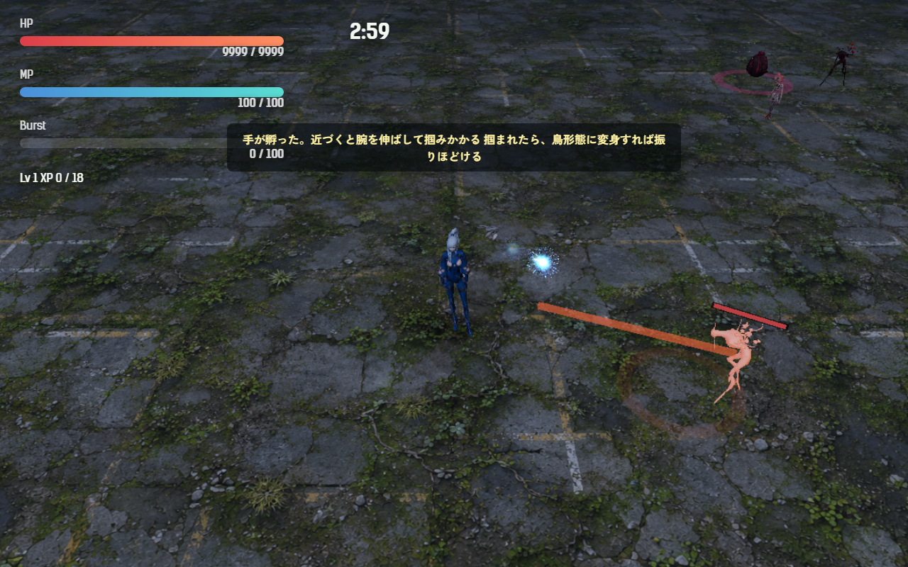
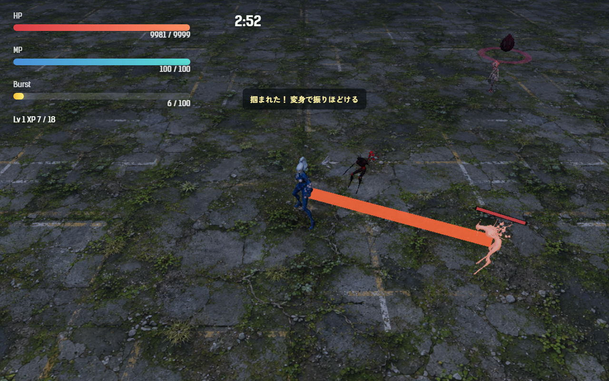
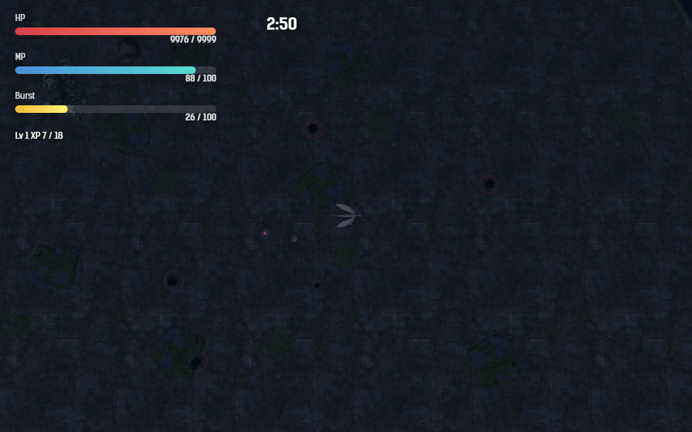

# 2026-11-01（サイクル 11）

## 今日やったこと
- A: **E11 手（第4章の新種）**。
  - 新しい敵の種類 `hand`（`src/entities.js`）。体は追い手と同じ人型を、灰色がかった肌色に塗った（専用の見た目はまだ無い）。
  - 出る条件: 第4章から、戦闘 55 秒以降に卵から孵る敵の 10% が手になる（同時に3体まで）。鳴き（40 秒以降 10%）の判定のあとに判定する。
  - 動き: 速さ 1.9 でゆっくり近づく。距離 5 以内に入ると **0.8 秒かけて腕を伸ばす**（予兆。体が赤く光り、細い半透明の腕がプレイヤーへ伸び、足元に届く範囲の輪が出る）。伸ばしきったときに人間形態のプレイヤーが届く所（5.4 以内）にいれば**掴む**（5 ダメージ）。
  - 掴まれると: 移動が **0.35 倍**になり、太い腕がプレイヤーまでつながる。「掴まれた！ 変身で振りほどける」（MP が 5 以下なら「掴まれた！ MPが足りない」）。**鳥（水中なら魚）形態に変身すると振りほどける**（赤い粒が散る）。ほかに、3.5 秒たつ・手を倒す・離れすぎる（8 以上）と離れる。予兆のあいだに変身すれば空振りになる。離したあと・空振りのあとは少し休む。
  - 初めて孵ったとき一度だけ「手が孵った。近づくと腕を伸ばして掴みかかる／掴まれたら、鳥形態に変身すれば振りほどける」。孵化予報（今は無効）の新種にも登録。
  - 調整と無効化は `Config.enemy.hand`（`enabled: false` で出なくなる）。テスト2件を追加（`tests/hand.test.js`: 予兆→掴む→変身で離れる／鳥は掴めない・時間切れで離す）。
  - ボット（`scripts/bot-play.mjs`）: 掴まれたら MP があれば変身して振りほどく。`--shake 0` で振りほどかない（比べる用）。結果に手の数・予兆・掴んだ数・振りほどいた数・掴まれていた秒数を出す。録画の見どころに `handGrab` を足した。
- B（日・隔週で素材の手直し）: **B2-2 効果音の音量をそろえた**。
  - 22 個の効果音のラウドネスを測ると、ファイルそのもので -20.8〜-8.1 LUFS（差 12.7 dB）、半分以上が 0 dBFS まで振り切れていた。ゲーム内の音量（`playSfx` の volume）をかけた実際の大きさでも、変身（-11.7）が捕食（-20.1）より 8 dB も大きいなど、よく鳴る操作音がうるさかった。
  - 役割ごとに目標を決めてそろえた: よく鳴る音（射撃・命中・経験値・撃破）とメニューは -18、操作への返事（変身・捕食・卵割り・被弾・アイテム・吸い上げ）は -15、大技とボス（バースト・レベルアップ・母卵）は -12 LUFS。1 秒前後の短い音なので loudnorm ではなく一定の増減をかけ、リミッター（-1 dB）で振り切れを止めた。結果は -19.1〜-12.0 LUFS、ピークはすべて -0.4 dB 以下（表は `asset-ledger.md`）。
  - 元のファイルは変えず、そろえた版を `assets/audio/sfx-normalized/` に置いた。`Config.audio.normalizedSfx: false` で元に戻る。作り方は `scripts/assets/normalize-sfx.mjs`（何度でも作り直せる）。
  - 耳での確認はしていない（自動のサイクルでは音を聞けない）。

## 確認結果
- npm test / build: 56 件すべて成功／ビルド成功
- プレイ確認: 開発サーバー（5183）を起動し、Playwright（Edge）で第4章に入って確認。時間を 60 秒に進め、プレイヤーの近くに手を置いた（確認のため手の HP を大きくした）。ページのエラーなし。
  - 腕を伸ばす予兆（赤く光る体、プレイヤーへ伸びる細い腕、足元の輪）と、初めて孵ったときの説明:
    
  - 掴まれたところ（太い腕でつながる）。掴まれているあいだ右へ 0.5 秒歩くと 1.20、離れてからは 3.47 進んだ（約 0.35 倍）:
    
  - 変身すると鳥形態になり、掴みが外れた（`grabbedBy` が空、振りほどき 1 回）:
    
  - 効果音: ゲームを開いて 22 個すべてが `sfx-normalized/` から読み込まれた（読み込みの失敗なし）。
  - 気になった点: 予兆の 0.8 秒のあいだに、自動射撃のノックバックで手が届く範囲の外へ押し戻され、空振りすることがある（確認中の 3 回の予兆のうち 2 回が空振り）。
- 数値（ツキミ・**第4章**・`--speed 6`・3回）: 全敗（235／226.2／240 秒）。平均被ダメージ 206、Lv 11〜12。手は 6／6／3 体孵ったが、**予兆も掴みも 0 回**。ボットは敵から離れて動き続けるうえ、自動射撃で手を押し返すので、手が近づけない。`--shake 0` の1回も掴み 0 回で、比べられなかった。鳴きは 3〜9 体、鳴いた回数 50〜90。

## 週の振り返り（サイクル 5〜11、10/26〜11/01）
- **できたこと**
  - ボス: 渇きの母（第5章、E4）、追い手（第2章、E7）、水門の母（第3章、E9）。第1〜3章と第5章のボスがそれぞれ違う動きになった。
  - 新種: 足跡（第2章、E8）、鳴き（第4章、E10）、手（第4章、E11）。第4章は新種が2つになった。
  - 孵化予報（E5）を作ったが、ユーザーの意見で無効に（コードは残してある）。
  - 素材: 効果音2つ（アイテム取得・吸い上げ）、ボス出現・レベルアップ・残り1分の声（3人分）、週の進捗素材の1回目（並べ画像・縦動画・投稿文の案）、効果音の音量そろえ。
  - 3D: Hunyuan3D をやめて Tripo だけにした（ユーザーの判断）。Hunyuan3D 製のアイテムは撤去。
  - ボット: `--start <秒>`（ボスの直前から）と `--shake 0` を足し、新しい敵ごとの数値を出すようにした。
- **うまくいかなかったこと・気づき**
  - 新しい敵とボスの「手応え」がボットでは測れていない。ボットは止まらず逃げ続けるので、足跡はほとんど追いつかず、鳴きは急降下の範囲に入らず、手は一度も掴めなかった。人が遊ぶ動き（卵を拾いに近づく、同じ所で戦う）をボットに足さないと、新種の強さの調整（A23・A26・A27）が進まない。
  - 第4章以降はボットが一度も勝てない。新種を足すたびに「ボットの全敗」が続くので、難しさの診断（A2）を先にやる価値が上がっている。
  - 判断待ちが溜まり続けている（試聴・遊んだ感想が中心）。返事がなくても進められるものを選んでいる。
  - 3D はユーザーの承認待ちで、今週はゲームに入った 3D 素材が無い。
- **来週の方針**
  - A は E12 群れの母（第4章のボス）。第4章（新種2つ＋ボス）がそろうので、その後に A2（診断）とボットの「近づく動き」を入れて、第2〜4章の新種をまとめて数値で見る。
  - B は月・木に Tripo の元絵（鳴き・手の専用の見た目も候補）。

## 判断待ち（ユーザーへ）
- **手を第4章で遊んでみてほしい**。気になる点: (1) 掴まれたときの 0.35 倍は重すぎ／軽すぎか、(2) 予兆 0.8 秒と届く距離 5 で「見てから変身」が間に合うか、(3) 自動射撃で押し返されて空振りしやすいので、予兆のあいだは押し返されないようにするか、(4) ボットでは一度も掴めなかったので、近づく速さ（1.9）を上げるか、(5) 見た目は今は追い手の色違い＋棒の腕。専用の見た目（長い腕のある体）を Tripo の元絵の候補に入れるか。
- **効果音の音量そろえを聞いてほしい**。とくに変身（前より 4.7 dB 小さい）、母卵の衝撃波の放出（3.9 dB 小さい）、捕食（1.8 dB 大きい）、命中（1.7 dB 大きい）。元に戻すなら `Config.audio.normalizedSfx: false`。目標の大きさ（よく鳴る音 -18／操作 -15／大技 -12）を変えたいときは `scripts/assets/normalize-sfx.mjs` の `ROLES` を変えて作り直せる。
- 前回までの判断待ち（鳴きの割合と強さ・見た目、週の進捗素材の使い方、水門の母の手応えと一言9本の試聴、足跡と第2章、`C:\out\` の削除、追い手の速さと「効かない」表示、画風の3系統と人物の担当、新しい効果音2つの試聴、E6 卵は学ぶ、渇きの母の手応え、擬態卵の強さと文言、ハイライト動画の使い方、A13 水中で衝撃波をかわせるか、A12 敗北画面の文言、生成ツールを使う時間帯）は回答がないので保留のまま。

## 次にやること
- A: E12 群れの母（第4章のボス）。光の糸で繋がった3体。1体だけ倒しても、10 秒以内に残りを倒さないと復活する。
- B（月・3D）: Tripo に渡す元絵（B1-3 鳥形態の代替表示か B1-4 弾。鳴き・手の専用の見た目も候補）。
