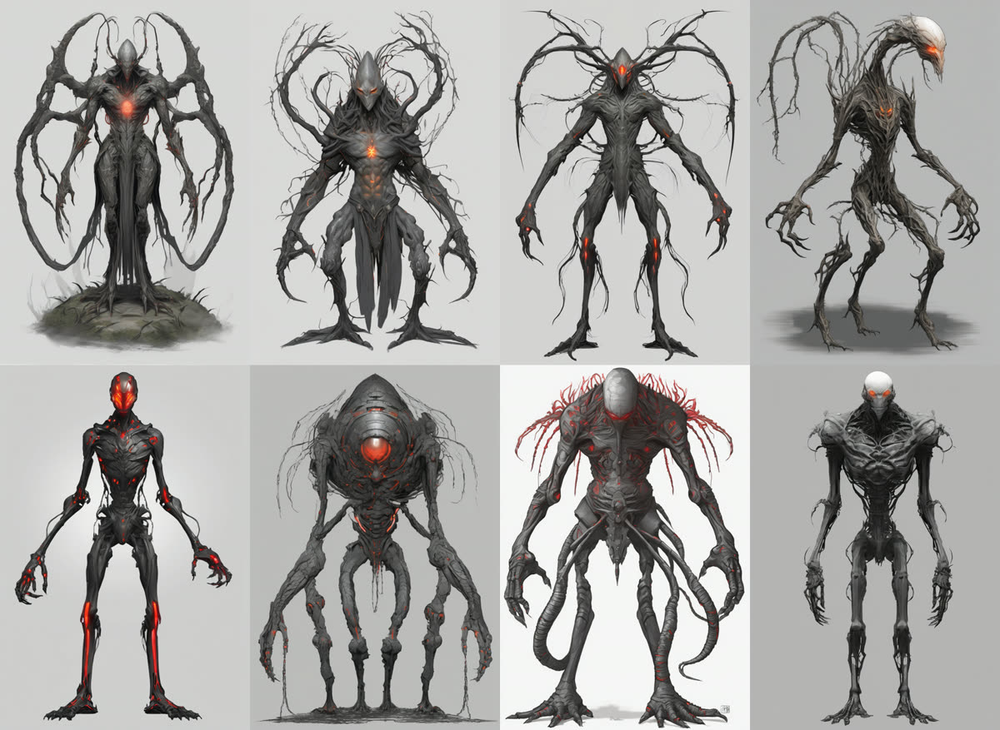
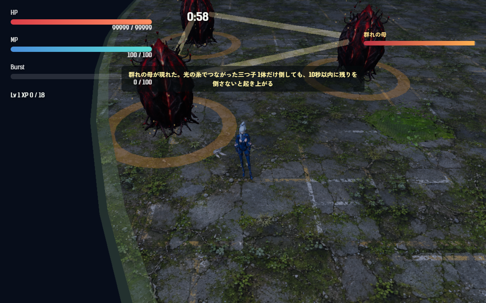
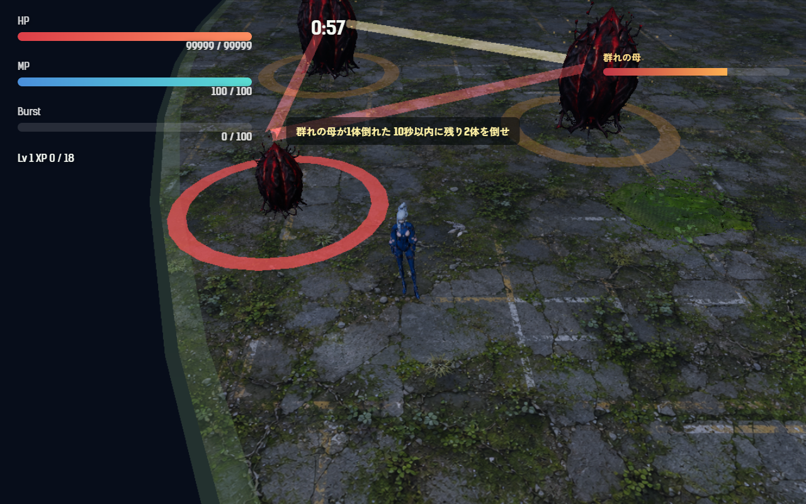

# 2026-11-02（サイクル 12）

## 今日やったこと
- A: **E12 群れの母（第4章のボス）**。
  - 新しいボスの種類 `swarmMother`（`src/bosses.js`）。画面の名前は「群れの母」。体は母卵を3つ使い、選んだ場所を囲む正三角形（中心から 6.5）に置く。建物や場外に重なる姉妹は内側へ寄せる。
  - 3体は光の糸（金色）でつながる。1体の HP は母卵の 0.45 倍（×章の倍率 1.3）で、3体の合計は母卵1体の 1.35 倍。
  - 1体の HP が 0 になっても**倒れるだけ**: 体が半分に縮み、その姉妹へ続く糸が赤く点滅し、足元に赤い輪が出て 10 秒かけて縮む。倒れている間は狙われず、攻撃も効かない。最後の 3 秒は体と輪が点滅する。
  - **10 秒以内に残りを全部倒さないと、HP 60% で起き上がる**（赤い輪と「群れの母が起き上がった」）。最後の1体を倒すと、倒れている姉妹もまとめて壊れて勝利。
  - 衝撃波は母卵と同じものを、**立っている姉妹が1体ずつ順番に**出す（3体同時には出さない）。番の姉妹が倒れたら、次の姉妹が 3 秒後から引き継ぐ。
  - 出現時に「群れの母が現れた。光の糸でつながった三つ子／1体だけ倒しても、10秒以内に残りを倒さないと起き上がる」、1体倒すと「群れの母が1体倒れた／10秒以内に残り2体を倒せ」。
  - HP バーは3体の合計（倒れた姉妹は 0 として数える）。画面外の矢印は一番近い立っている姉妹を指す。
  - ボスが1体だけの前提だった所を直した: ゲームは `bossEggs`（ボスの体の一覧）と `getBossTargets()`（狙える体）を持ち、自動射撃・バースト（3キャラとも）・鳥の急降下・弾の当たり判定がそこから選ぶ。ほかの章のボスの動きは変わらない（`motherEgg` は1体目のまま）。
  - 調整と無効化は `Config.boss.swarmMother`（第4章の `boss` を `motherEgg` に戻せば元の母卵）。テスト5件を追加（`tests/swarm.test.js`: 倒れて起き上がる／3体まとめて倒すと壊れる／衝撃波の番の受け渡し／置き場所）。「まだ作っていないボス」の例に第4章を使っていた既存のテスト2件は、第6章（白蓮の核）に置き換えた。
  - ボット（`scripts/bot-play.mjs`）: 一番近い立っている姉妹を狙い、衝撃波は予兆中の姉妹を見て避ける。結果に `swarm`（倒した回数・起き上がった回数）を出す。
- B（月・3D）: **手（第4章の新種）の Tripo 用の元絵**（B1-8）。
  - 今日から、商用の条件が「○」の **`sd_xl_base_1.0`** で描いた（juggernaut は「要確認」のため使わない）。正面 8 枚・三面図 2 枚。
  - 1回目は細い枝や蔓が肩から伸びた（Tripo が壁にしやすい形）ので、2回目は `thick black vine bands`・`compact silhouette` と、否定に `antlers, branches, tendrils, thin strands` などを入れて消した。
  - 三面図は向きごとに別の生き物になり、Multiview には使えなかった。
  - 上段が1回目（101〜104）、下段が2回目（v2-103・105・106・107）:
    
  - 候補は **v2-103（下段の左端）** が第一。細い部品がなく輪郭がすっきりしている（少し機械っぽい）。第二は 103（上段の左から3枚目）で、いちばん生き物らしいが肩の上に細い枝がある。ファイルは `assets_src/3d/2026-11-02-hand/`（プロンプトとシードは asset-ledger.md）。

## 確認結果
- npm test / build: 61 件すべて成功／ビルド成功
- プレイ確認: 開発サーバー（5183）を起動し、Playwright（Edge）で第4章に入り、時間をボスの出現（180 秒）まで進めて確認した（確認のためプレイヤーの HP を大きくした）。ページのエラーなし。
  - 出現したところ。金色の糸でつながった3体と、出現時の説明:
    
  - 1体を倒したところ。縮んで、糸が赤くなり、足元に赤い輪が出る。HP バーは 98% → 67%、狙える体は 3 → 2:
    
  - そのまま待つと 10 秒で起き上がった（HP 176 中 105＝60%、HP バー 87%）。そのあと3体を続けて倒すと、3体とも壊れて勝利になり、第4章の帰還後の会話へ進んだ。
- 数値（ボット、ツキミ、`--speed 6`）:
  - 第4章・3回: 全敗、死亡 222.8〜229.4 秒、平均被ダメージ 230、平均 Lv 11.3。ボスは 180 秒に出たが、姉妹を倒した回数は 0（ボットは敵から離れ続け、ボスまで届かない）。
  - 第4章・`--start 170`・3回: Lv1 のまま 222.6〜234.7 秒で倒れる（ボスの確認には向かない）。
  - 第1章・3回（変更の影響の確認）: 全敗、死亡 224.3〜232.8 秒、平均被ダメージ 260、平均 Lv 11.7、衝撃波は 7 回すべて避けた。10-30 の5回（死亡 219.6〜230.5 秒、被ダメージ 193.8）と同じくらい（3回なので被ダメージはばらつく）。

## 判断待ち（ユーザーへ）
1. **群れの母を第4章で遊んでみてほしい**。気になる点: (1) 3体の合計 HP（母卵1体の 1.35 倍）が重すぎないか、(2) 猶予 10 秒と起き上がりの HP 60% で「均等に削って、最後にまとめて落とす」遊びになるか、(3) 3体の間隔（中心から 6.5）が近すぎて、バーストで2体まとめて削れてしまわないか、(4) 倒れた姉妹は縮むだけの見た目でよいか（ひびが入る・沈むなどにするか）。
2. **手の専用の見た目を Tripo で作ってよいか**。元絵は `assets_src/3d/2026-11-02-hand/hand-front-v2-103.png`（第一候補）か `hand-front-103.png`（第二候補）。設定は P2.0・Quad・2000 面・テクスチャあり・正面1枚（三面図は使えなかった）。**1体、見込み 120 クレジット**。どちらの絵にするかも選んでほしい。
3. 前回までの判断待ち（手の掴みの強さと見た目、効果音の音量そろえの試聴、鳴きの割合と強さ・見た目、週の進捗素材の使い方、水門の母の手応えと一言9本の試聴、足跡と第2章、`C:\out\` の削除、追い手の速さと「効かない」表示、画風の3系統と人物の担当、新しい効果音2つの試聴、E6 卵は学ぶ、渇きの母の手応え、擬態卵の強さと文言、ハイライト動画の使い方、A13 水中で衝撃波をかわせるか、A12 敗北画面の文言、生成ツールを使う時間帯）は回答がないので保留のまま。

## 次にやること
- A: E13 吸水根（第5章の新種）。周りに乾いた円を作り、円の中では MP が回復しない。
- B（火・効果音）: 新種とボスの専用の音の候補（鳴き声・手の掴み・群れの母の起き上がり）。今は既存の音を流用している。
