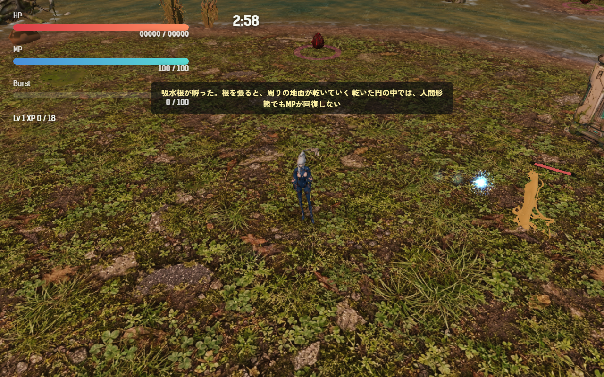
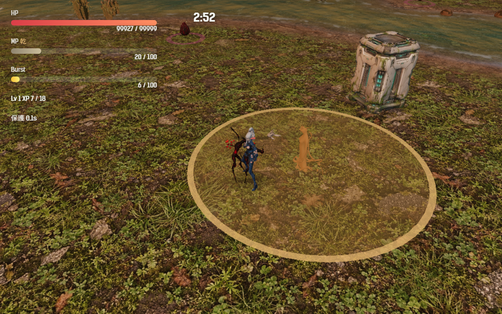

# 2026-11-03（サイクル 13）

## 今日やったこと
- A: **E13 吸水根（第5章の新種）**。
  - 新しい敵の種類 `rootsucker`（`src/entities.js`）。動かず、孵って 1.5 秒で根を張り、足元に**土色の乾いた円**を作る。円は半径 3.5 から 25 秒かけて 8 まで広がる（広がっているあいだは縁が脈打つ）。
  - **円の中にいる人間形態は MP が回復しない**。画面の MP に「乾」が付き、バーが灰色になる（MP が満タンのときは出さない）。鳥・魚形態の MP の減りは今までどおり。
  - 根を張ったあとは押されても動かない（円がずれないように）。倒すと円は消える。
  - 体は守り手の体を土色に塗ったもの（根を張るあいだ少し光る）。HP 60、第5章の 45 秒から、卵から孵る敵の 8% がこの種類（同時に3体まで）。
  - 孵ったときに「吸水根が孵った。根を張ると、周りの地面が乾いていく／乾いた円の中では、人間形態でもMPが回復しない」、初めて円の中で MP が止まったときに「乾いた地面ではMPが回復しない」。
  - 調整と無効化は `Config.enemy.rootsucker`（`enabled: false` で出なくなる、`dryRegenScale` を 1 にすれば回復は止まらない）。
  - 孵化予報（今は無効）の第5章の新種にも足した。予報のテストは第5章に擬態卵と吸水根の2つが出るように直した。テスト2件を追加（`tests/rootsucker.test.js`: 根を張って円が広がり倒すと消える／円の中で MP が回復しない）。
  - ボット（`scripts/bot-play.mjs`）の結果に `rootsuckers`（孵った数・根を張った数・円の中で MP が止まった秒数と失った MP）を出す。
- B（火・効果音）: **新種の専用の音3つ**（B2-1 の続き）。Stable Audio 3 で各4本作り、周波数と音量の推移を見て選んだ（耳では聞いていない）。
  - 鳴きの声 `crier_cry.wav`（1.8 秒）: 今まで流用していた `motherRelease` から差し替え。
  - 手に掴まれた音 `hand_grab.wav`（0.9 秒）: 今までは被弾の音だけだった。
  - 吸水根が根を張る音 `root_dry.wav`（1.3 秒、ひび割れ）。
  - 音量は `normalize-sfx.mjs` に役割を足してそろえた（鳴きは「よく鳴る」-18、ほか2つは「操作への返事」-15 LUFS）。`Config.audio.newSfx: false` で元に戻る。
  - 鳴きと根張りの1回目（長く説明的なプロンプト、2.5 秒）は8本とも一面の雑音で失敗。短いプロンプトと 3 秒で作り直したら正常だった（asset-pipeline.md に記録）。候補と見比べ画像は `assets_src/sfx/2026-11-03/`。

## 確認結果
- npm test / build: 63 件すべて成功／ビルド成功
- プレイ確認: 開発サーバー（5183）を起動し、Playwright（Edge）で第5章に入り、プレイヤーの隣に吸水根を出して確認した（確認のためプレイヤーの HP を大きくした）。ページのエラーなし、新しい音3つは読み込み成功（200）。
  - 孵った直後（根を張る前）:
    
  - 根を張って円が広がったところ。円の中にいるので MP の欄に「乾」が付き、バーが灰色。6 秒立っていても MP は 20 のまま（円の外へ出ると 2 秒で 20→32）:
    
- 数値（ボット3回、第5章、`--speed 6`）: 全敗（184.5・231・179.5 秒で倒れる、平均被ダメージ 214.7、平均 Lv 9.7）。吸水根は 3〜4 体孵ってすべて根を張ったが、ボットが円の中で MP が止まったのは 0〜1.7 秒だけ。ボットは敵から離れ続けるので円に入らない（A28 と同じ理由）。手応えは A30 で人が遊んで確かめる。

## 判断待ち（ユーザーへ）
1. **吸水根を第5章で遊んでみてほしい**。気になる点: (1) 円の中で MP の回復が完全に止まるのは厳しすぎないか（半分にする等もできる）、(2) 円の最大の大きさ 8 と広がる速さ 25 秒、(3) 見た目が守り手の色違いで平たく見えるので、専用の見た目（地面に刺さる根）を Tripo で作る候補に入れてよいか。
2. **新しい効果音3つを聞いてみてほしい**: `assets/audio/sfx-normalized/crier_cry.wav`（鳴きの声）、`hand_grab.wav`（手の掴み）、`root_dry.wav`（吸水根の根張り）。合わなければ `Config.audio.newSfx: false` で元に戻る（10/27 の2つも同時に戻る）。
3. 前回の判断待ち（群れの母の手応え、手の専用の見た目を Tripo で作るか・どちらの絵か・120 クレジット）と、それ以前の判断待ちは回答がないので保留のまま。

## 次にやること
- A: E14 群れ鳥・割れ殻（E6 の対策用の敵）。E6 は保留中なので、群れ鳥・割れ殻だけを普通の出現として作るか、飛ばして E15 白蓮の核に進むかを、着手前に backlog と設計書で確認する。
- B（水・イラスト）: B4-1 画風の基準づくりの続き（世界の色と塔の形）か、新種の元絵の下準備。
