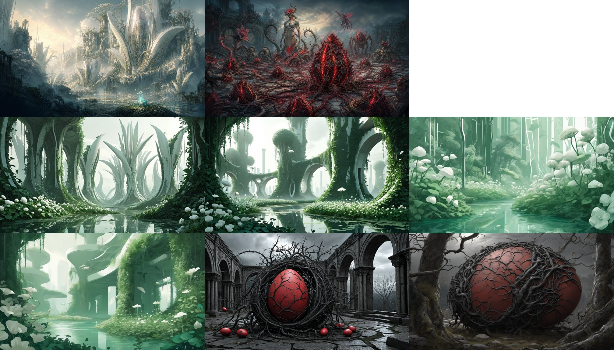
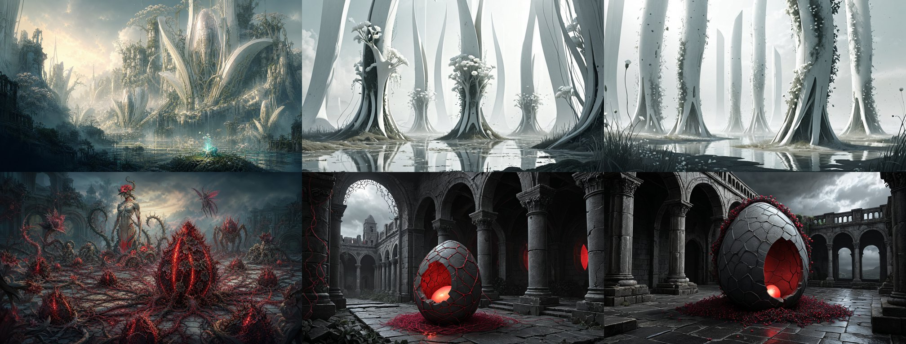
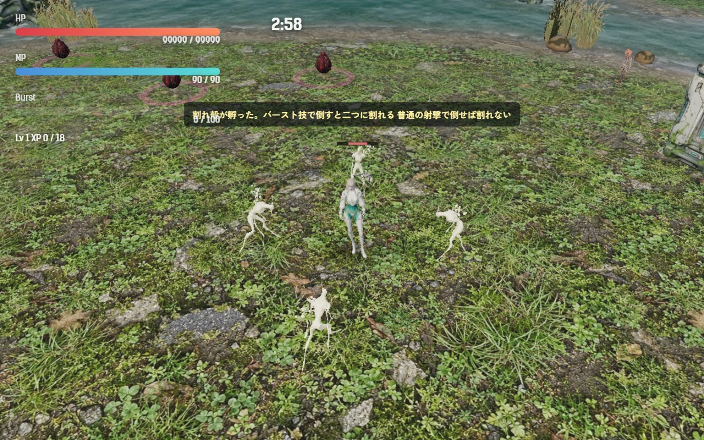
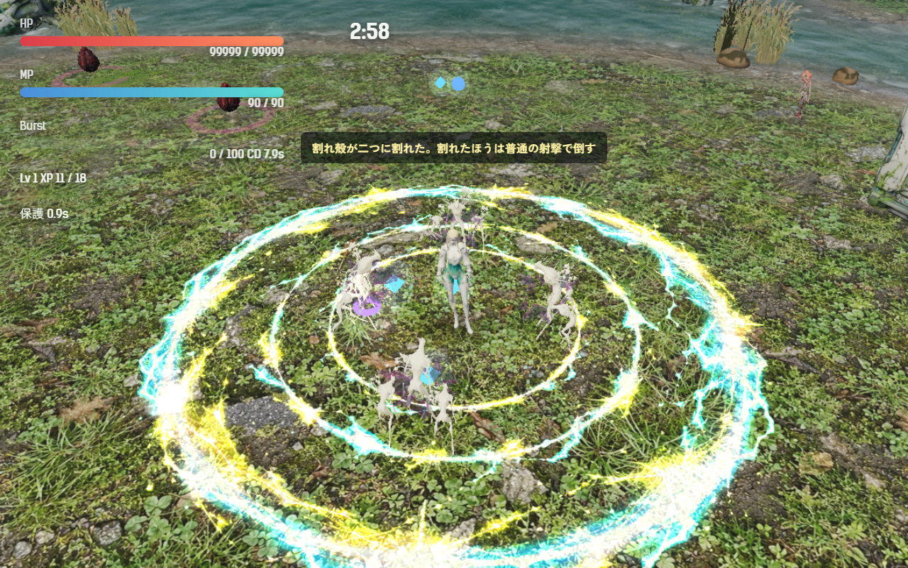

# 2026-11-04（サイクル 14）

## 今日やったこと
- A: **E14 の片方、割れ殻（第3章の新種）**。
  - E14（群れ鳥・割れ殻）は E6「卵は学ぶ」で出す対策用の敵の予定だった。E6 は保留中なので、**割れ殻だけを普通の新種として**作った。出す章は、設計書で新種が空いている**第3章**にした（判断待ちの1）。群れ鳥は次の E14 の日に回す。
  - 新しい敵の種類 `splitshell`（`src/entities.js`）。追いかけ役の体を白っぽい殻の色に塗ったもの。HP 46、速さ 2.2。第3章の 40 秒以降に、卵から孵る敵の 10% がこの種類になる（同時に4体まで）。
  - **バースト技で倒すと二つに割れる**（アカメの爆発・ツキミのビーム・キイチゴの斬撃のどれでも）。半分は小さく、HP と経験値が半分で、もう割れない。割れた直後の 0.9 秒は、続くビームや斬撃でまとめて消えないよう、バースト技を受けない。半分は敵の上限を超えても出る。
  - 普通の射撃・パルス・鳥の急降下で倒せば割れない。
  - 孵ったときに「割れ殻が孵った。バースト技で倒すと二つに割れる／普通の射撃で倒せば割れない」、初めて割れたときに「割れ殻が二つに割れた。割れたほうは普通の射撃で倒す」。
  - 調整と無効化は `Config.enemy.splitshell`（`enabled: false` で出なくなる）。孵化予報（今は無効）の第3章の新種にも足した。テスト2件を追加（`tests/splitshell.test.js`）。ボットの結果に `splitshells`（孵った数・割れた回数・半分の数）を出す。
- B（水・イラスト）: **B4-1 画風の基準づくりの続き**。Forge で2巡、計10枚。**すべて不採用**だが、それぞれ課題が一つずつ前に進んだ。
  - 1巡目（juggernaut と sd_xl_base、世界4枚・敵2枚）。上段が手本:
    
    - 世界: 塔を `curved white petal-like structures` と言い換えたら**花弁の形が出た**。黄色と尖塔も消えた。ただ蔦の緑が濃すぎ、逆光と霞が弱い。sd_xl_base は平たいイラスト調。
    - 敵: 黒い棘の巣に包まれた赤い卵にはなったが、筋が光らない。
  - 2巡目（juggernaut、緑を抑え、割れ目を光らせる）。左が手本:
    
    - 世界: 白・クリームと霧と水の映り込みは手本に近づいた。今度は白と灰色だけになって、空の暖色と細密さが消えた。
    - 敵: **割れ目から赤い光が漏れる**ようになった。ただ卵が灰色の石になり、赤い蔓は足元だけ。
  - 次に試す言葉は `asset-pipeline.md` の「画風の基準」、生成物は `assets_src/illust/2026-11-04/`、台帳に記録した。Forge の起動は 130 秒、1枚 29〜59 秒。使い終わってから止めた。

## 確認結果
- npm test / build: 65 件すべて成功／ビルド成功
- プレイ確認: 開発サーバー（5183）を起動し、Playwright（Edge）で第3章にアカメで入った。プレイヤーの周りに割れ殻を4体置いてバーストを撃った（確認のため HP を大きくした）。ページのエラーなし、読み込みの失敗なし。
  - 孵ったところ（白い体、初回の説明）:
    
  - バーストで4体を倒すと8体の半分（HP 23）に割れた。初めて割れたときの説明が出ている:
    
  - そのあと普通の自動射撃（Lv1）だけで、半分8体は約 10 秒で全部倒れた（2秒ごとの残り 8→8→6→4→1→0）。
  - 途中で一度、確認の数字が進まなかった。これはレベルアップの画面でゲームが止まっていたためで、不具合ではなかった（強化を選ぶと進んだ）。
- 数値（ボット3回、アカメ、第3章、`--speed 6`）: 全敗（242.8・235.5・235.2 秒で倒れる、平均被ダメージ 268.3、平均 Lv 10.3）。割れ殻は 8・9・7 体孵り、割れたのは 3・0・0 回（半分 6・0・0 体）。ボットはバーストを敵の群れに向けて撃たないので、割れる場面が少ない。手応えは A31 で人が遊んで確かめる。

## 判断待ち（ユーザーへ）
1. **割れ殻を出す章**: 今は第3章から（E6「卵は学ぶ」が保留なので、普通の新種として）。このままでよいか、E6 を進めて「バーストでよく倒す人にだけ出る」にするか、別の章にするか。元に戻すときは `Config.enemy.splitshell.enabled: false`。
2. **割れ殻を第3章で遊んでみてほしい**。気になる点: (1) バーストのあとに半分が残る手間が「バースト頼みにできない」の程よい不便さか、(2) HP 46（半分 23）、(3) 割れる音が撃破音だけで足りるか。
3. **画風の基準（B4-1）のモデル**: 手本に近いのは juggernautXL だけで、商用の条件が「要確認」のまま。商用 ○ の sd_xl_base は平たくなる。juggernaut で詰めてよいか（商用に使う前に条件を確かめる）、それとも一枚絵は Codex（GPT Image）でユーザーが作る方向にするか。
4. 前回までの判断待ち（吸水根・群れの母の手応え、新しい効果音、Tripo で作る敵の見た目とクレジットなど）は回答がないので保留のまま。

## 次にやること
- A: E14 の残り、群れ鳥（鳥形態のときだけ襲う空の群れ）。出す章は割れ殻と同じく判断待ちなので、`Config` で章を選べる形で作る。
- B（木・3D）: Tripo に渡す元絵の準備（割れ殻・吸水根の専用の見た目の候補）か、届いた GLB があれば整形。
