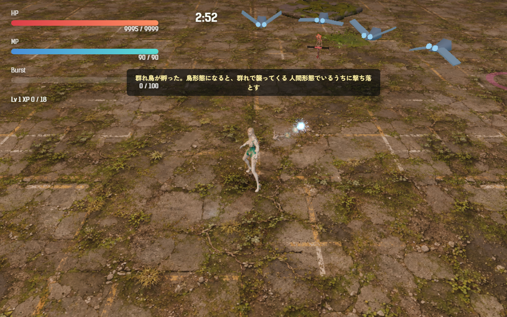
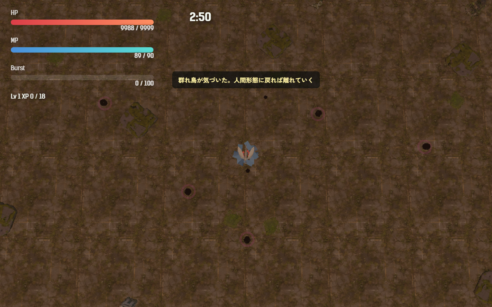

# 2026-11-05（サイクル 15）

## 今日やったこと
- A: **E14 の残り、群れ鳥**。これで E14（群れ鳥・割れ殻）は両方できた。
  - 新しい敵の種類 `swarmbird`（`src/entities.js`）。細い円錐の胴と左右の羽（羽ばたく）、光る目の小さな鳥。体は青みがかった灰色。
  - **卵1つから4羽の群れが孵る**。2羽目以降は敵の上限を超えても出す（群れが欠けないように）。同時に2群れまで。
  - **出す章は第2章（60 秒以降、卵から孵る敵の 8%）にした**（判断待ちの1）。第2章の新種の足跡は「鳥で飛ぶと見失う」ので、「鳥で逃げると群れ鳥に襲われる」と組み合わせるため。割れ殻（第3章）とは章を分けた。
  - **人間形態の間**: 群れごとプレイヤーの周り（半径 9、高さ 3.2）を遠巻きに回るだけで、襲わない。自動射撃（射程 12）で撃ち落とせる。HP 18、経験値 3。
  - **鳥形態になると**: 0.6 秒で気づいて目が赤くなり、速さ 15.5 で鳥の高さ（8.5）まで上がってくる。追いつくとプレイヤーのすぐ周りを回りながら当たる（1羽 2 ダメージ、1.2 秒ごと）。鳥形態のカメラは高く引くので、襲っている間は体を 1.6 倍に大きくする。
  - 人間形態に戻ると、また遠巻きに戻る。
  - 鳥形態は常に前へ飛ぶので、最初の速さ 12.2 では追いつけなかった。15.5 にしたので、キイチゴ（16.1）だけは振り切れる。
  - 初めて孵ったときに「群れ鳥が孵った。鳥形態になると、群れで襲ってくる／人間形態でいるうちに撃ち落とす」、初めて気づいたときに「群れ鳥が気づいた。人間形態に戻れば離れていく」。
  - 調整と無効化は `Config.enemy.swarmbird`（`enabled: false` で出なくなる）。孵化予報（今は無効）の新種にも足した。テスト2件を追加（`tests/swarmbird.test.js`）。ボットの結果に `swarmbirds`（群れの数・羽数・気づいた回数・当たった回数・実際に減った HP）を出す。
- B（木・3D）: **群れ鳥と割れ殻の Tripo 用の元絵を Forge で作ろうとしたが、失敗**。
  - Forge は起動した（156 秒）が、最初の生成のモデル読み込みで黙って落ちた（呼び出し側は `ECONNRESET`、ログはモデル一覧の取得で止まる）。
  - 原因は空きメモリと見ている。31 GB 中 2.6 GB しか空いていなかった（Photoshop が 15.5 GB）。ユーザーのアプリなので閉じず、再試行もしなかった。Forge のプロセスが残っていないことは確かめた。
  - ジョブ（sd_xl_base_1.0。商用 ○ のモデルにした。群れ鳥3枚・割れ殻3枚）は `assets_src/3d/2026-11-05-swarmbird-splitshell/jobs.json` に置いたので、次の 3D の日にそのまま流せる（backlog B1-8）。
  - 起動前に空きメモリを確かめる手順を `asset-pipeline.md` に足した。台帳にも失敗を記録した。

## 確認結果
- npm test / build: 67 件すべて成功／ビルド成功
- プレイ確認: 開発サーバー（5183）を起動し、Playwright（Edge）で第2章にアカメで入った。群れを1つ孵らせて、人間形態 → 鳥形態 → 人間形態と切り替えた（確認のため HP を大きくし、鳥形態のときはプレイヤーを同じ場所に留めた）。ページのエラーなし、読み込みの失敗なし。
  - 人間形態: 4羽が距離 8〜10 の高さ 3.2 を回る。最初の説明が出ている。2.5 秒のうちに自動射撃で1羽落ちた:
    
  - 鳥形態: 約 1 秒で4羽とも高さ 8.5 まで上がってプレイヤーの周り（距離 1.1）を回り、当たり始めた（2 秒で 16 回）。人間形態に戻ると距離 8〜10 に戻り、当たらなくなった:
    
- 数値（ボット3回ずつ、ツキミ、第2章、`--speed 6`）:

  | 設定 | 結果 | 被ダメージ | うち群れ鳥 | 平均 Lv |
  |---|---|---|---|---|
  | 群れ鳥なし | 全敗（231・239・241 秒で倒れる） | 226〜233 | — | 11.3 |
  | 最初の設定（3 ダメージ・1 秒ごと） | 全敗（222〜242 秒） | 227〜499（平均 340.7） | 89〜283 | 11.3 |
  | **今の設定（2 ダメージ・1.2 秒ごと）** | 全敗（227・237 秒で倒れ、1回は時間切れ） | 241〜354（平均 292.7） | 43〜158 | 11.3 |

  - 群れは1回の戦闘で 7〜8 回孵る。ボットは卵を食べに鳥形態をよく使うので、群れ鳥の被ダメージは人より多めに出ているはず。手応えは A32 で人が遊んで確かめる。
  - 第2章はもともとボットが勝てない（群れ鳥なしでも全敗）。

## 判断待ち（ユーザーへ）
1. **群れ鳥を出す章**: 今は第2章から（足跡と組み合わせるため）。このままでよいか、別の章にするか、E6「卵は学ぶ」を進めて「鳥形態を長く使う人にだけ増える」にするか。元に戻すときは `Config.enemy.swarmbird.enabled: false`。割れ殻（第3章）の章の判断（前回の1）と合わせて決めてほしい。
2. **群れ鳥を第2章で遊んでみてほしい**。気になる点: (1) 鳥で卵を食べに行く前に「先に群れを落とそう」と思えるか、(2) 襲われたときの痛さ（ボットでは被ダメージが 1.1〜1.5 倍）、(3) 鳥形態の高いカメラで群れが見えるか。
3. **Tripo に渡す元絵（B1-8）**: 今日は Forge がメモリ不足で落ちて作れなかった。次の 3D の日（月曜）に、空きメモリがあれば流す。そのとき Photoshop などが重いと同じことになるので、生成したい日はそれだけ覚えておいてほしい。
4. 前回までの判断待ち（割れ殻の章と手応え、画風の基準のモデル、吸水根・群れの母の手応え、Tripo で作る敵とクレジットなど）は回答がないので保留のまま。

## 次にやること
- A: E15 白蓮の核（最終章のボス）の第1・第2段階。6枚の花弁がそれまでの新種を産み、壊すと核が開く。大きいので、まず花弁と核の仕組みだけを作る。
- B（金・音声）: Irodori-TTS。B3-6 の手順（手本の声を `refs` に指定）で、まだ無い声を作る。
