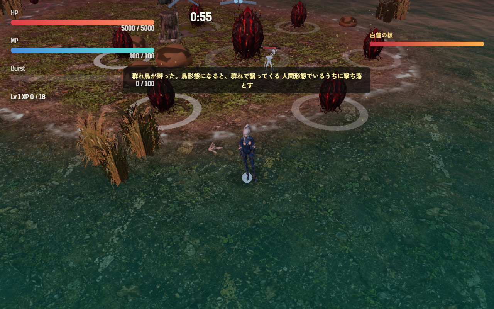
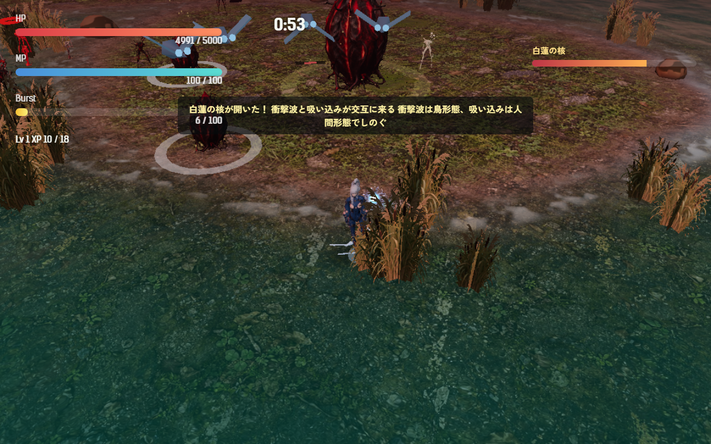
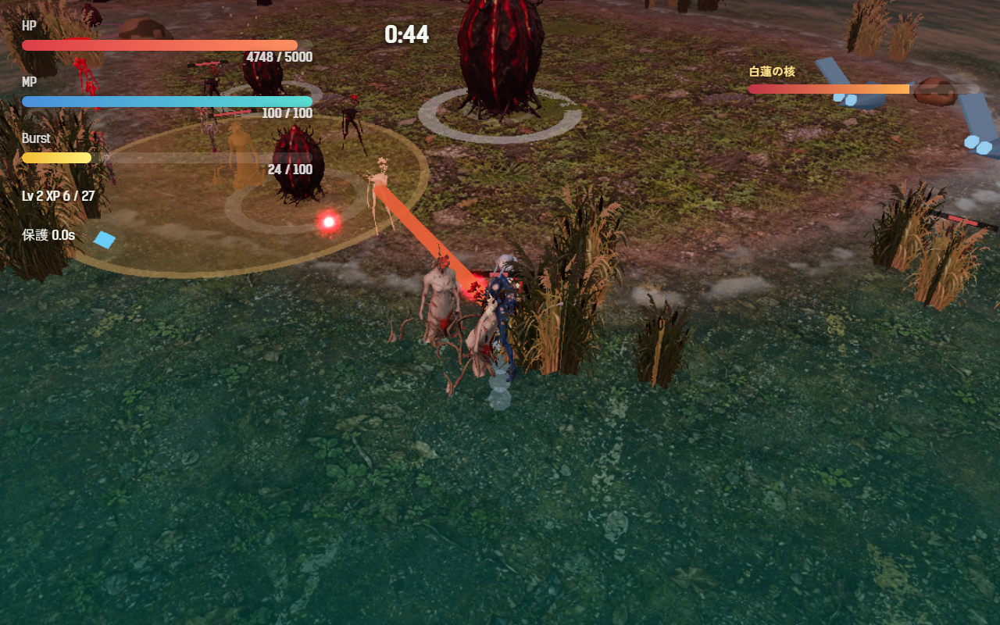

# 2026-11-06（サイクル 16）

## 今日やったこと
- A: **E15 白蓮の核（最終章のボス）の第1・第2段階**。
  - ボスの種類 `whiteLotusCore`（`src/bosses.js`）。画面の名前「白蓮の核」。核の周り（距離 8）に花弁を6枚置く。体は今のところ母卵を半分の大きさにしたもの（見た目は仮。下の判断待ち）。
  - **第1段階（閉じた核）**: 核は狙えない（弾も当たらず、画面外の矢印は一番近い花弁を指す）。花弁はそれぞれ、それまでの章の新種を 11 秒ごとに産む（1枚につき同時に2体まで、敵の上限を超えても出す）。
    - 花弁と新種: 足跡・群れ鳥・割れ殻・鳴き・手・吸水根（擬態卵は卵なので入れていない）。`Config.enemy.<種類>.enabled: false` にした新種の花弁は追いかけ役を産む。
    - 花弁の HP は母卵の 0.14 倍×章の倍率（第6章は 67）。核は母卵と同じ（480）。HP バーは核と花弁の合計。
  - **第2段階（開いた核）**: 花弁を4枚壊すと核が開く（6枚全部ではないので、どの新種を残すかを選べる）。開いた核は**衝撃波**（母卵と同じ。鳥形態でかわす）と**吸い込み**を交互に出す。
    - 吸い込み: 1.4 秒の予兆（「白蓮の核が息を吸う／鳥形態だと引き寄せられる。人間形態で踏みとどまれ」）のあと 3 秒、範囲 30 のプレイヤーを核へ引き寄せる。鳥形態は 7.5、人間・魚形態は 1.4 の速さ。核に触れると 0.6 秒ごとに 8 ダメージ。「衝撃波は鳥、吸い込みは人間」で形態の切り替えを逆向きに求める。
    - 残った花弁は産み続ける。
  - **第6章は水が多い地図**なので、最初は花弁が全部水の上と判定されて核の中心に重なった。水中では鳥になれず（魚になる）衝撃波を避けられないので、核は「花弁が全部陸に乗る陸地」のうち、プレイヤーから一番遠い所に置くようにした。
  - 見た目: 花弁は白い輪がゆっくり揺れ、産む直前に輪が明るくなる。核は閉じている間は小さく薄い輪、開くと大きくなって金色の輪が脈打ち、吸い込みの間は白い輪が縮む。
  - 調整と無効化は `Config.boss.whiteLotusCore`（無効にするには第6章の `boss` を `motherEgg` に）。テスト5件（`tests/white-lotus.test.js`）。以前「白蓮の核はまだ無い」を例にしていたテスト2件は、架空の種類名に書き換えた。ボットの結果に `lotus`（産んだ数・壊した花弁・開いた時刻・衝撃波・吸い込み・噛まれた回数）を出す。ボットは閉じた核を狙わないようにした（`getBossTargets` を見る）。
- B（金・音声）: **ボスを倒したときの一言**を3人分作ってゲームに入れた（`assets/audio/voice/<キャラ>/boss_down_01.mp3`）。どの章でもボスを倒した瞬間に鳴る。`Config.audio.bossDownVoice: false` で鳴らない。
  - 台詞（口調は `docs/story-direction.md` の「台本上の声」に合わせた短い掛け声）:
    - ツキミ「……止まった。終わった、の？」（「どうして」を口にする、問いの人）
    - アカメ「片付いた。次。」（感想を言わず、短く言い切る）
    - キイチゴ「よっしゃ、割ってやった！」（軽口）
  - 手本の声（`refs`）＋各3シードで9本作り、文字起こしと声の高さ・画像で1本ずつ選んだ（理由は台帳）。キイチゴは3本中2本が「割って」→「終わって」と聞き取られたので、唯一「わってやった」と聞こえた 3603 にした。
  - 生成は約 4 分（Irodori の `.venv` に whisper が無かったので、文字起こしは transformers の pipeline で。asset-pipeline.md に追記）。Irodori のプロセスは終了済み。

## 確認結果
- npm test / build: 72 件すべて成功／ビルド成功
- プレイ確認: 開発サーバー（5183）を起動し、Playwright（Edge）でツキミで第6章に入り、時計を 179.5 秒に進めてボスを出した（確認のため HP 5000）。ページのエラーなし、読み込みの失敗なし。
  - 第1段階: 花弁6枚が核から距離 8 に並び、狙える対象は花弁の6つだけ（閉じた核は入らない）。5 秒で足跡と群れ鳥が孵った:
    
  - 花弁を4枚壊すと「白蓮の核が開いた！」が出て、核が狙えるようになった（HP バー 70%）:
    
  - 吸い込み: 人間形態で距離 14 から 1 秒で 12.6 まで引かれた（1.4／秒のとおり）。鳥形態での確認は、その場所が水の上で魚になってしまったのでできなかった（引く量は単体テストで確認）。衝撃波 → 吸い込みの順で交互に出た:
    
  - 核を壊すと勝利になり（第6章の結果の文）、`bossDown` の声が呼ばれた。
- 数値（ボット3回ずつ、ツキミ、第6章、`--speed 6`）:

  | 設定 | 結果 | 倒れた時刻 | 被ダメージ | Lv | 花弁が産んだ数 | 壊した花弁 |
  |---|---|---|---|---|---|---|
  | `--start 170`（Lv1 でボスへ） | 3敗 | 217.8・230・（240 時間切れ） | 105〜130 | 3 | 12〜14 | 0 |
  | 最初から | 3敗 | 150.7・177.3・239.2 | 117〜301 | 8〜9 | 10（ボスまで行けた1回） | 0 |

  第6章はボットにはまだ難しく（3回中2回はボスの前に倒れる）、花弁を壊すところまで行かない。第4章の群れの母と同じ状況で、手応えは人が遊んで見るしかない（A33）。

## 判断待ち（ユーザーへ）
1. **白蓮の核を最終章で遊んでみてほしい**（第6章は F2 で選べる）。気になる点: (1) 花弁の重さ（1枚 67、開くまで4枚）、(2) 「どの新種の花弁から壊すか」を選ぶ気になるか、(3) 「衝撃波は鳥、吸い込みは人間」が分かるか、吸い込みの強さ（鳥 7.5／人間 1.4）。元に戻すときは第6章の `boss` を `motherEgg` に。
2. **白蓮の見た目**: 今は花弁も核も母卵と同じ赤い卵（大きさと輪の色だけ違う）で、「白い蓮」には見えない。(a) 白い板の花弁を6枚組んだ仮の形をコードで作る、(b) Tripo で花弁と核を作る（元絵を次の 3D の日に用意。1体 120 クレジット×2体の見込み）、のどちらにするか。
3. **ボスを倒したときの一言を聞いてみてほしい**（`assets/audio/voice/<キャラ>/boss_down_01.mp3`）。ツキミの「止まった」と「終わった、の？」の間に約 1 秒の間がある（「……」の間）。長ければ詰める。台詞を変えたいときは文案をもらえれば作り直す。
4. 前回までの判断待ち（群れ鳥・割れ殻の章と手応え、画風の基準のモデル、吸水根・群れの母の手応え、Tripo で作る敵とクレジットなど）は回答がないので保留のまま。

## 次にやること
- A: E16 白蓮の第3段階と影法師（残り時間が少なくなると、選んだキャラの黒い写しが孵り、こちらと逆の形態で戦う）。
- B（土・動画/SNS）: 白蓮の核の場面を `--record` で撮って、ハイライトに使えるか見る（ボットは花弁を壊せないので、確認用に壊した状態から撮るかも検討）。
