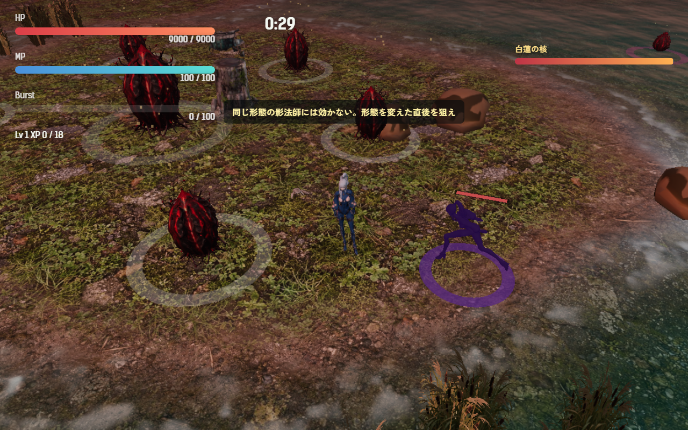
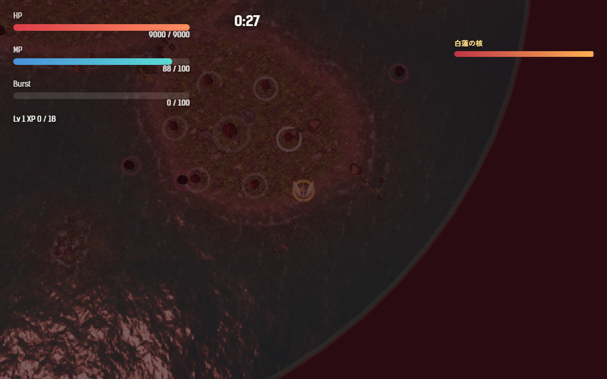

# 2026-11-07（サイクル 17）

## 今日やったこと
- A: **E16 白蓮の第3段階と影法師**（最終章）。
  - 残り時間が 30 秒になると、白蓮の核から**影法師**が1度だけ孵る（花弁が残っていても、核が閉じていても）。敵の種類 `shadow`、HP 260。
  - 体は**選んだキャラの人間形態と鳥形態の写し**を暗い紫に塗ったもの（`SkeletonUtils.clone`）。人間形態はキャラの走りの動きをそのまま流す。鳥形態は鳥のカメラで見えるよう 1.7 倍・明るめ。
  - **こちらの形態を 1.4 秒遅れで真似る**（魚形態は鳥の側に数える。遅れの間に戻すと真似をやめる）。
    - **同じ形態のとき**: 影法師はこちらに当たる（人間どうしは地上で、鳥どうしは高さが近いときだけ。14 ダメージ、0.9 秒ごと）。こちらの攻撃は灰色の火花で弾かれ、「同じ形態の影法師には効かない。形態を変えた直後を狙え」と出る。足元の輪は紫。
    - **逆の形態のとき**（形態を変えた直後の 1.4 秒）: 影法師はこちらに当たらず、攻撃が通る。足元の輪が金色に広がり、体が脈打つ。鳥になった直後は地面を走る影法師へ自動で急降下する（範囲 7。急降下の予兆＋落下 0.83 秒は遅れ 1.4 秒より短い）。人間に戻った直後は、まだ飛んでいる影法師を射撃で撃てる。
  - 影法師が生きているあいだは**核へのダメージが半分**（`shadowCoreDamageScale`）。倒すと HP を 15% 回復し、「影法師がほどけた。核の守りが消えた」。
  - 設定は `Config.enemy.shadow`（`enabled: false` で出ない）と `Config.boss.whiteLotusCore.shadowAtRemaining`・`shadowCoreDamageScale`。テスト5件（`tests/shadow.test.js`）。ボットの結果の `lotus` に `shadowAt`・`shadowDownAt`・`shadow`（当てられた回数、受けたダメージ、弾いた回数、真似た回数）を出す。
- B（土・動画/SNS）: **週の進捗素材（B6-2 の2回目）**を `promo/2026-11-07/` にまとめた（投稿はしていない）。
  - 並べ画像 `weekly-grid.png`: 今週ふえた7種（手・群れの母・吸水根・割れ殻・群れ鳥・白蓮の核・影法師）＋開いた白蓮の核の8枚。
  - 縦動画 `weekly-9x16.mp4`（約19秒、音なし）: 花弁が新種を産む → 核から影法師が孵る → 形態を変えた直後だけ攻撃が通る。花弁はボットの録画（`--start 172`）。ボットは影法師の近くに行かず水に入ってしまったので、影法師は確認用の台本（プレイヤーの被ダメージ 0、影法師 HP 200、2〜2.6 秒ごとに形態を切り替える）で録った。
  - 投稿文の案 `post.md`（案A 7種の一覧／案B 影法師だけ／案C 白蓮の核）。

## 確認結果
- npm test / build: 77 件すべて成功／ビルド成功
- プレイ確認: 開発サーバー（5183）を起動し、Playwright（Edge）でツキミで第6章に入り、時計を進めてボスと影法師を出した。ページのエラーなし。
  - 孵ってすぐ（同じ人間形態）: 撃っても HP 260 のまま、弾いた一言が出た。核の被ダメージ倍率 0.5:
    
  - 鳥になると、影法師は 1.4 秒人間のまま → 金の輪になり、急降下が当たって 260 → 170。2 秒後には影法師も鳥になって鳥の高さ 8.5 へ:
    
  - 人間に戻した直後（影法師はまだ鳥）に 30 ダメージが通った（170 → 140）。3 秒後には影法師も人間に戻った。
  - 倒すと核の倍率が 1 に戻り、HP が最大の 15% 回復した（数値で確認。倒した瞬間の画面は、同時にレベルアップの選択画面が出て写らなかった）。
- 数値（ボット3回、ツキミ、第6章、`--start 170`、`--speed 6`）: 3敗（222.7・223.7・224.1 秒）、被ダメージ平均 126、Lv 2〜5。影法師は3回とも 210 秒に孵った。ボットは影法師を狙わない（当てられた回数 0〜7）。花弁は0枚のまま（前回と同じ）。

## 判断待ち（ユーザーへ）
1. **影法師を遊んでみてほしい**（第6章、残り 30 秒）。気になる点: (1) 「形態を変えた直後の 1.4 秒だけ攻撃が通る」が分かるか（遅れは `Config.enemy.shadow.mirrorDelay`）、(2) HP 260 と、生きている間の核の守り（半分）が重すぎないか（第6章のボス戦は 60 秒しかなく、残り 30 秒で出る）、(3) 切り替えを繰り返すので MP が足りるか。
2. **水の上での影法師**: 第6章は水が多く、水の上で鳥になろうとすると魚になるため、射撃も急降下もできない時間ができる。(a) このままにする（陸に上がって戦う判断）、(b) 影法師を陸の上だけ追わせる、のどちらがよいか。
3. **影法師の見た目**: 今はキャラの写しを暗い紫に塗っただけ。「黒い抜け殻」らしく、ひび割れや白い目などの印を足すか。
4. **SNS の案B**（「最後の敵は、自分と同じ体」）は物語の伏線（最後の敵は三人と同じ体）に触れる。出してよいか、ネタバレとして避けるか。
5. 前回までの判断待ち（白蓮の核の手応えと見た目、ボスを倒したときの一言、群れ鳥・割れ殻の章、画風の基準のモデル、Tripo で作る敵とクレジットなど）は回答がないので保留のまま。

## 次にやること
- A: E16 で敵とボスの E 項目は E17（`[?]`、承認待ち）を残して終わり。次は A2（ボットの数値で現状を診断し `balance-report.md` にまとめる）。
- B（日）: 前回の日曜（11-01）は素材の手直しだったので、今回は動くアバター（Mesh Avatar Studio）。あわせて週の振り返り。
