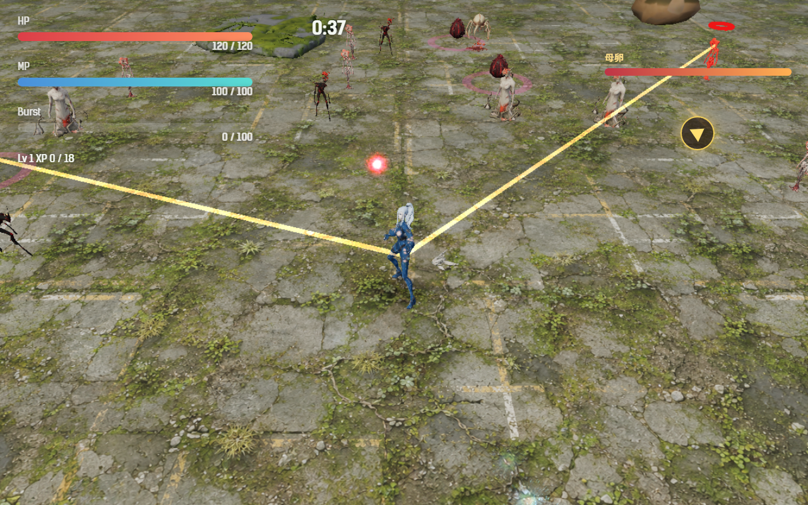

# 2026-11-08（サイクル 18）

## 今日やったこと
- A: **A2 難しさの診断**。結果は `docs/dev-cycle/balance-report.md`。
  - ボット（`scripts/bot-play.mjs`）に、**どの敵・攻撃で HP が減ったか**（`damageBySource`・`damageLog`）と、10 秒ごとの撃破数・経験値・被ダメージを足した（A11 の「死因の内訳」）。ゲームのコードは変えていない（テスト用の応答の中だけで関数を包む）。
  - 集計スクリプト `scripts/bot-report.mjs` を作った（章×キャラの結果、章ごとの被ダメージの内訳、10 秒ごとの静かな時間帯、倒れた回の最後の 10 秒、強化を取った回・取らなかった回の比較を Markdown の表で出す）。
  - 3人 × 全6章 × 3回 = 54 回を回した。分かったこと:
    - **54 回すべて負け**（倒れた 44、時間切れ 10）。母卵は毎回 180 秒に出るが、60 秒で倒せない。
    - **退屈な時間帯は最初の 90 秒**。0〜60 秒の撃破は 10 秒で 1.7〜3 体（終盤の 5 分の 1 以下）、攻撃もほぼ受けない。どの章も同じ立ち上がり。
    - **理不尽な死はボス戦中の狙撃手の重なり**。倒れた 44 回中 29 回は、最後の 10 秒の被ダメージの半分以上が狙撃手。狙撃手は母卵と同時（180 秒）に増え、2〜4 方向からビームが来る。しかも鳥形態は当たり判定が大きい（1.8、人間 0.85）ので、**衝撃波を鳥でかわすと狙撃手に撃たれやすい**。
    - **強すぎる強化は見えない**（差は ±12 秒以内）。最大MP・MP回復は効果が見えない（ボットが MP をあまり使わないため）。
    - **キイチゴが弱い**: 18 回すべて倒れ、撃破数は最少。
  - 調整はしていない（案を判断待ちに出した）。新しい課題を backlog に追加: A35 狙撃手の重なり（`[?]`）、A36 キイチゴ、A37 アバターの読み込み。
- B（日・動くアバター）: **B5-5 会話画面のアバターの重さ（スマホ相当）と警告の確認**。
  - 計測スクリプト `scripts/check-avatar-weight.mjs` を作った。390×844 のタッチ画面で CPU を遅くし、プロローグを AUTO で 8 秒進めて、アバターあり・なしを比べる。
  - 結果（CPU 4 倍遅く）:

    | | 1秒のコマ数 | コマの間隔（中央／95%） | 50ms を超えたコマ | メモリ | 出そろうまで |
    |---|---|---|---|---|---|
    | アバターあり（開発サーバー） | 57〜59.4 | 16.7／16.8 ms | 0〜3 | 73〜118 MB | 11.1〜12.8 秒 |
    | アバターなし（開発サーバー） | 59.1〜59.5 | 16.7／16.8 ms | 1〜2 | 28 MB | - |
    | アバターあり（ビルド版） | 59.1〜59.5 | 16.7／16.8 ms | 1 | 88〜93 MB | 10.6〜11.2 秒 |

    CPU 6 倍遅くではビルド版で出そろうまで 20.7 秒、遅くしないと 2.0 秒。
  - 結論: **動き出してからの重さは問題なし**（3枚の WebGL でもコマ落ちしない。ただし GPU はこのパソコンのもの）。メモリは 45〜90 MB 増える。**問題は読み込みの遅さ**で、スマホではプロローグの最初の数行が静止画のまま、途中でアバターに切り替わる。CPU に比例して遅くなるので、読み込み（画像の展開や網の作成）が重い。→ A37。
  - 警告「eye / mouth sprites not loaded」は、表示部品が描き分け画像（`sprites/sprites.json`）を毎回探して 404 になるため。描き分け画像（B5-4）を作るまで消えない。動きに影響はないので、表示部品（複製したもの）は書き換えていない。

## 確認結果
- npm test / build: 77 件すべて成功／ビルド成功
- プレイ確認: 開発サーバー（5183）を起動し、Playwright（Edge）でツキミの第1章を 200 秒まで進めて狙撃手を確認した（確認のため被ダメージを 0 にした）。202 秒で2体が同時にビームを撃っていた（左の1体は画面の外）。ページのエラーなし。
  
- 数値: 上の 54 回（`tmp/bot/a2/`、集計 `node scripts/bot-report.mjs tmp/bot/a2`）。章ごとの1回あたりの被ダメージは 180〜264、平均レベルは 180 秒で 6.9〜9.7。

## 週の振り返り（サイクル 12〜18、11/02〜11/08）
- **できたこと**
  - 敵とボスの E 項目が、承認待ちの E17 を除いて**すべて終わった**。今週: 群れの母（第4章のボス、E12）、吸水根（第5章、E13）、割れ殻（第3章）・群れ鳥（第2章、E14）、白蓮の核（最終章のボス、第1・2段階、E15）、影法師（第3段階、E16）。これで6章すべてにボスと新種がある。
  - 素材: 手の Tripo 用の元絵、新種の効果音3つ、ボスを倒したときの一言（3人分）、週の進捗素材の2回目。
  - 今日、初めてボットで全章をまとめて診断し、負ける理由を数値で言えるようになった。
- **うまくいかなかったこと・気づき**
  - ボットは1回も勝てない（第1章も）。新種を足した分、全章が難しくなったままで、勝ち負けでは手応えを比べられない。今日の診断では、原因の一番は新種ではなく**ボス戦中の狙撃手**だった。
  - イラスト（画風の基準、10 枚すべて不採用）と 3D の元絵（Forge がメモリ不足で落ちた）が進まなかった。Photoshop などが開いているとメモリが足りない。
  - 判断待ちがさらに増えた（遊んだ感想が中心）。
- **来週の方針**
  - A は新しい敵を足すのをいったん止め、**A35（狙撃手の重なり）の承認をもらって直し、A5（波と小休止、最初の 90 秒）**へ。ボットに狙撃手の予兆を避けさせ（A11）、1回でも勝てる状態にしてから、引き継ぎ強化（A17）や新種の手応え（A23〜A34）を見る。
  - B は月・木の 3D をユーザーの Tripo の判断待ちのまま元絵づくり、水のイラストは Forge の前に空きメモリを確かめる。

## 判断待ち（ユーザーへ）
1. **ボス戦中の狙撃手（A35）をどう直すか**。案: (a) 母卵が出ている間は、同時にビームを撃つ狙撃手を1体までにする（おすすめ。見た目は変わらない）、(b) 鳥形態の当たり判定を 1.8 → 1.2 に小さくする、(c) 210・225 秒の波の狙撃手を1体ずつに減らす。組み合わせても良い。
2. **最初の 90 秒が単調**（A5 で直す予定）。案: (a) 最初の波を 35 秒 → 15〜20 秒に早める、(b) 第2章以降は最初の敵と卵を多くする（第1章は今のまま）、(c) 50〜60 秒と 140〜150 秒の谷に小さな波を足す。進めてよいか、方向の希望があれば。
3. **キイチゴが弱いと感じるか**（ボットでは 18 回すべて倒れ、撃破数が最少）。人が遊んでも弱ければ A36 で調整する。
4. **アバターの読み込み（A37）**: スマホではプロローグの最初の数行が静止画で、途中からアバターに変わる。タイトル画面で先に読み込む方向で直してよいか。
5. 前回までの判断待ち（影法師の手応え・水の上・見た目・SNS の案B、白蓮の核の手応えと見た目、群れ鳥・割れ殻の章、画風の基準のモデル、Tripo で作る敵とクレジットなど）は回答がないので保留のまま。

## 次にやること
- A: A35 は承認待ちなので、次は A3（手触り: ヒットストップ、撃破時の小さな揺れ、被弾時の縁の赤み。設定で無効化できる形）。A35 の承認が来たらそちらを先に。
- B（月・3D）: Tripo に渡す元絵（B1-8 群れ鳥・割れ殻の続き。Forge の前に空きメモリを確認）。
