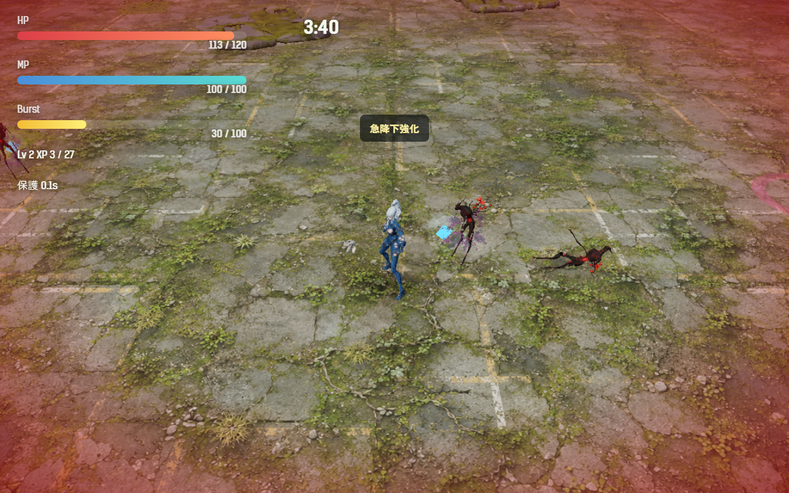
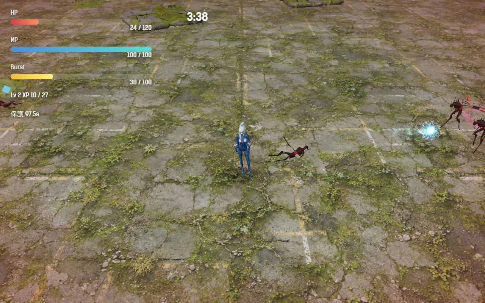

# 2026-11-09（サイクル 19）

## 今日やったこと
- A: **A3 手触り**（A35 は承認待ちのため、次の未着手の A3）。設定は `Config.feel`（`src/config.js`）。`enabled: false` か URL の `?feel=0` で、3つとも消えて元の揺れに戻る。
  - **ヒットストップ**: 敵を倒した瞬間 0.025 秒、湧き手・影法師は 0.06 秒、卵を壊すと 0.03 秒、被弾で 0.07 秒、世界の速さを 5% に落とす。バーストで一度に何体も倒しても止まりすぎないよう、撃破と卵の分は 0.12 秒（ゲーム内の時間）に1回まで、長さの上限は 0.09 秒。カメラ・HUD・入力は止めない。
  - **小さな画面揺れ**: 撃破 0.07、湧き手・影法師の撃破 0.16、卵 0.1。被弾は 0.18 → 0.26 に少し強めた。`shake.scale` でまとめて強さを変えられる（0 で無し）。
  - **被弾時の画面の縁の赤み**: 被弾の直後に赤い縁（強さ 0.75）が出て 0.5 秒で消える。HP が 30% を切ると、縁がうっすら脈打ち続ける（強さ 0.28）。防護膜で防いだときは出ない。
  - テスト `tests/feel.test.js` を追加（被弾・撃破から入口が呼ばれること、ストップが短いこと）。
- B（月・3D）: **B1-8 群れ鳥・割れ殻の元絵は今日も見送り**。空きメモリが 31 GB 中 3.2 GB（Affinity 6.9 GB・Photoshop 5 GB が開いている）で、`asset-pipeline.md` の「10 GB を切ったら翌日に回す」に当たるため Forge を起動しなかった（ユーザーのアプリは閉じない）。ユーザーが Tripo から作った新しい GLB も見当たらなかった（`assets_src/3d/`、ダウンロード）。

## 確認結果
- npm test / build: 80 件すべて成功／ビルド成功
- プレイ確認: 開発サーバー（5183）を起動し、Playwright（Edge）でツキミの第1章を遊んで確かめた。ページのエラーなし。
  - 敵を1体倒すと、ヒットストップ 0.025 秒・揺れ 0.07 が入り、その 79 ms の間にゲームは 0.050 秒だけ進んだ（止まっていた分だけ遅れる）。
  - 被弾すると、ヒットストップ 0.07 秒・揺れ 0.26・赤い縁（直後の不透明度 0.72）。

    
  - HP 20% のときの縁の脈（不透明度 0.25 前後）:

    
- 数値（ボット5回、ツキミ・第1章、`--speed 6`）:

  | | 結果 | 平均被ダメージ | 平均レベル | 倒れた時刻 |
  |---|---|---|---|---|
  | 手触りあり | 5 回とも負け（倒れた 4、時間切れ 1） | 209.2 | 10 | 219〜237 秒 |
  | 手触りなし（`?feel=0`） | 5 回とも負け（倒れた 5） | 240.8 | 11 | 214〜242 秒 |

  差はばらつきの範囲。ヒットストップでゲームの進み方が少し変わるので、同じシードでも別の展開になる。難しさは変わっていない。
- メモ: `.claude/launch.json`（ユーザーのファイル）の開発サーバーの設定は、使わなくなった `search_survive_daily` を指したままだったので、今日はコマンドで直接起動した（ファイルは変えていない）。

## 判断待ち（ユーザーへ）
1. **手触りの強さ（A3）**: 遊んでみて、止まり方・揺れ・赤い縁が強すぎ／弱すぎないか。特に (a) 撃破のたびの小さな止まりが「重い」と感じないか、(b) 赤い縁が画面の中ほどまで赤く見える（直後だけ）のが邪魔でないか。強さは `Config.feel` の数字で変えられ、`?feel=0` で比べられる。
2. **3D の元絵（B1-8）の生成の日取り**: Photoshop・Affinity が開いていると空きメモリが足りず Forge を動かせない（11/05、11/09 と2回見送り）。月・木のどちらかで、これらを閉じておいてもらえる日があれば、その日に流す。難しければ、元絵づくりを別の方法（Codex の画像生成など）に切り替えるか決めてほしい。
3. **前回からの判断待ち（回答がないので保留）**: A35 ボス戦中の狙撃手の重なりの直し方（案 a〜c、おすすめは a）、A5 最初の 90 秒の緩急の方向、A36 キイチゴが弱いと感じるか、A37 アバターをタイトル画面で先に読み込んでよいか、ほか前回までの項目。
4. （任意）`.claude/launch.json` の開発サーバーの設定を、今の作業フォルダ（`D:\0001_App_Dev\search_survive`）に向け直してよいか。ユーザーのファイルなので触っていない。

## 次にやること
- A: A35 の承認が来たらそちらを先に。来なければ A4（撃破と取得のフィードバック: 撃破時の破片、経験値の吸い込み、レベルアップ直前の予告）。
- B（火・効果音）: B2 の続き（卵の孵化、母卵出現の警告、残り1分の警告など）か、新種の手応えの項目で挙がった専用の音（水中の噛みつき、殻の割れる音）。
