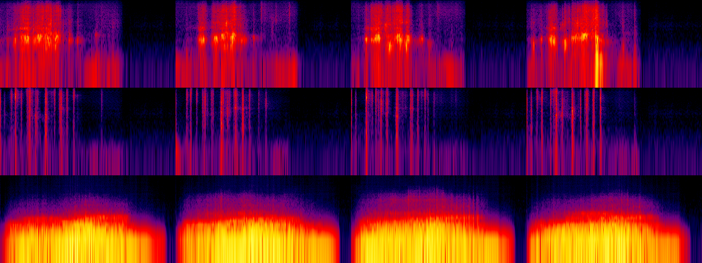
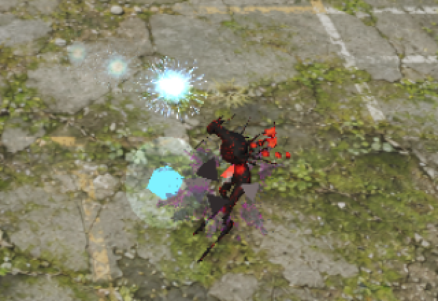
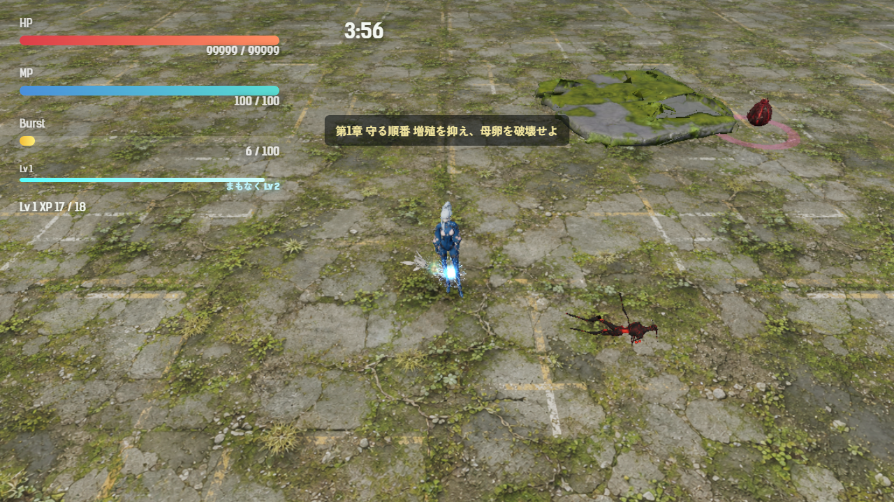
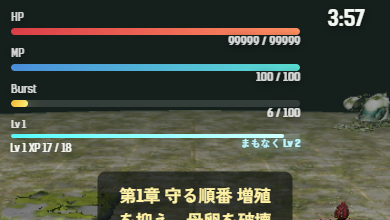

# 2026-11-10（サイクル 20）

## 今日やったこと
- A: **A4 撃破と取得のフィードバック**（A35 は承認待ちのため、次の未着手の A4）。設定は `Config.feedbackFx`（`src/config.js`）。`enabled: false` か URL の `?feedbackFx=0` で、3つとも消えて元の見た目・HUD に戻る。計算は `src/reward-feedback.js` にまとめた。
  - **撃破時の破片**: 敵が消えるときの砂ぼこりに加えて、殻のかけら（暗い灰色2色と赤、普通の敵 5 個・湧き手／影法師／守り手 9 個）が飛び散り、地面で跳ねて 0.6 秒で縮んで消える。形と色は全部の破片で使い回すので、倒すたびに材質を作らない。バーストで一度に倒しても重くならないよう、同時に出す組は 16 まで。遠くの敵（`enemyLodDistance` より外）では出さない。
  - **経験値の吸い込み**: 吸い寄せられ始めてからだんだん速くなる（1 秒で最大 3.2 倍）。プレイヤーの 1.6 以内に入ると小さくなり（最小 45%）、吸い込まれて見える。速くしても行き過ぎて往復しないよう、1 フレームで進む距離を残りの距離までにした。
  - **経験値バーとレベルアップ直前の予告**: HP・MP・バーストの下に細い経験値バー（Lv と「あと N」）を足した。経験値が 85% を超えると、バーが光って脈打ち「まもなく Lv N」に変わる。経験値が入るたびに一瞬明るくなる。下の文字の欄（Lv・XP の行と案内）はその分だけ下げた（スマホ縦向きも）。
  - テスト `tests/reward-feedback.test.js` を追加（吸い込みの速さの上限、近くでだけ小さくなる、行き過ぎない、85% で予告、破片の消え方）。
- B（火・効果音）: **B2-1 の続き。3 つの音を Stable Audio 3 で作って差し替えた**。どれも `Config.audio.newSfx: false` で元の流用に戻る。記録は asset-ledger.md の「2026-11-10 効果音」。
  - `fish_bite.wav`（0.75 秒）: 水門の母を魚形態で噛んだときの音。今までは鳥の捕食音の流用（A25 を閉じた）。
  - `shell_crack.wav`（0.9 秒）: 割れ殻がバーストで割れたときの音。今までは撃破音だけだった（A31 で挙がっていた分）。
  - `swarm_rise.wav`（2.6 秒）: 群れの母の姉妹が起き上がるときの低いうなり。今までは `motherCharge` の流用。
  - 生成: 3 音 × 4 シード、12 本とも正常（振り切れ・一面の雑音なし）。周波数の見比べ（上から噛みつき・殻・起き上がり、左からシード 11・23・37・51）:

    
  - 選んだ理由: 噛みつきは山がいちばん早く短い s37、殻は最初の割れがいちばん強い s37、起き上がりは膨らんで引く形がいちばんはっきりした s11。音の大きさは `normalize-sfx.mjs` でそろえた（殻だけ尖った音のため目標 -15 に届かず -20 LUFS）。
  - 空きメモリが 4.1 GB（ユーザーの ComfyUI・Photoshop・Affinity が起動中）でも生成できた。読み込みが遅く全体で 4 分 11 秒（asset-pipeline.md に追記）。終わるとプロセスごと終わる。

## 確認結果
- npm test / build: 85 件すべて成功／ビルド成功
- プレイ確認: 開発サーバー（5183）を起動し、Playwright（Edge）でツキミの第1章を遊んで確かめた（ページのエラーなし）。終わったあとサーバーは止めた。
  - 敵を倒した 0.12 秒後。死体のまわりに灰色と赤のかけらが飛んでいる（拡大）:

    
  - 経験値 17/18 のとき。経験値バーが光って「まもなく Lv 2」:

    
  - スマホ縦向き（390×844）の HUD。経験値バーは細く、下の文字と重ならない:

    
  - 新しい効果音 3 つを鳴らして、読み込み（200/206）とエラーがないことを確かめた。音そのものは聞けていない。
  - `?feedbackFx=0` では破片が出ず、経験値バーが隠れ、下の文字の欄が元の位置（230px）に戻ることを確かめた。
- 数値（ボット5回、ツキミ・第1章、`--speed 6`）:

  | | 結果 | 平均被ダメージ | 平均レベル | 倒れた時刻 |
  |---|---|---|---|---|
  | フィードバックあり | 5 回とも倒れた | 205.0 | 11.2 | 219〜230 秒 |
  | なし（`?feedbackFx=0`） | 倒れた 4・時間切れ 1 | 183.4 | 10.0 | 189〜227 秒 |

  吸い込みが速くなった分だけ経験値を早く拾い、レベルが少し上がる（+1.2）。被ダメージの差はばらつきの範囲（前回の手触りあり 209.2、なし 240.8）。難しさは変わっていない。
- 気づいたこと: 横向きのスマホ（844×390）は幅が 760 より広いのでパソコン用の大きな HUD になり、画面の 7 割を覆う。前からの問題だが、経験値バーで 1 段増えた。backlog に A40 として足した。

## 判断待ち（ユーザーへ）
1. **撃破と取得のフィードバック（A4）の見え方**: 遊んでみて、(a) 破片が小さすぎ／うるさすぎないか、(b) 経験値の吸い込みの速さ、(c) 経験値バーと「まもなく Lv N」が HUD に増えて邪魔でないか。数字は `Config.feedbackFx`、`?feedbackFx=0` で比べられる。
2. **新しい効果音 3 つ（噛みつき・殻の割れ・起き上がり）**: 音を聞いて、合わないものがあれば教えてほしい（候補は各 4 本ずつ `assets_src/sfx/2026-11-10/` にある）。前回までの鳴き・手・吸水根の音も、まだ耳での確認がない。
3. **前回からの判断待ち（回答がないので保留）**: A3 手触りの強さ、A35 ボス戦中の狙撃手の重なりの直し方（案 a〜c、おすすめは a）、3D の元絵（B1-8）の生成の日取り（Photoshop・Affinity を閉じてもらえる日）、`.claude/launch.json` を今のフォルダに向け直してよいか、ほか前回までの項目。

## 次にやること
- A: A35 の承認が来たらそちらを先に。来なければ A5（敵の出現に緩急をつける。波と小休止）。
- B（水・イラスト）: B4-1 画風の基準づくりの続き（世界の色と塔の形、敵の質感）。空きメモリが 10 GB を切っていたら Forge は起動せず、B4-2 強化アイコンの見直しの下調べに回す。
