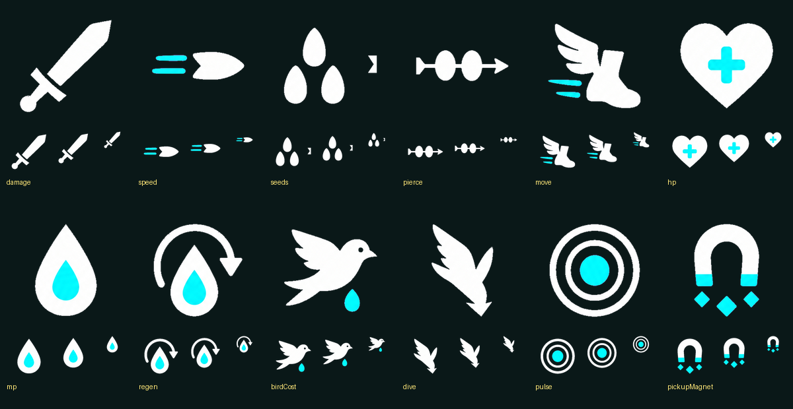
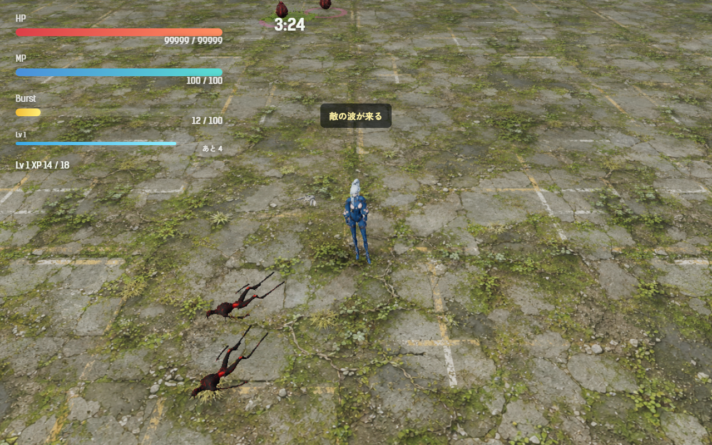
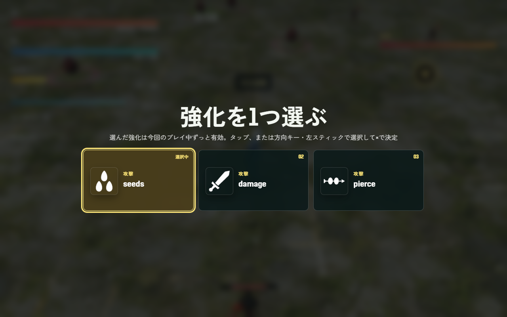

# 2026-11-11（サイクル 21）

## 今日やったこと
- A: **A5 敵の出現に緩急をつける（波と小休止）**（A35 は承認待ちのまま）。設定は `Config.pacing`（`src/config.js`）、計算は `src/pacing.js`。`enabled: false` か URL の `?pacing=0` で元の出方に戻る。balance-report（2026-11-08）の「退屈な時間帯」の案 (a)(c) をもとにした。
  - **小さな波を 3 つ足した**: 18 秒（追いかけ役 2・卵 1）、55 秒（追いかけ役 1・射撃役 1・卵 1）、140 秒（追いかけ役 2・射撃役 1・卵 1）。balance-report で静かだった「最初の 60 秒」「50–60 秒」「140–150 秒」に当てた。敵と卵の上限は元のまま。
  - **波の直後は押し寄せ、そのあと小休止**: すべての波（元からある 35・70・110・150 秒と、上の 3 つ）の直後 8 秒は卵が 1.5 倍早く孵り、続く 7 秒は 0.5 倍。次の波が来たら小休止は切り上げる。0〜180 秒の平均は 1.03 倍で、全体の量はほぼ変えていない。
  - **ボス戦（180 秒以降）は元のまま**。狙撃手の重なり（A35）がある所をこれ以上重くしない。
  - 元からある大きな波（35・70・110・150 秒）では「敵の波が来る」と 1.4 秒出す。新種の説明などほかの文字が出ている間は出さない（上書きしない）。
  - 章が進むほど最初の敵と卵を増やす案 (b) は入れていない（難しさが変わるので、まず緩急だけ）。
  - テスト `tests/pacing.test.js`（6 件: 波の順、押し寄せ→小休止→普通、ボス戦では何もしない、次の波で切り上げ、平均がほぼ 1、小さな波の中身）。
  - ボットの 10 秒ごとの記録に、そのときの段階（`pacing`）を足した。
- B（水・イラスト）: **空きメモリが 5.8 GB（Affinity が起動中）のため Forge は起動せず、B4-2 強化アイコンの見直し**に回した（前回決めたとおり）。生成はしていない。
  - 今ある 12 個を、実際の表示の大きさ（68・58・32 px）で並べて見比べた:

    
  - 画風は 12 個でそろっている（白い形＋シアンの差し色）。Forge で描くより、この型のまま手で直すほうがそろう、と分かった（asset-pipeline.md に書いた）。
  - **`seeds`（種を増やす）の右側に切り残しのかけらがあったので、消して中央に寄せた版 `seeds-clean.png` を作って差し替えた**（左が元、右が直した版）。`Config.visuals.cleanedUpgradeIcons: false` で元に戻る。

    
  - 弱いもの: `speed`・`pierce` は細くて小さい。`damage` は剣（このゲームの攻撃は種の射撃）、`dive` は葉か矢印に見える。引き継ぎ強化 15 個には絵がない。backlog B4-2 に続きとして分けた。

## 確認結果
- npm test / build: 91 件すべて成功／ビルド成功
- プレイ確認: 開発サーバー（5183）を起動し、Playwright（Edge）でツキミの第1章を開いて確かめた（ページのエラーなし）。終わったあとサーバーは止めた。時間を飛ばしながら、段階と孵る速さを読んだ。

  | 時刻 | 段階 | 孵る速さの倍率 | 起きたこと |
  |---|---|---|---|
  | 17.7 秒 | 普通 | 1.85 | — |
  | 18.4 秒 | 押し寄せ | 2.77 | 小さな波（卵 4→5、敵が増える） |
  | 27 秒 | 小休止 | 0.94 | — |
  | 35.5 秒 | 押し寄せ | 2.87 | 元からある波＋「敵の波が来る」 |
  | 45 秒 | 小休止 | 0.98 | — |
  | 52 秒 | 普通 | 2.0 | — |
  | 181 秒 | 普通 | 2.85 | ボス出現。緩急なし |
  - 35 秒の波。画面中央に「敵の波が来る」:

    
  - `?pacing=0` では 18 秒に何も起きず、孵る速さは 1.85→1.93 と元の伸びだけ、一言も出ないことを確かめた。
  - 強化の選択画面で、直した `seeds` のアイコンが出ることを確かめた（確認用に 3 枚を並べたので、名前は id のまま）:

    
- 数値（ボット5回、ツキミ・第1章、`--speed 6`）:

  | | 結果 | 平均被ダメージ | 平均レベル | 撃破数（5回） | 0–60 秒の撃破/10秒 | 60–120 秒 | 120–180 秒 |
  |---|---|---|---|---|---|---|---|
  | 緩急あり | 5 回とも倒れた（218〜239 秒） | 207.2 | 10.8 | 252・127・164・85・144 | 3.1 | 6.0 | 7.8 |
  | なし（`?pacing=0`） | 倒れた 4・時間切れ 1 | 177.0 | 10.0 | 67・50・88・42・83 | 2.4 | 2.4 | 3.2 |

  - 最初の 60 秒の撃破は 2.4→3.1（10 秒あたり）に増え、その間の被ダメージは増えていない（1.6 と 3.1）。狙いどおり、立ち上がりに少しやることが増えた。
  - **ただし撃破数の差（平均 154 と 66）は、緩急の効果だとは言い切れない**。この 2 日間の同じ条件の 5 回の平均は 93〜121 で、1 回ごとに 34〜185 とばらつく。今日の「なし」が低めに出ただけの可能性が高い。被ダメージ（207 と 177）も前回までの幅（183〜241）の中。難しさが大きく変わった様子はないが、5 回では決められない。
  - 1 回目に流した「緩急あり」は、走っている最中に自分がアイコンのコードを編集して開発サーバーが再読み込みし、3 回目で落ちた。編集を終えてからやり直したのが上の数字。README の確認の手順に「ボットが走っている間は `src/` を編集しない」と書き足した。

## 判断待ち（ユーザーへ）
1. **緩急（A5）の手応え**: 遊んでみて、(a) 波の直後に敵が増えて、そのあと一息つけると感じるか、(b) 18 秒の小さな波で最初の 1 分が退屈でなくなったか、(c) 「敵の波が来る」の一言は要るか・言葉はこれでよいか（消すなら `Config.pacing.announce: false`）。`?pacing=0` で比べられる。
2. **強化アイコンの絵柄**: `damage` が剣、`dive` が葉に見える、`speed`（攻撃速度）と `move`（移動速度）が紛らわしい。絵柄を変えてよいか（変えるなら、damage は「大きな種」、dive は「下向きの鳥」などを今の白＋シアンの型で描く）。`speed`・`pierce` を太くする手直しと、引き継ぎ強化 15 個のアイコンは、返事がなくても次の水曜に進める。
3. **前回からの判断待ち（回答がないので保留）**: A4 フィードバックの見え方、新しい効果音 3 つ、A3 手触りの強さ、A35 ボス戦中の狙撃手の重なりの直し方（案 a〜c、おすすめは a）、3D の元絵（B1-8）の生成の日取り（Photoshop・Affinity を閉じてもらえる日）、`.claude/launch.json` を今のフォルダに向け直してよいか、ほか前回までの項目。

## 次にやること
- A: A35 の承認が来たらそちらを先に。来なければ A6（強化の相乗効果。特定の組み合わせで性能が変わる強化を 2〜3 種）。
- B（木・3Dモデル）: 組み込み済みの Tripo の 8 体をゲームの中で見て、大きさ・色・動きの手直し（Blender）。新種の体は 8 体でそろったので、B1-8（群れ鳥・割れ殻の元絵）は閉じてよいかも確かめる。
