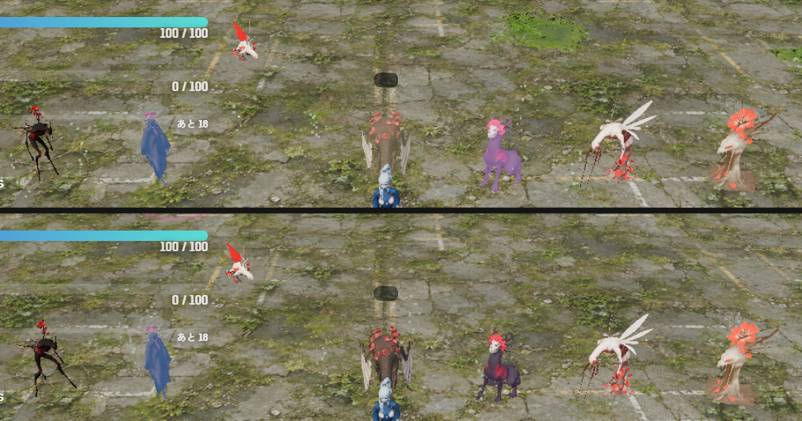
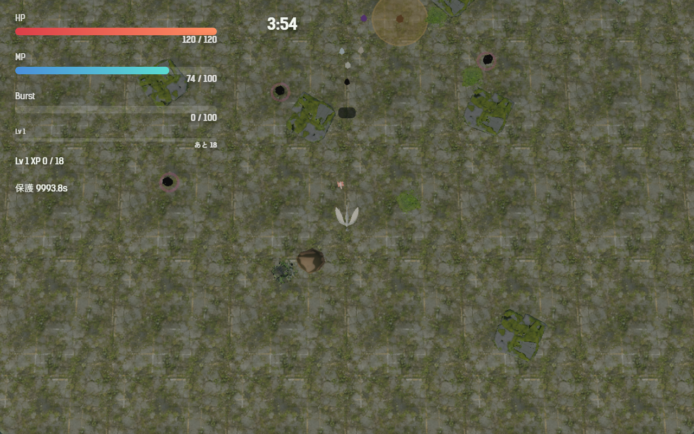
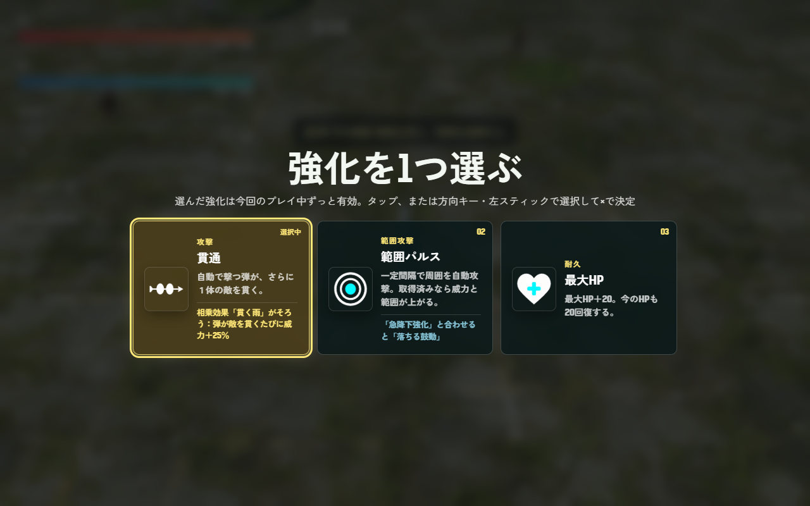
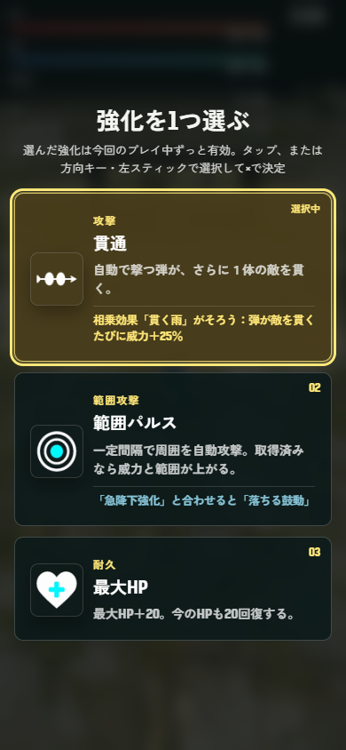
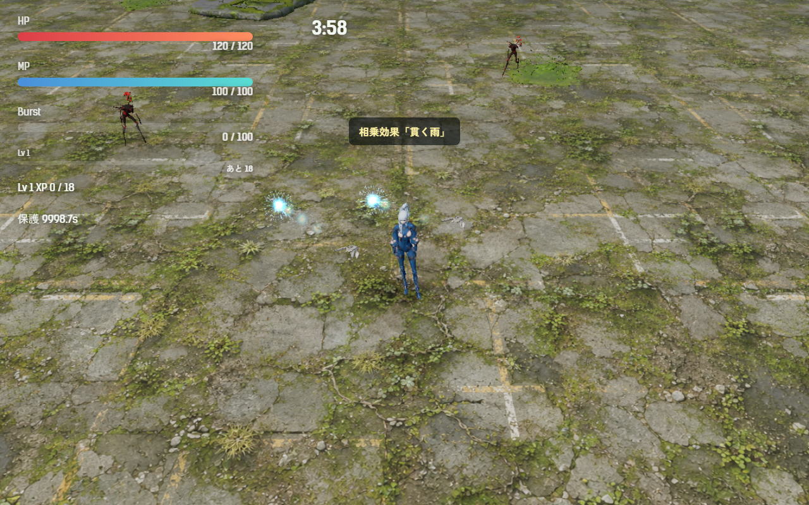

# 2026-11-12（サイクル 22）

## 今日やったこと
- A: **A6 強化の相乗効果**（A35 は承認待ちのまま）。設定は `Config.synergy`（`src/config.js`）、計算は `src/synergies.js`。`enabled: false` か URL の `?synergy=0` で、相乗効果もカードのヒントも出ない（元のまま）。
  - 2 つの強化を両方持つと働く。3 種を入れた:

    | 名前 | 組み合わせ | 効果 |
    |---|---|---|
    | 貫く雨 | 発射弾数 ＋ 貫通 | 弾が敵を貫くたびに威力 +25%（2 体目 1.25 倍、3 体目 1.56 倍） |
    | 落ちる鼓動 | 急降下強化 ＋ 範囲パルス | 鳥形態の急降下の着地で、範囲パルスが 1 回出る |
    | 満ちる水 | 最大MP ＋ MP回復 | MP が 8 割以上のあいだ、自動攻撃の威力 +20% |
  - 「持っているか」は取った回数ではなく、プレイヤーの今の数値で見る。前の章から引き継いだ強化や、章の強化「夜の鼓動」「芽吹く種」でもそろう（「深い呼吸」の最大MP も数える）。
  - **強化の選択肢にヒントを 1 行出す**（`Config.synergy.hints: false` で消える）。相手をもう持っていれば黄色で「相乗効果『貫く雨』がそろう：…」とカードの縁が光り、まだなら水色で「『急降下強化』と合わせると『落ちる鼓動』」、もう働いていれば「働いている」。
  - そろった瞬間は、強化の名前の代わりに「相乗効果『貫く雨』」と 2.4 秒出す。
  - 名前と説明文は自分で付けた仮のもの（台本には触れていない）。
  - テスト `tests/synergies.test.js`（5 件: 3 種とも 2 つの実在する強化でできている、片方だけでは働かない、無効にすると効果もヒントも無い、ヒントの出し分け、数字）。
  - ボットの結果に、そろった相乗効果と時刻、着地のパルスの回数（`synergies`）を足した。
- B（木・3Dモデル）: **組み込み済みの Tripo の体 6 種（足跡・群れ鳥・割れ殻・鳴き・手・吸水根）をゲームの中で並べて見て、色を直した**。生成・Blender の作業はしていない（Tripo へのアップロードもなし）。
  - **鳴きが一面の紫、割れ殻が薄茶に見えていた**。元絵は「黒い体に赤い筋・頭蓋骨の顔」「黒い背に赤い花の帯」だが、普段から乗せている自発光（鳴き 0.2、割れ殻 0.08）が黒い体を塗りつぶしていた。普段の光を鳴き 0.04・割れ殻 0.02 に下げた（`src/entities.js` の `TRIPO_ENEMY_MODELS`）。鳴きが膨らむときの紫の光はそのまま（鳴く前だけ紫になるので、予兆としてはむしろ分かりやすくなった）。上が直す前、下が直した後（左から 追いかけ役・足跡・群れ鳥（上）・割れ殻・鳴き・手・吸水根）:

    
  - 大きさ: 追いかけ役と比べて 6 種とも違和感なし（プレイヤーとほぼ同じ背丈、群れ鳥だけ小さい）。動きも idle・walk が流れている。Blender での作り直しは要らないと判断した。
  - **鳥形態の高いカメラでは、どの敵も 10 px ほどの点になり、種類は見分けられない**（Tripo の体に限らず、元からの敵も同じ）。backlog A42 に足した:

    
  - 新種の体は 8 体でそろったので、B1-8（群れ鳥・割れ殻の Forge の元絵）は閉じた。

## 確認結果
- npm test / build: 96 件すべて成功／ビルド成功
- プレイ確認: 開発サーバー（5183）を起動し、Playwright（Edge）でツキミの第1章を開いて確かめた（ページのエラーなし）。終わったあとサーバーは止めた。
  - 発射弾数を 1 回取った状態で「貫通・範囲パルス・最大HP」の 3 枚を出した。貫通は「そろう」、範囲パルスは「合わせると」、最大HP は何も出ない:

    
  - スマホの幅（390×844）でも 1〜2 行に収まる:

    
  - 貫通を選ぶと「相乗効果『貫く雨』」と出る:

    
  - 働き（ゲームの中で数字を読んだ）:

    | 相乗効果 | 確かめたこと |
    |---|---|
    | 貫く雨 | 自動攻撃の弾に `pierceGain: 0.25` が付く。`?synergy=0` では 0 |
    | 満ちる水 | 攻撃力 10 のとき、MP 100% の弾は 12、MP 50% の弾は 10。`?synergy=0` ではどちらも 10 |
    | 落ちる鼓動 | 卵へ急降下した着地でパルスが 1 回出て、卵のそばに置いた追いかけ役 5 体の HP が 28→2（範囲の外の 1 体は 28→18 で別の要因）。`?synergy=0` では出ない |
  - `?synergy=0` ではカードのヒントが 1 つも出ず、選んだあとの一言は「貫通」（元のまま）。
- 数値（ボット5回、ツキミ・第1章、`--speed 6`）:

  | | 結果 | 平均被ダメージ | 平均レベル | 撃破数（5回） | 相乗効果がそろった回 |
  |---|---|---|---|---|---|
  | 相乗効果あり | 5 回とも倒れた（220〜240 秒） | 188.0 | 11.2 | 75・304・90・193・55 | 3 回（貫く雨＋落ちる鼓動 2 回、落ちる鼓動だけ 1 回。着地のパルス 15〜25 回） |
  | なし（`?synergy=0`） | 5 回とも倒れた（227〜232 秒） | 202.8 | 10.6 | 98・107・54・129・122 | — |

  - ボットは強化をランダムに選ぶので、そろうのは 5 回中 3 回。2 種そろった 2 回は撃破が 304・193 と多い（ほかは 55〜129）。ただし 5 回ずつで、前回までと同じく 1 回ごとのばらつきが大きい（55〜304）ので、**「強すぎる」とも「ちょうどよい」ともまだ言えない**。ボス（180 秒以降）で倒れるのは変わらず、難しさが大きく変わった様子はない。
  - 落ちる鼓動は、ボットが鳥形態で卵をよく食べるので 1 回の戦いで 15〜25 回出る。人が遊ぶともっと少ないはず。

## 判断待ち（ユーザーへ）
1. **相乗効果（A6）の名前と中身**: 「貫く雨」「落ちる鼓動」「満ちる水」は仮の名前。(a) 名前と説明文はこれでよいか、(b) 3 種の組み合わせと強さ（+25%／着地のパルス／+20%）は遊んでみてどうか、(c) カードのヒントの 1 行は邪魔でないか（消すなら `Config.synergy.hints: false`）。`?synergy=0` で比べられる。
2. **鳥形態から敵が見分けられない**（A42）: 高いカメラでは敵が小さな点になる。鳥形態のあいだだけ敵の足元に種類ごとの色の輪を出す、などの案を試してよいか（見た目が変わるので先に聞く）。
3. **前回からの判断待ち（回答がないので保留）**: A5 緩急の手応えと「敵の波が来る」の一言、強化アイコンの絵柄（damage が剣・dive が葉に見える）、A4 フィードバックの見え方、新しい効果音 3 つ、A3 手触りの強さ、A35 ボス戦中の狙撃手の重なりの直し方（案 a〜c、おすすめは a）、`.claude/launch.json` を今のフォルダに向け直してよいか、ほか前回までの項目。

## 次にやること
- A: A35 の承認が来たらそちらを先に。来なければ A7（結果画面に成績を出し、再挑戦までの操作を短くする）。
- B（金・音声）: B3-6 の手順（手本の声を `refs` に指定）で、足りない一言を 3 人分。候補は「相乗効果がそろったとき」ではなく、台本に触れない戦闘中の短い声（例: 被弾が続いたとき、HP が少ないとき）から選び、台詞は判断待ちに出す。
