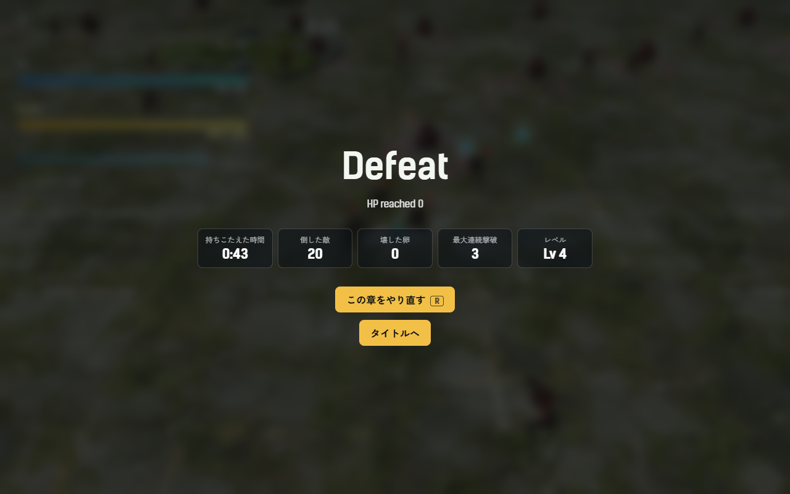
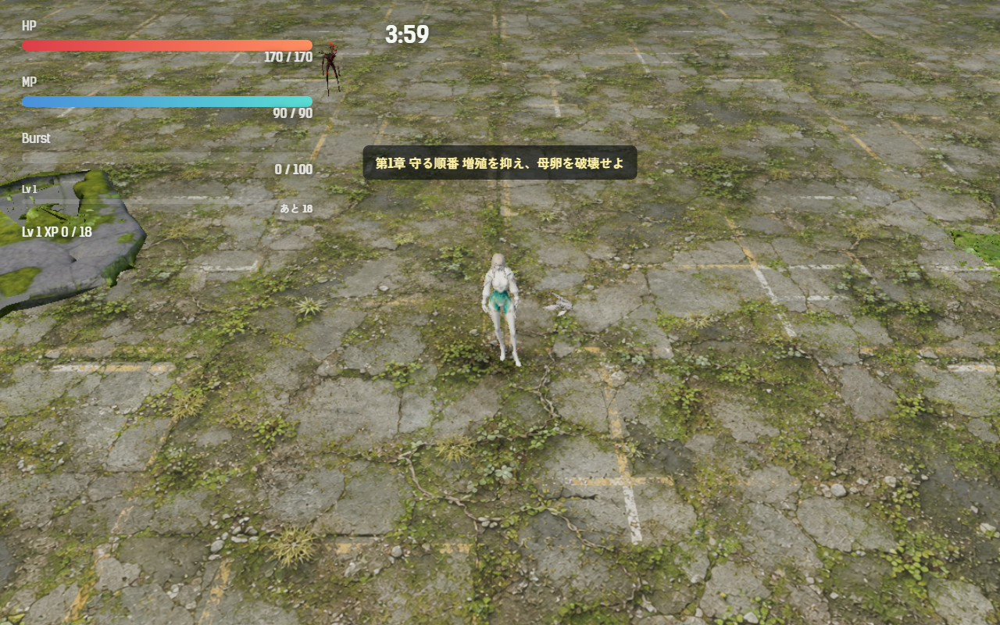
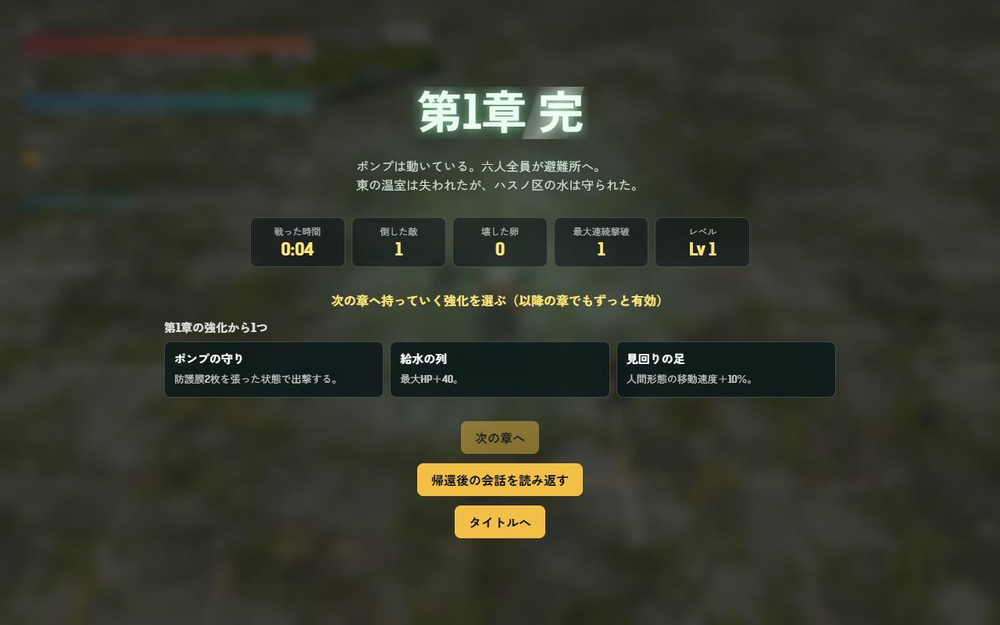
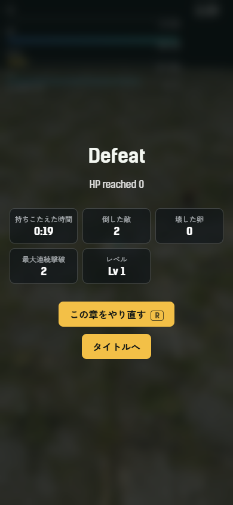

# 2026-11-13（サイクル 23）

## 今日やったこと
- A: **A7 結果画面の成績と、やり直しの短縮**（A35 は承認待ちのまま。feedback.md に未反映の項目はなし）。設定は `Config.results`（`src/config.js`）、計算は `src/run-stats.js`。`enabled: false` か URL の `?results=0` で、成績も R キーも会話の省略も無い（元のまま）。
  - 結果画面に 5 つの数字を出す: **戦った時間**（倒れたときは「持ちこたえた時間」）・**倒した敵**・**壊した卵**・**最大連続撃破**（前の撃破から 1.5 秒以内に倒すと連続）・**レベル**。時間は倒れた瞬間（クリアならボスを壊した瞬間）で止める（倒れる動きや帰還後の会話の時間は数えない）。
  - backlog の「救った時間」は意味がはっきりしないので、戦った時間として出した（判断待ち 1）。
  - **やり直しを短く**: 倒れたあと **R キー**でもやり直せる（ボタンに「R」の印。タッチ端末とコントローラーでは印を出さない）。やり直しでは**出撃前の会話を飛ばして、すぐ戦闘に入る**（`quickRetry`。R を押してから戦闘開始まで約 3.2 秒、ほとんどページの読み直し）。クリア後の「次の章へ」は今までどおり会話から。
  - テスト `tests/run-stats.test.js`（4 件: 連続の数え方、最初の 1 体、時間の表示と行の中身、設定の切り替え）と、`tests/campaign.test.js` にやり直しの起動の 1 件を足した。
- B（金・音声）: **B3-9 HP が 3 割を切ったときの一言**（3 人分、`low_hp_01`）。B3-6 の手順（手本の声を `refs` に指定、各 3 シード → 文字起こし → 声の高さと画像）で作った。台本には触れない戦闘中の短い声。
  - その被弾の「被弾の声」の代わりに鳴る。40 秒に 1 回まで。`Config.audio.lowHpVoice: false` で鳴らない（元のまま）。
  - 台詞（仮。判断待ち 2）:

    | キャラ | 台詞 | 長さ |
    |---|---|---|
    | ツキミ | まだ……倒れません。 | 2.4 秒 |
    | アカメ | ……かすり傷だ。 | 0.8 秒 |
    | キイチゴ | いったた……まだまだ！ | 3.3 秒 |
  - ファイル: `assets/audio/voice/<キャラ>/low_hp_01.mp3`。候補 9 本は `assets_src/voice/2026-11-13/`、選んだ理由は asset-ledger.md の「2026-11-13 HP が 3 割を切ったときの一言」。
  - 文字起こしの手順を `scripts/assets/voice-asr.py` にまとめた（これまでは別フォルダのスクリプトを使っていた）。

## 確認結果
- npm test / build: 100 件すべて成功／ビルド成功
- プレイ確認: 開発サーバー（5183）を起動し、Playwright（Edge）で第1章を開いて確かめた（ページのエラーなし）。終わったあとサーバーは止めた。
  - アカメで 40 秒戦って倒れたとき（43 秒・20 体・最大連続 3・Lv 4）:

    
  - R キーで、会話なしに同じ章・同じキャラで戦闘に戻った:

    
  - クリアしたとき（確認のため戦闘 4 秒でクリア扱いにした。引き継ぎ強化の選択の上に並ぶ）:

    
  - スマホの幅（390×844）では 3 列×2 段:

    
  - `?results=0` では成績が出ず、R キーを押しても何も起きない（元のまま）。
  - HP 35% から 10% のダメージで「HP 3 割の声」が鳴り、40 秒以内にもう一度 3 割を切ったときは普段の被弾の声になった。3 人分の mp3 が読み込まれている。
- 数値（ボット 5 回、ツキミ・第1章・`--speed 6`）: 全敗、倒れたのは 186〜225 秒（平均被ダメージ 186.8、平均 Lv 10.6、撃破 88〜127）。前回（11-12）と同じ傾向で、今日の変更は戦闘の中身に触れていない。

## 判断待ち（ユーザーへ）
1. **結果画面（A7）**: (a) 「救った時間」が何を指すか（今は戦った時間として出した。別の意味なら教えてほしい）、(b) 倒れたあとのやり直しで出撃前の会話を飛ばしてよいか（戻すなら `Config.results.quickRetry: false`）、(c) 5 つの数字で足りるか（自己ベストとの比較などを足すか）。`?results=0` で前と比べられる。
2. **HP 3 割の一言（B3-9）の台詞**: 「まだ……倒れません。」「……かすり傷だ。」「いったた……まだまだ！」でよいか。ファイルは `assets/audio/voice/<キャラ>/low_hp_01.mp3`。ツキミとキイチゴは「……」の間で 2.4〜3.3 秒あり、戦闘中には少し長いかもしれない（短く切ることもできる）。
3. **前回からの判断待ち（回答がないので保留）**: A6 相乗効果の名前と強さ、A42 鳥形態での敵の見分け（足元に色の輪を出す案）、A35 ボス戦中の狙撃手の重なり（案 a〜c、おすすめは a）、`.claude/launch.json` が以前の worktree を向いている件、ほか前回までの項目。

## 次にやること
- A: A35 の承認が来たらそちらを先に。来なければ A12 は判断待ちなので、次の未着手は A17（引き継ぎ強化の調整）。
- B（土・動画/SNS）: 結果画面と相乗効果の入ったプレイ動画を撮り、`promo/2026-11-14/` に紹介画像と投稿文の案をまとめる（投稿はしない）。
