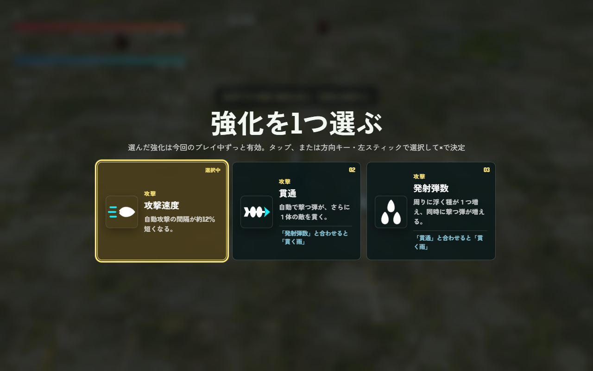
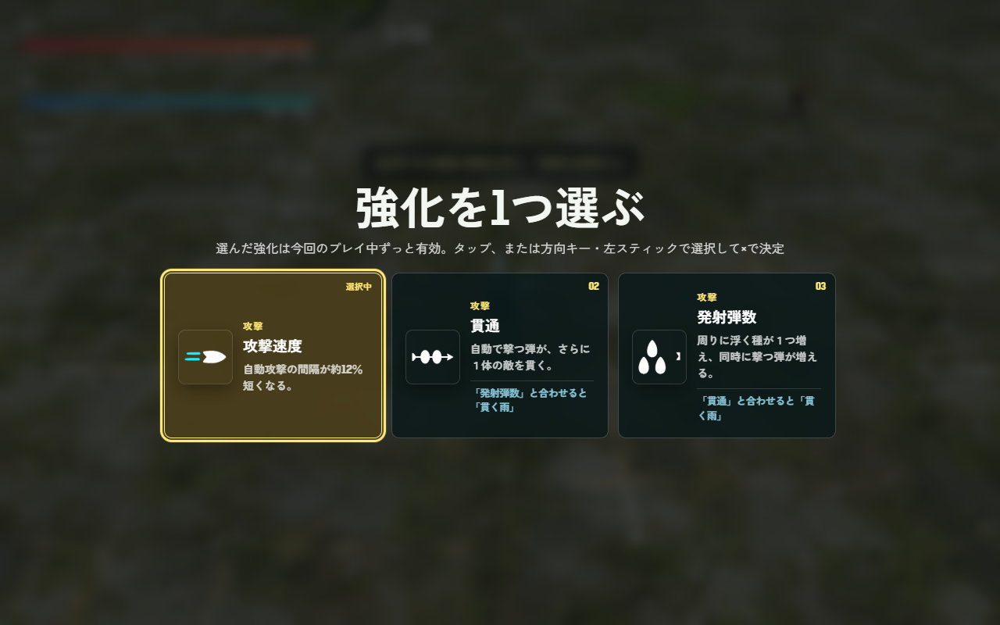

# 2026-11-15（サイクル 24）

（11-14 の土曜のサイクルは記録がない。動画・SNS 素材は来週の土曜へ。）

## 今日やったこと
- A: **A17 引き継ぎ強化の調整（その1: ボットで測る仕組みと最初の比較）**（A35・A12 は承認待ちのまま。feedback.md に未反映の項目はなし）。
  - ボットに `--carry` を足した（`scripts/bot-play.mjs`）。結果画面で選んだのと同じ形の引き継ぎを、ページを開く前に localStorage に書いてから章を始める。書き方は `--carry 1:waterLine`、`--carry "1:waterLine+multishot,2:sharpSeeds"`（章:章の強化+その章で取った強化）。開始時の HP・MP・防護膜・移動速度・攻撃力を `startStats` に残し、効いているかを確かめられるようにした。
  - ツキミ、`--speed 6`、各 5 回（シード 1〜5）で比べた。「時間切れ」は 240 秒まで生き残ったが母卵を倒せなかった回。

    | 章 | 引き継ぎ | 勝ち | 倒れた／時間切れ | 平均の終わり（秒） | 被ダメージ | 撃破 |
    |---|---|---|---|---|---|---|
    | 2 | なし | 0/5 | 5／0 | 229.9 | 275 | 126 |
    | 2 | ポンプの守り（防護膜 2） | 0/5 | 4／1 | 228.8 | 263 | 171 |
    | 2 | 給水の列（HP +40） | 0/5 | 3／2 | 234.5 | 351 | 173 |
    | 2 | 見回りの足（移動 +10%） | 0/5 | 5／0 | 229.9 | 276 | 151 |
    | 3 | なし | 0/5 | 4／1 | 210.5 | 186 | 88 |
    | 3 | シラユリの記録（バースト 50%） | 1/5 | 4／0 | 197.2 | 214 | 169 |
    | 3 | 残された手順（再使用 -25%） | 0/5 | 4／1 | 178.6 | 162 | 78 |
    | 3 | 研いだ種（威力 +15%） | 0/5 | 5／0 | 201.9 | 204 | 125 |
  - 分かったこと:
    - 第1章の 3 つのうち、**給水の列が一番効いた**（5 回中 2 回が時間切れまで生存、もう 1 回も 240 秒で倒れた）。ポンプの守りも少し。**見回りの足はボットでは差が出ない**（ボットは敵から離れ続けるだけなので、速さを生かせない）。
    - 第2章の 3 つは**ばらつきの方が大きく、強弱を言えない**。「なし」でも 131 秒、「シラユリの記録」でも 85 秒で倒れる回がある（主な死因は弾と狙撃手）。「残された手順」は数字では一番悪いが、バーストの回数はなし（平均 5）と変わらず（平均 4）、ボットがバーストの使い方を変えないので効き目自体が出ていない。
    - ボットは今も 1 回も勝てない章がほとんどなので（狙撃手の重なり A35 が先）、**勝率では比べられない**。
  - **今日は強さの数字を変えなかった**。5 回の差はばらつきの範囲で、変える根拠にならない。A35 が直ってボットが勝てるようになってから、回数を増やして（各 10 回以上）見る。backlog の A17 は「途中」にした。
  - 結果画面のスマホ幅での見え方は、11-13 に確認済み（`img/2026-11-13-result-mobile.png`）。
- B（日・素材の手直し。先週はアバターだったので今週は手直しの週）: **B4-2 の続き。強化アイコン `speed`（攻撃速度）と `pierce`（貫通）を太く描き直した**。
  - 11-11 の見比べで「細くて小さい」（絵の占める割合 9〜10%）とした 2 つ。今の型（白い形＋シアンの差し色）のまま Pillow で描いた（生成なし）。スクリプト `scripts/assets/redraw-upgrade-icons.py`。
  - 攻撃速度は種を高さ約 1.5 倍にし、速さの線 3 本を太く。貫通は矢の軸を太くし、貫かれる 2 体を大きく、矢じりをシアンにした。
  - `assets/ui/upgrade-icons/speed-bold.png`・`pierce-bold.png`。`Config.visuals.cleanedUpgradeIcons: false` で元の絵に戻る（11-11 の seeds と同じ切り替え）。記録は asset-ledger.md の「2026-11-15」。

## 確認結果
- npm test / build: 100 件すべて成功／ビルド成功
- プレイ確認: 開発サーバー（5183）を起動し、Playwright（Edge）で第1章を開いて、レベルアップの選択に攻撃速度・貫通・発射弾数を並べて確かめた（ページのエラーなし）。終わったあとサーバーは止めた。
  - 新しい絵:

    
  - `cleanedUpgradeIcons: false`（元の絵）:

    
- 数値: 上の表（ボット 40 回、結果は `tmp/bot/bot-tsukimi-stage2-*`・`stage3-*` の今日の分）。

## 週の振り返り（サイクル 19〜24、11/09〜11/15）
- **できたこと**
  - A は新しい敵を足すのを止めて、遊びの手触りに集中した: 手触り（A3、撃破の止まり・被弾の縁）、撃破と取得のフィードバック（A4、破片・経験値の吸い込み・経験値バー）、出現の緩急（A5、波と小休止）、強化の相乗効果（A6）、結果画面の成績と R でのやり直し（A7）、今日の引き継ぎ強化の測り方（A17）。どれも `Config` と URL で元に戻せる。
  - 素材: Tripo の 8 体をゲームに組み込み（11-09、受け取り用のチャット）、色の直し（11-12）、効果音 3 つ（11-10）、強化アイコンの手直し 3 つ（11-11・11-15）、HP 3 割の一言 3 人分（11-13）。
- **うまくいかなかったこと・気づき**
  - **ボットが勝てないまま**。先週の方針だった A35（狙撃手の重なり）は承認待ちで進まず、今日の A17 もばらつきに埋もれて数字を変えられなかった。勝ち負けやバランスを測る項目（A17、A23〜A34、A36）は、A35 が片付くまで足踏みになる。
  - 「人が遊んで確かめる」項目（A38〜A44）が 7 つたまった。ボットでは手触りは測れない。
  - 11-09・11-11 は空きメモリ不足（Affinity・Photoshop が開いている）で Forge・元絵づくりを見送った。11-14 の土曜は記録がない。
- **来週の方針**
  - A35 の判断をもらうのが一番の近道（おすすめは案 a「母卵が出ている間は同時に撃つ狙撃手を1体まで」）。承認が来なければ、ボット側で狙撃手の予兆を避ける動き（A11 の残り）を先に入れ、それでも勝てるか見る。
  - 人が遊ぶ確認（A38〜A44）は、1 回 10 分ほど遊んでもらえれば一度に答えが出る。まとめて聞き方を整える。
  - B は月・木に Tripo の判断待ち（B1-1 拾うアイテム 6 種）、水はメモリを確かめてから Forge、土は先週分の動画・SNS 素材。

## 判断待ち（ユーザーへ）
1. **A35 ボス戦中の狙撃手の重なり**: 案 (a) 母卵が出ている間は同時に撃つ狙撃手を1体まで、(b)(c) は backlog の A35。これが決まらないとボットが勝てず、引き継ぎ強化（A17）などの強さの調整が進まない。おすすめは (a)。
2. **引き継ぎ強化「見回りの足」（移動 +10%）**: ボットでは効き目が見えない（他の 2 つは生存が延びた）。+15% に上げるか、別の効果（たとえば「レベルアップごとに少し回復」）に替えるか、今のままにするか。
3. **アイコン**: 攻撃速度・貫通の新しい絵（上の画像）でよいか。`damage`（剣）・`dive` の絵柄を変えるか、`speed` と `move` の見分け（11-11 からの判断待ち）も合わせて。
4. **前回からの判断待ち（回答がないので保留）**: A7 結果画面（「救った時間」の意味、やり直しで会話を飛ばすか）、HP 3 割の一言の台詞、A6 相乗効果の名前と強さ、A42 鳥形態での敵の見分け、`.claude/launch.json` が以前の worktree を向いている件、ほか前回までの項目。

## 次にやること
- A: A35 の承認が来たらそちら。来なければ A12 は判断待ちなので、次の未着手は A15（ボットが擬態卵を見分ける）か、A11 の残り（狙撃手の予兆を避ける動き）を先に。
- B（月・3D）: Tripo の判断待ち（B1-1）。届いた GLB がなければ、元絵の用意か組み込み済みの体の見直し。
