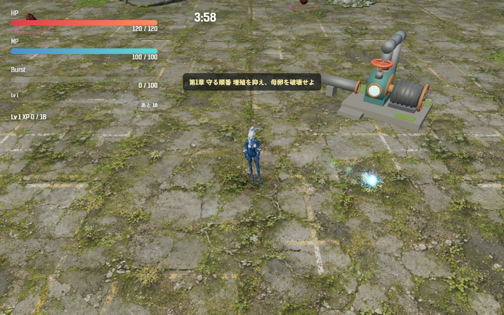
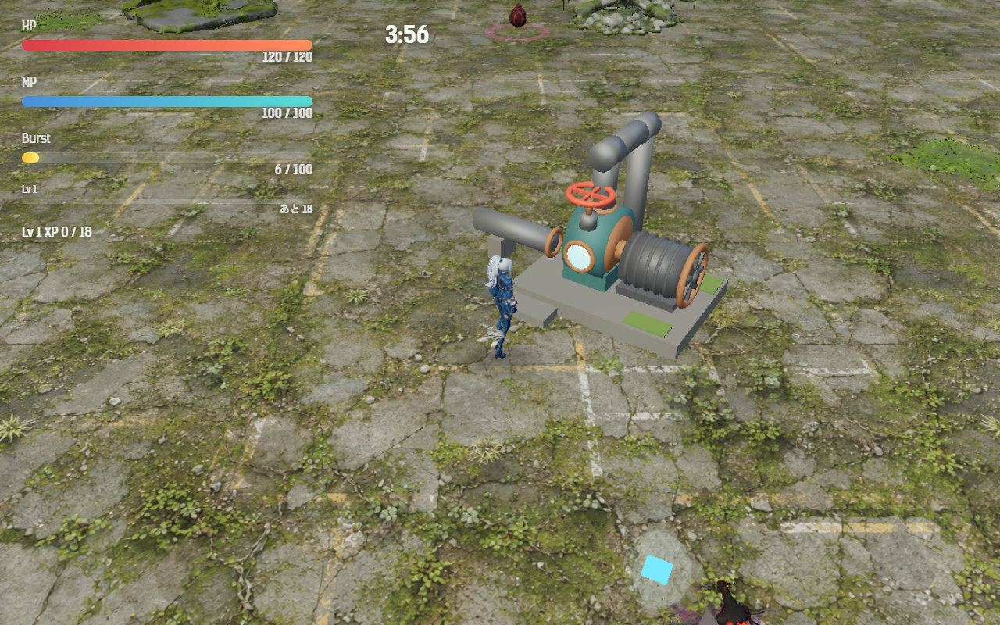
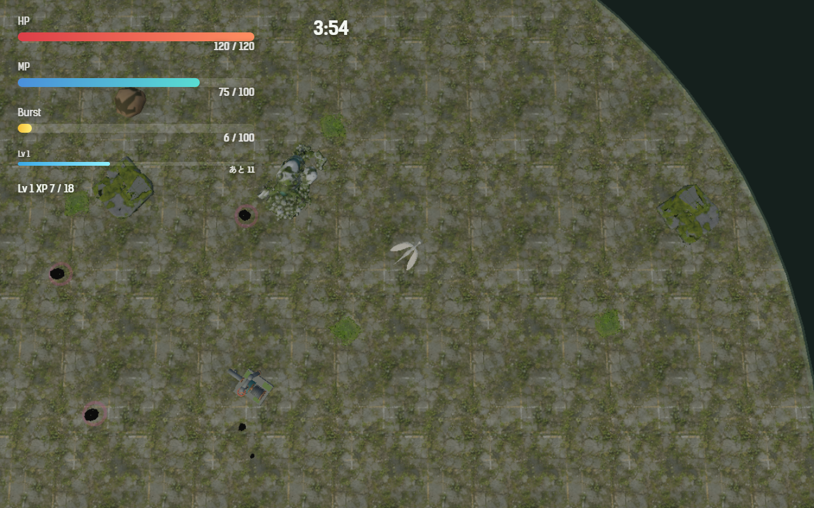
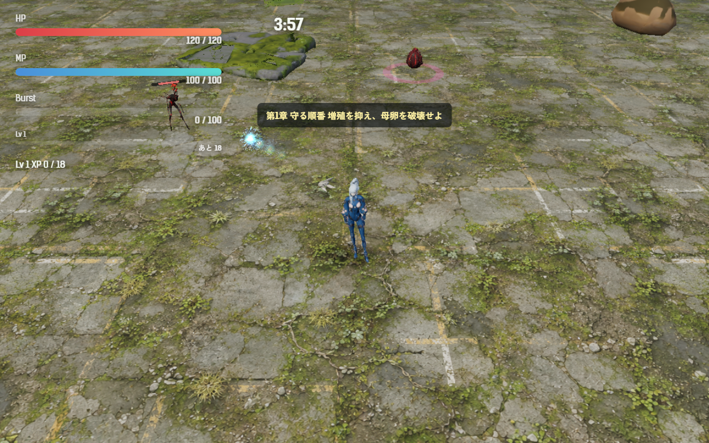

# 2026-11-16（サイクル 25）

## 今日やったこと
- A: **A15 ボットが擬態卵を見分ける**（A35・A12 は承認待ちのまま。feedback.md に未反映の項目はなし）。`scripts/bot-play.mjs` だけの変更で、ゲームのコードは変えていない。
  - 擬態卵（第5章から。脈が速い）は `isMimic` で見分ける（人が脈の速さで見分けるのの代わり）。
  - 鳥のときは擬態卵から離れる（急降下は近くの卵を自動で選ぶので、上を飛ばない）。急降下の予兆（0.55 秒）の的が擬態卵なら、**人間に戻って取り消す**。取り消したあと 2.5 秒は飛ばずに人間で撃つ。鳥になるかの判断で数える「近くの卵」から擬態卵を外した。
  - `--mimic 0` で前の動き（見分けない）に戻る。結果の JSON に `mimic: { seen, diveAborts, shot }`（見た数・取り消した数・人間で撃った数）を足した。
  - 比べた結果（ツキミ、第5章、`--speed 6`、シード 1〜5、各 5 回。全敗は変わらず）:

    | ボット | 擬態卵での硬直 | 取り消し | 鳥の時間（平均） | 終わりの時刻（平均） | 被ダメージ |
    |---|---|---|---|---|---|
    | 見分けない（`--mimic 0`） | 計 7 回（1 回で 5 回の回も） | — | 65 秒 | 201.6 秒 | 173 |
    | 見分ける（最初の版、取り消し後すぐまた飛ぶ） | 0 | 0〜61 回 | 75 秒 | 220.5 秒 | 194 |
    | 見分ける（「擬態卵の 5.5 以内では飛ばない」） | 0 | 0〜1 回 | 37 秒 | 164.6 秒 | 151 |
    | **見分ける（採用: 取り消し後 2.5 秒は飛ばない）** | **0** | **0〜3 回** | **62 秒** | **216.0 秒** | 184 |

  - 分かったこと: 「擬態卵の近くでは飛ばない」は鳥の時間が半分になり、人間のまま弾で倒れた（5 回中 4 回が 139〜163 秒）。このボットは鳥の間に弾をかわしているので、飛ばない決め方は逆効果。採用した版は硬直を 0 にしたまま、鳥の時間を保てた。勝てないのは変わらず、主な死因は今も弾・狙撃手・衝撃波（A35 の問題）。
- B（月・3D）: **B1-7 第1章の舞台に給水ポンプを置いた**（Blender で手作り、生成なし）。
  - 空きメモリが 31 GB 中 9.3 GB で、手順の基準（10 GB を切ったら Forge を使わない）に届かず、Tripo 用の元絵づくりは見送った。届いた Tripo の GLB も無い（11-09 の 8 体は組み込み済み）。そこで元絵の要らない人工物として、台本の中心のポンプを Blender のスクリプトで作った。
  - コンクリートの台・塗装の剥げたポンプの胴・モーター・送水管・取水管・**上から見える赤い弁ハンドル**・**シアンに光る水の窓**。はずみ車がゲームの中で回り、水の窓の光が脈打つ（「ポンプは回り続けている」）。3848 三角形、135 KB。
  - 第1章だけ、出発点の北東（x 6.5、z -5.5）に 1.2 倍で置く。**見た目だけの目印で、当たり判定も耐久値も無い**（ポンプの耐久は A9 で保留中。今の建物の当たり判定は耐久値付きで壊れるので使わなかった）。
  - `Config.visuals.chapterPump: false` か URL の `?pump=0` で置かない（元のまま）。スクリプト `scripts/blender/build_chapter1_pump.py`、記録は asset-ledger.md の「2026-11-16」、作り方の気づきは asset-pipeline.md の「3Dの整形（Blender）」。

## 確認結果
- npm test / build: 100 件すべて成功／ビルド成功
- プレイ確認: 開発サーバー（5183）を起動し、Playwright（Edge）で第1章を開いて確かめた（ページのエラーなし）。はずみ車が回り（2.5 秒で約 8 ラジアン）、`?pump=0` ではポンプが無い。終わったあとサーバーは止めた。
  - 戦闘開始直後（右上にポンプ）:

    
  - ポンプに近づいたところ:

    
  - 鳥形態の高いカメラ（左下の小さな四角がポンプ。赤い弁とシアンの窓で目印にはなる）:

    
  - `?pump=0`（元のまま）:

    
- 数値:
  - 第5章の擬態卵は上の表（ボット 20 回、`tmp/bot/bot-tsukimi-stage5-*` の今日の分）。
  - いつもの第1章 5 回（ツキミ、`--speed 6`、ポンプあり）: 全敗、倒れたのは 219〜237 秒（平均被ダメージ 218.2、平均 Lv 12.6）、FPS 75〜86。前回までと同じ傾向で、ポンプで重くなってはいない。

## 判断待ち（ユーザーへ）
1. **第1章のポンプ（B1-7）**: (a) この見た目でよいか（Blender の手作りなので、敵の Tripo の体より少しおもちゃっぽい。Tripo で作り直すなら元絵から用意し、見込み 1 体 120 クレジット）、(b) 当たり判定を付けるか（今は通り抜けられる。付けるなら壊れない障害物として）、(c) 置き場所（今は出発点の北東、最初の画面の右上）。台本では「ポンプの脇で母卵が脈打つ」ので、母卵をポンプの近くに出すかも合わせて（B1-9）。`?pump=0` で前と比べられる。
2. **A35 ボス戦中の狙撃手の重なり**（前回から）: 案 (a) 母卵が出ている間は同時に撃つ狙撃手を1体まで、がおすすめ。今日のボットも第5章の死因の上位は弾・狙撃手・衝撃波で、ここが決まらないと強さの調整（A17 など）が進まない。
3. **前回からの判断待ち（回答がないので保留）**: 引き継ぎ強化「見回りの足」の強さ、攻撃速度・貫通の新しいアイコン、A7 結果画面（「救った時間」の意味、やり直しで会話を飛ばすか）、HP 3 割の一言の台詞、A6 相乗効果の名前と強さ、A42 鳥形態での敵の見分け、`.claude/launch.json` が以前の worktree を向いている件、ほか前回までの項目。

## 次にやること
- A: A35 の承認が来たらそちら。来なければ次の未着手は A18（第1章でまれに早く倒れる回の死因を見る）か、A11 の残り（狙撃手の予兆を避ける動き）。
- B（火・効果音）: B2-3 鳥形態の急降下・捕食の音の差し替え候補、か B2-1 の残り。
