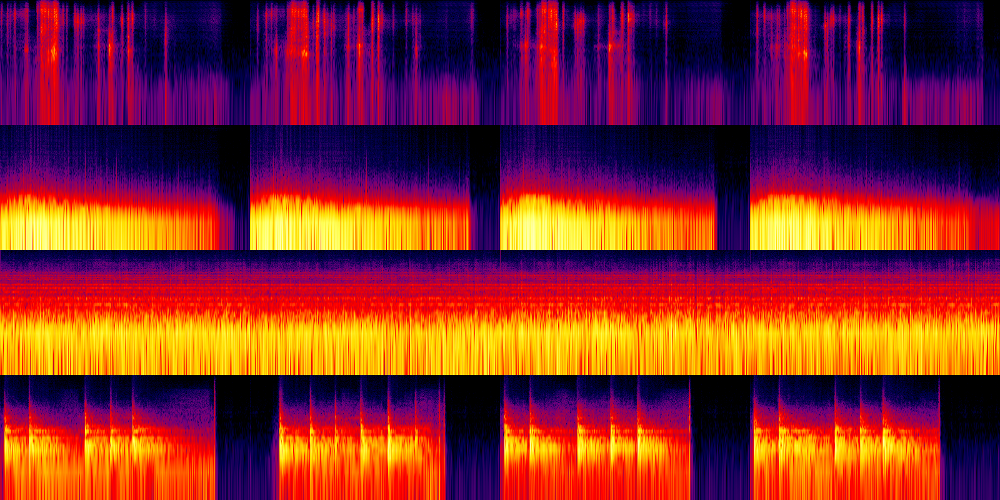
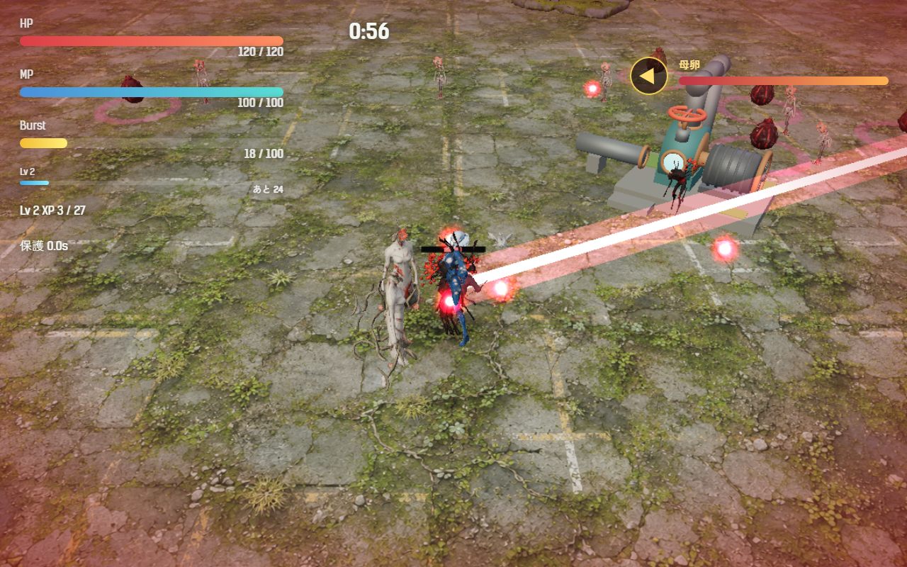

# 2026-11-17（サイクル 26）

## 今日やったこと
- A: **A18 第1章で早く倒れる回の原因を見る**（feedback.md に未反映の項目はなし）。ゲームのコードは変えず、`scripts/bot-play.mjs` だけを直した。
  - 11-16 に難しさを下げたあとの第1章を 10 回遊ばせた。**早く倒れる回はもう無い**（最も早い終わりは 232.7 秒、倒れたのは 1 回だけ）。受けたダメージは弾と狙撃手がほとんどで、狙撃手は 1 回 8〜87。
  - 負けた 3 回の原因は別にあった。10 秒ごとの記録に「ボスまでの距離」を足して見ると、**ボットが敵の群れに押されてボスから 40〜90 も離れ、その間ボスの HP が 20〜30 秒動かない**（残り HP 16 のまま 30 秒過ぎて時間切れ、という回もあった）。ボスは出発点から 75〜117 離れた所に出るので、着くまでにも 10〜20 秒かかる。
  - もう 1 つ: 人間形態のボットはボスから 9 の距離に立っていたが、卵への射撃は 6 までしか届かない（`Config.player.specialEggRange`）。バーストと急降下の合間は、ボスに何も当たっていなかった。
  - 直したこと: (1) ボスが遠いほど強く戻る（距離に応じて最大 6 倍。`--chase 0` で前の動き）、(2) 人間形態でボスから 5 に立つ（`--bossRange 9` で前の動き）。結果の JSON の 10 秒ごとの記録に `bossDist` を足した。
  - 比べた結果（ツキミ、第1章、`--speed 6`、シード 1〜10）:

    | ボット | 勝ち | 撃破の平均 | 平均被ダメージ | 負け方 |
    |---|---|---|---|---|
    | 前のまま（ボスから 9、戻らない） | 7/10 | 221.6 秒 | 121.9 | 時間切れ 2・倒れる 1 |
    | ボスから 5 に立つだけ | 5/10 | 223.2 秒 | 143.3 | 時間切れ 4・倒れる 1（やはり 40〜87 離れる） |
    | **ボスから 5 ＋ 遠いほど戻る（採用）** | **10/10** | **206.2 秒** | 101.3 | — |

  - 同じボットで第2〜6章（各 5 回）: 第2章 3/5（時間切れ 2）、第3章 3/5（倒れる 1・時間切れ 1）、第4章 5/5、第5章 3/5（倒れる 1・時間切れ 1）、第6章 3/5（時間切れ 2）。勝った回の撃破は 187〜239 秒。11-16 の最後の確認（6 回ずつ）は 2/6・2/6・0/6・1/6・1/6 だった。
  - 分かったこと: 11-16 の「ボットが勝てる所まで下げる」は、ボスから離れてしまうボットに合わせていた。ボットを直した今は、第1章と第4章が全勝で、**下げすぎかもしれない**（判断待ち 1、backlog A45）。数字はまだ変えていない。
- B（火・効果音）: **B2-1 の続き。卵の孵化・ボス出現の警告・時間切れ前の警告の 3 つ**。Stable Audio 3 で 20 本作り、3 本を採用（選び方と理由は asset-ledger.md の「2026-11-17」）。
  - 卵の孵化 `egg_hatch.wav`（0.9 秒）: プレイヤーから 24 以内の卵が孵ったとき、0.6 秒に 1 回まで。殻の割れる音のあとに湿った音が続く。
  - ボス出現の警告 `boss_warning.wav`（2.6 秒）: ボスが出た瞬間に低い角笛のような響き。声（「来た」など）と同時に鳴る。
  - 時間切れ前の警告 `time_warning.wav`（2.2 秒）: 鐘のような打音が 5 回。**残り 30 秒**でボスがまだ立っているときに 1 回鳴る。もとは「残り 1 分」の音として作ったが、残り 1 分はボスの出現とまったく同じ瞬間（どちらも 180 秒）で、角笛と声 2 本に重なるので 30 秒に移した（`Config.audio.timeWarningSeconds`、0 で鳴らない）。
  - 3 つとも `Config.audio.newSfx: false` で鳴らない（元は無音だった）。音量は `normalize-sfx.mjs` で役割ごとにそろえた（-18.3／-12.2／-15.8 LUFS）。
  - 失敗と対処: 「残り 1 分」の最初の 8 本（2.5 秒指定、プロンプト 2 種）はすべて平らな雑音だった。長さを 3 秒にしたら 4 本とも正常。11-03 の失敗も 2.5 秒だったので、**長さは 2 秒か 3 秒にする**と asset-pipeline.md に書いた。生成は 12 本で 1 分 34 秒、空きメモリ 11.3 GB。
  - 周波数の見比べ（上から 卵の孵化・ボス出現・残り 1 分の失敗 8 本ぶんのうち 4 本・作り直し。各行の左から シード 11・23・37・51）:

    

## 確認結果
- npm test / build: 100 件すべて成功／ビルド成功
- プレイ確認: 開発サーバー（5183）を起動し、Playwright（Edge）で第1章を開いて、鳴った効果音の名前と時刻を記録した（ページのエラーなし）。終わったあとサーバーは止めた。
  - `newSfx: true`: ボス出現の警告が 180.0 秒に 1 回、時間切れ前の警告が 210.0 秒に 1 回、卵の孵化が 170〜212 秒の間に 11 回（間隔を 0.6 秒に広げる前の数）。3 つのファイルはどれも読み込めている（そろえた版、長さ 0.9／2.61／2.22 秒）。
  - `newSfx: false`: 3 つとも 0 回。
  - 音そのものは聞けていない（自動のサイクルなので、波形の数字と周波数の絵で選んだ）。
  - ボスが出た直後の画面（右上にボスの HP バー、奥にポンプ）:

    
- 数値: 上の表（ボット、第1章 30 回・第2〜6章 25 回。`tmp/bot/` の今日の分）。FPS は 60〜86 で、いつもと同じ。

## 判断待ち（ユーザーへ）
1. **難しさを少し戻すか（A45）**: ボットを直したら第1章 10/10・第4章 5/5、ほかの章は 3/5 になった。11-16 に下げた数字（被ダメージ倍率 0.8、母卵の HP 150、第2〜5章のボスの HP 倍率 1、水の章の被ダメージ 0.65・0.5 など）は、ボスを見失うボットに合わせたもの。(a) このまま（人が遊ぶぶんには易しめで良い）、(b) 第1章だけ母卵の HP を 150 → 200 くらいに戻す、(c) 全部の章を「ボットが 5〜6 割勝つ」所まで戻す、のどれにするか。おすすめは (a) のまま一度遊んでもらってから決めること。
2. **新しい効果音 3 つを聞いてほしい**: `assets/audio/sfx/egg_hatch.wav`・`boss_warning.wav`・`time_warning.wav`。特に (a) 卵の孵化が戦闘中にうるさくないか（近くの卵だけ、0.6 秒に 1 回まで）、(b) 時間切れ前の警告を残り 30 秒に置いたのでよいか（残り 1 分はボスの出現と重なる）、(c) 鐘の音が世界に合うか。
3. **前回からの判断待ち（回答がないので保留）**: 第1章のポンプの見た目・当たり判定・置き場所（B1-7）、引き継ぎ強化「見回りの足」の強さ、攻撃速度・貫通の新しいアイコン、A7 結果画面、HP 3 割の一言の台詞、A6 相乗効果の名前と強さ、A42 鳥形態での敵の見分け、`.claude/launch.json` が以前の worktree を向いている件、ほか前回までの項目。

## 次にやること
- A: 次の未着手は A19（大事な説明がほかのメッセージで上書きされる。優先度つきのメッセージ）。A45 の返事が来たらそちらを先に。
- B（水・イラスト）: B4-2 の続き（引き継ぎ強化 15 個のアイコン）か、空きメモリがあれば B4-1 の画風の詰め。
