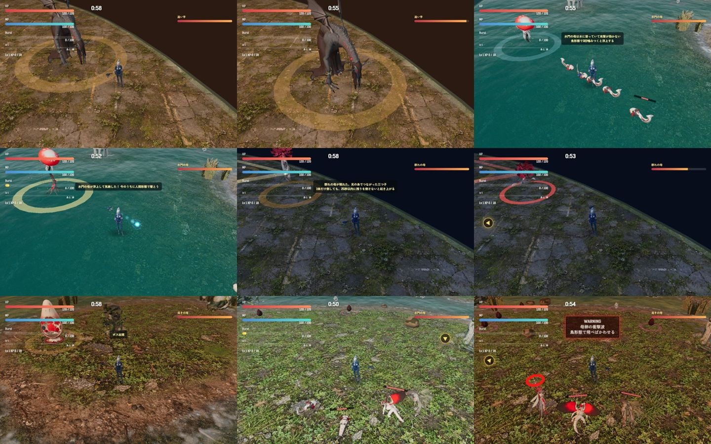

# 2026-11-18 敵とボスの 3D モデルを main へ（作業ブランチと派生チャットのまとめ）

ユーザーの指示「派生チャットも含めてmainに」「main の動きにモデル」。

## やったこと
- 作業ブランチ `claude/enemy-3d-implementation-0a21a1`（2026-10-26〜28 の Tripo の敵・ボス）を main に入れた。
  - その間に main でもボス（追い手・水門の母・群れの母）が別に作られていたので、**ボスの動き（状態の移り方・数値）は main のまま**にし、作業ブランチの体とアニメだけを載せた。
  - Hunyuan3D の試作（2026-10-27 のコミット）は入れていない（利用条件のため使わない）。
- 派生チャット `claude/recursing-fermat-5ecd53`（キャラごとの鳥形態・魚形態・ドローンの Tripo モデル）もそのまま合流した。台帳の衝突だけ手で直した。

## ボスの体
- `src/bosses.js` の各ボスに `bodyKey`（と足元の輪の大きさ `ringScale`）を足した。体は `src/main.js` の `GAMEPLAY_MODELS`。
- アニメのある体は、白蓮の核と同じ「生き物の体」（`Egg.useCreatureModel`）で動かす。ふだんの動き（idle・walk・stun）と一回きりの動きを分けた。
  - 追い手（黒衣の長首翼獣）: 歩いている間は walk。立ち止まって産卵する 3.5 秒の間は attack（首と翼を持ち上げて胸を開く）を、その長さに合わせて流す。
  - 水門の母（茎の生えたクラゲ）: 潜っている間は 1.7 沈んで赤い傘だけ出す（卵の体は今までどおり 2.6）。噛まれると hit、列を流すと attack、浮上すると surface のあと stun でふらつく。
  - 群れの母（浮遊する彼岸花 3 体）: 1.2 浮いて揺れる（`Config.boss.swarmMother.hoverHeight`）。衝撃波を溜めるときに attack、倒れると die の姿勢のまま沈み、起き上がると revive。
  - 渇きの母（薔薇の繭）: 骨が無いので、母卵と同じように回って拍動する。
- 骨のない母卵の拍動（`Config.egg.motherBeat`）: ふだんはゆっくり縮んで膨らみ、衝撃波の予告と卵を吸う間は速く大きく打つ。放つ瞬間に大きく膨らむ。
- `?tripoEnemies=0`（`Config.visuals.tripoEnemyModels`）で、新種と同じく元の体（母卵・射撃敵の色違い・円錐）に戻る。

## 敵・卵
- スナイパー（白骨のトンボ人形）、飛ぶ敵（赤い翼の獣。0.85 浮き、死ぬと落ちる）、跳ねる敵（葉を背負った甲殻獣。跳ぶときに attack）、オタマジャクシ、ヤゴ、水中の卵（目玉卵）。
- 魚形態で水中の卵を噛んだときも、鳥形態で食べたときと同じだけ回復する。章の引き継ぎ強化「根の誓い」の説明も「鳥形態・魚形態」に直した。

## 確認結果
- npm test: すべて通過（ボスの体のテスト `tests/boss-bodies.test.js` 6 件、敵のアニメのテストに飛ぶ敵・跳ねる敵を追加）。npm run build: 通過。
- プレイ確認（開発サーバー 5193、Playwright・Edge）: 第2〜5章でボスを出し、体が読み込まれ、動きが切り替わることを確認（追い手 walk、水門の母 潜る→浮上して stun、群れの母 倒れると die、渇きの母の繭）。ページのエラーなし。

## 注意
- 2026-10-26〜28 の devlog（`2026-10-27-pursuer-swarm.md` など）にあるボスの動きの説明は作業ブランチのもので、main の動きとは違う（例: 追い手の産卵は 2 個ではなく 1 個）。体とアニメの作り方の記録として残している。
