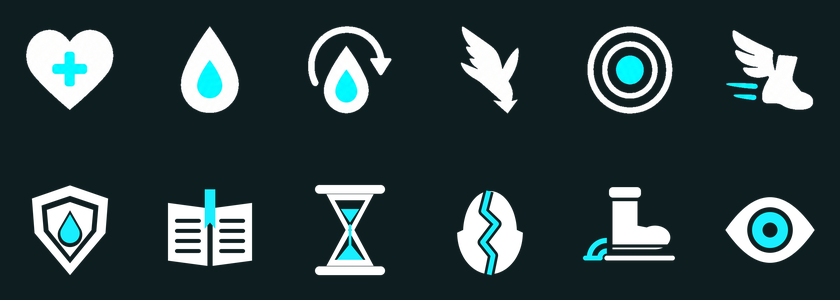
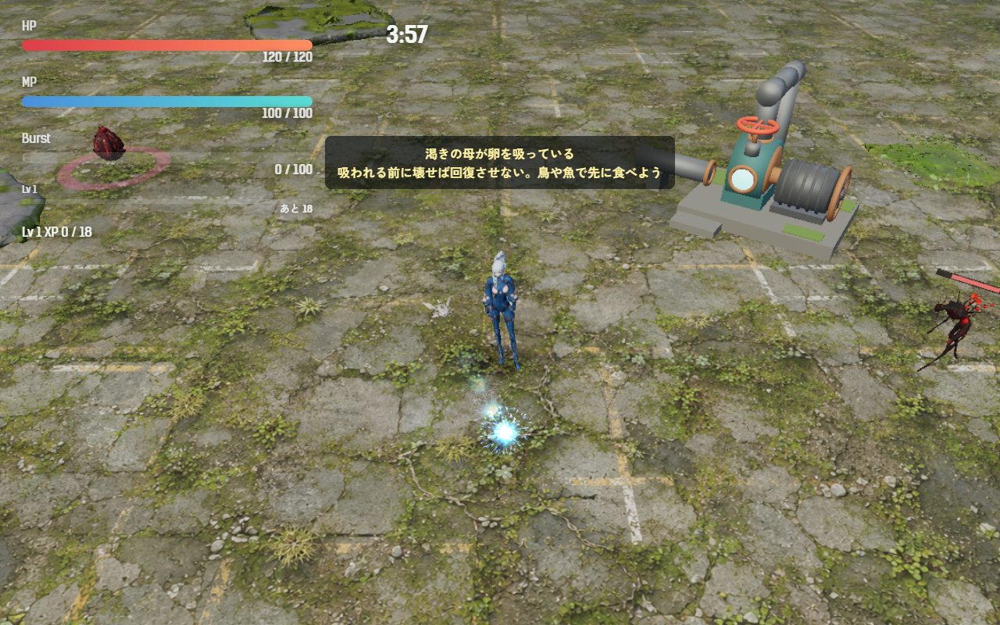
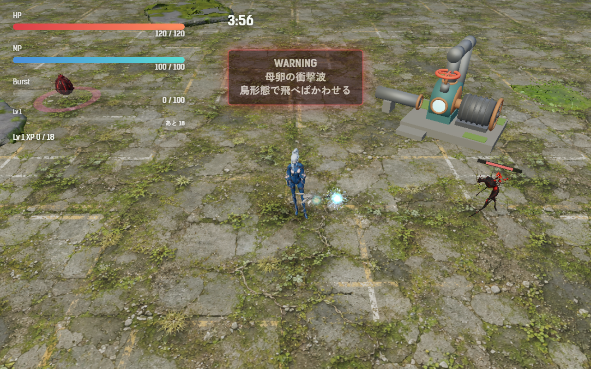
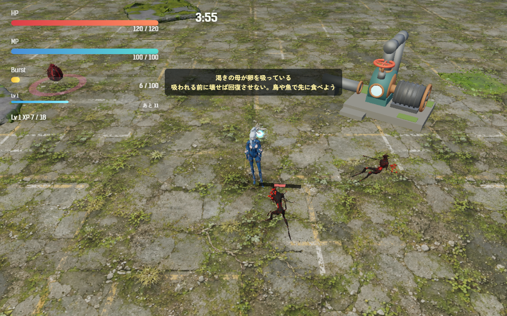
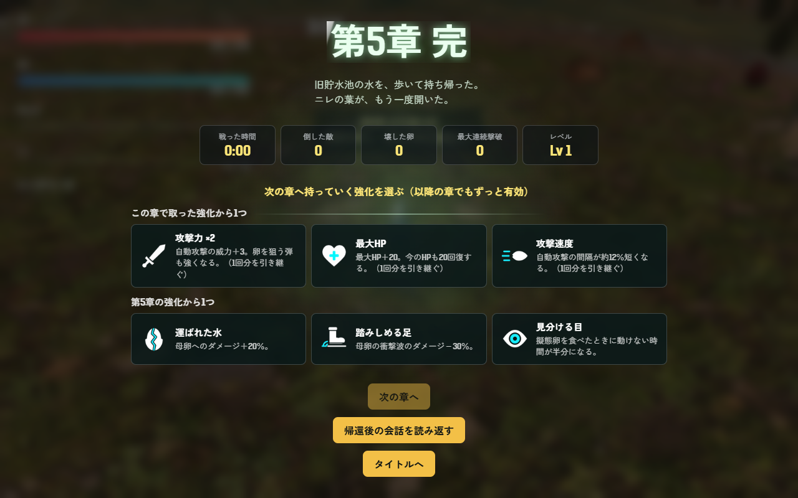
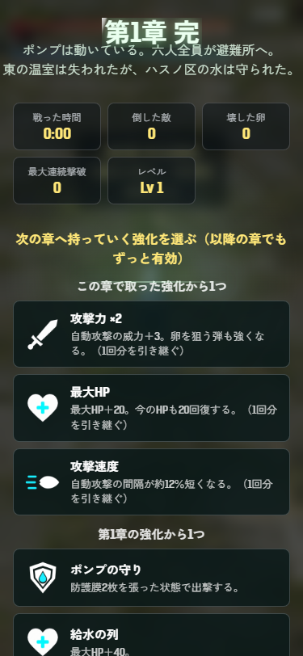

# 2026-11-18（サイクル 27）

## 今日やったこと
- A: **A19 優先度つきのメッセージ**（feedback.md に未反映の項目はなし。A45 は返事待ちなので次の未着手の A19 へ）。
  - 画面中央のメッセージは 1 枠しかなく、後から来たものが何でも上書きしていた。そのため「擬態卵！ 動けない」が強化の名前で消えたり、渇きの母の初回の説明が「水中の卵は魚形態で駆除できます」ですぐ消えたりしていた。
  - メッセージに 3 段階の優先度を付けた（`src/message-slot.js`）。
    - **普通**: 強化の名前、MP不足、噛みついた回数など（何も指定しない呼び出しはすべてこれ）。
    - **大事な説明**: 章の開始、ボスの出現と初回の説明、新種が孵ったときの説明、群れの母が倒れた、などの 20 か所。
    - **警告**: 母卵の衝撃波、白蓮の吸い込み、擬態卵で動けない、手に掴まれた、の 4 か所。
  - 優先度の低いものは、高いものが出ている間は出ない（捨てる）。警告で途切れた説明は、警告が消えたあとに**残りの時間だけ出し直す**（残りが 0.8 秒未満なら出さない）。
  - `Config.messages.priority: false` か URL の `?messagePriority=0` で、元の「後から来たものが常に上書き」に戻る。
  - ついでに見つけた不具合: 説明の 2 行目（`\n`）は WARNING のときしか改行されず、ほかは 1 行に長く伸びて左の HUD（バーストの数字）に重なっていた。改行が効くようにした（`src/styles.css` の `#centerMessage`）。
  - テスト `tests/message-slot.test.js`（6 件）。
- B（水・イラスト）: **B4-2 の続き。引き継ぎ強化 15 個のアイコン**。章のクリア後に選ぶ強化は文字だけだった。
  - 9 個は意味の合う強化アイコンを流用した（給水の列＝最大HP、見回りの足＝移動、研いだ種＝攻撃力 など）。
  - 合うものが無い 6 個は、今の型（白い形＋シアンの差し色）で Pillow で描いた（`scripts/assets/draw-reward-icons.py`。11-11 に決めたとおり、アイコンは Forge では描かない）。
    - ポンプの守り（盾と水滴）、シラユリの記録（開いた帳面としおり）、残された手順（砂時計）、運ばれた水（ひびの入った卵）、踏みしめる足（ブーツと止まる衝撃波）、見分ける目（目）。
  - 結果画面の選択肢の左に 48 px で出す。「この章で取った強化」の側も、その強化のアイコンを出す。`Config.visuals.carryOverIcons: false` で元の文字だけに戻る。
  - 対応表は asset-ledger.md の「2026-11-18」。テスト `tests/reward-icons.test.js`（15 個すべてに絵があるか）。

## 確認結果
- npm test: 108 件すべて通過。npm run build: 通過。
- プレイ確認（開発サーバー 5183、Playwright・Edge。ページのエラーなし。終わったあとサーバーは止めた）:
  - A19: 渇きの母の説明（大事）を出したあと、水中の卵の一言（普通）を出しても説明が残る → 衝撃波の WARNING が割り込む → WARNING が消えると説明が戻る、を確認。`?messagePriority=0` では前と同じく上書きされる。
    - 普通の一言のあと、説明が残っている: 
    - WARNING が割り込んだところ: 
    - WARNING のあと、説明が戻ったところ（2 行で改行されている）: 
  - B4-2: その場で章をクリアさせて、結果画面を見た。第1・2・5章の 6 枚とも読み込めた。スマホ幅（375）でも崩れない。
    - 第5章: 
    - 第1章・スマホ幅: 
- 数値（ボット、ツキミ、第1章、`--speed 6`、5 回）: **5/5 勝**。撃破の平均 201.5 秒、平均被ダメージ 73.2、平均 Lv 10.8（11-17 の 10 回: 10/10 勝、206.2 秒、101.3）。メッセージは戦いの強さに関係しないので、前回とほぼ同じ。

## 判断待ち（ユーザーへ）
1. **難しさを少し戻すか（A45、11-17 から）**: 今日も第1章は 5/5 勝（平均 201 秒）。(a) このまま、(b) 第1章だけ母卵の HP を 150 → 200 くらいに戻す、(c) 全部の章を「ボットが 5〜6 割勝つ」所まで戻す、のどれにするか。おすすめは (a) のまま一度遊んでもらってから決めること。
2. **メッセージの優先度（A19、新）を遊んで見てほしい**: 新種やボスの説明（3〜4 秒）の間は「MP不足」や強化の名前が出なくなった。押しても反応が無いように感じないか。2 行の説明がちゃんと改行されるようになったので、画面の中ほどが隠れすぎないか。気になれば `?messagePriority=0` で前の動きと比べられる。
3. **引き継ぎ強化のアイコン（B4-2、新）**: 新しく描いた 6 個（上の画像の下段）の絵柄でよいか。特に「運ばれた水」を「ひびの入った卵（母卵へのダメージ）」にした点と、「踏みしめる足」のブーツ。章の印（第何章の強化か）は付けていない（見出しに章の名前があるため）。
4. **新しい効果音 3 つ（11-17 から）**: `assets/audio/sfx/egg_hatch.wav`・`boss_warning.wav`・`time_warning.wav` を聞いてほしい。
5. **前回からの判断待ち（回答がないので保留）**: 第1章のポンプの見た目・当たり判定・置き場所（B1-7）、「見回りの足」の強さ、攻撃速度・貫通の新しいアイコン、A7 結果画面、HP 3 割の一言の台詞、A6 相乗効果の名前と強さ、A42 鳥形態での敵の見分け、`.claude/launch.json` が以前の worktree を向いている件（今日も Bash で開発サーバーを起動した）、ほか前回までの項目。

## 次にやること
- A: 次の未着手は A20（渇きの母の「卵の取り合い」の確認）。A45 の返事が来たらそちらを先に。
- B（木・3D）: Tripo から届いた GLB があれば整形と組み込み。無ければ B1-8 の鳴きの元絵か、B1-1 拾うアイテムの元絵（三面図）。
