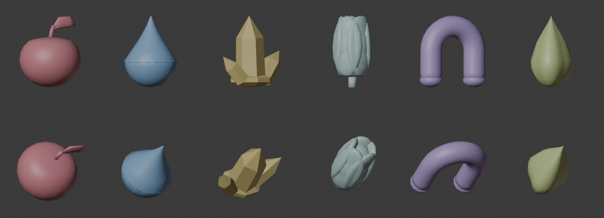

# 2026-11-19（サイクル 28）

## 今日やったこと
- A: **A20 渇きの母の「卵の取り合い」の確認**（feedback.md に未反映の項目はなし。A45 は返事待ちなので、次の未着手の A20 へ）。
  - ボットに `--thirst 1` を足した（`scripts/bot-play.mjs`）。渇きの母が卵を吸い始めたら、吸われている卵に向かい、陸なら鳥・水なら魚になって壊しに行く。吸い始めの卵までの距離も記録する（結果の `thirst.reach`）。既定は今までどおり狙わない。
  - 分かったこと（ツキミ・第5章・`--speed 6`、各 6 回）:

    | 設定 | ボット | 勝ち | 撃破の平均 | 吸い込み（1 戦） | 吸われた / 阻止 | 回復 |
    |---|---|---|---|---|---|---|
    | 元（22・3.4 秒） | 狙わない | 3/6 | 210 秒 | 0〜2 回 | 0〜4 / 0 | 0〜21 |
    | 元 | 狙う（8 以内で変身） | 5/6 | 205 秒 | 1〜4 回 | 2〜9 / 計 1 | 0〜45 |
    | 元 | 狙う（26 以内で変身） | 3/6（時間切れ 3） | 209 秒 | 0〜4 回 | 0〜16 / 計 3 | 0〜74 |
    | 範囲 14・5 秒 | 狙わない / 狙う | 3/6 / 3/6 | — | 0〜4 回 / 0〜4 回 | 阻止 計 2 / 0 | 0〜42 |
    | **22・5 秒＋急降下の直し（今日の値）** | 狙わない / 狙う | 6/6 / 5/6 | 202 / 204 秒 | 0〜2 回 / 0〜1 回 | 阻止 計 1 / 0 | 0〜21 / 0〜11 |

    1. **鳥の急降下は、近く（5.4 以内）にボスがいればボスを優先する**。吸われる卵はボスのそばにあるので、鳥で卵の上に来てもボスに降りてしまい、「鳥で先に食べる」ができなかった。→ 吸っている間だけは、届く範囲の吸われている卵を先に狙うようにした（`pickDrainedDiveTarget`、`Config.boss.thirstMother.diveAtDrainedEggs`。false で前の「ボス優先」）。
    2. 吸い始めの卵までの距離は多くが 15〜35。3.4 秒では鳥でも間に合わない → **吸う時間を 3.4 → 5 秒**にした。
    3. 範囲を 22 → 14 に狭めて試したが、ボスのそばの卵はすぐ無くなり、吸い込み自体がほとんど起きなかったので 22 のまま。
    4. **いちばん大きいのは、今の難しさ（11-16 にボスの HP を下げた）ではボスが出てから 15〜50 秒で倒れ、吸い込みが 1 戦に 0〜4 回しか起きないこと**。回復は 1 個 5（ボス HP 150 の 3.5%）で、全部吸われても戦いはほとんど変わらない。どの設定でも勝ち負けは吸い込みより時間切れや敵の群れで決まっていた。「取り合いが面白いか」は、取り合いが起きる強さにしてからでないと確かめられない → 判断待ち 1（backlog A47）。
  - ブラウザで、吸われている卵（水中）から 2.5 の陸に置いた鳥が卵を 1 個壊し、残りの 1 個だけ吸われた（回復 5）のを確かめた。
    - 
  - テスト `tests/bosses.test.js` に `pickDrainedDiveTarget` の 1 件。
- B（木・3D）: **B1-1 拾うアイテム 6 種を Blender で手作りして組み込んだ**。
  - Tripo から届いた新しい GLB は無い。空きメモリが 5.6 GB で、Forge（元絵）の基準 10 GB を下回ったので、画像生成はやめた。
  - 10-26・10-29 に選んだ形の案（Hunyuan3D の利用条件で外したもの）を、球・円錐・管を頂点ごとに曲げて作った（`scripts/blender/build_pickups.py`、6 個で約 10 秒、154〜1036 三角形、9〜20 KB）。画像生成も 3D 生成も使っていないので、利用条件の心配はない。
    - HP回復: 葉の付いた赤い実／MP回復: 水滴の種／Burst欠片: 琥珀の結晶 3 本／防護膜: 閉じたつぼみ／吸引石: 馬蹄の石（上から U に見える）／加速: 矢じり形の実
  - `Config.pickups.models.enabled: true`。false か URL の `?pickupModels=0` で元の多面体に戻る。台帳は asset-ledger.md の「2026-11-19」。
  - テスト `tests/pickup-models.test.js`（6 個とも GLB として読めて、main.js から参照されている）。

## 確認結果
- npm test: 124 件すべて通過。npm run build: 通過。
- プレイ確認（開発サーバー 5183、Playwright・Edge。ページのエラーなし。終わったあとサーバーは止めた）:
  - 拾うアイテム（第1章で 6 種を 2 個ずつ置いた）。赤い実・水滴・結晶・馬蹄・つぼみ・矢じりの実が、ゲームのカメラから見分けられる。
    - 新: 
    - `?pickupModels=0`（元の多面体）: 
  - A20: 上の画像のとおり。吸い終わりの画面: 
- 数値（ボット、ツキミ、第1章、`--speed 6`、5 回）: 1 回目 3/5 勝（被ダメージ平均 150）、同じ条件の 2 回目 **5/5 勝**（撃破 209.5 秒、被ダメージ 81.8）。`?pickupModels=0` は 5/5 勝（202.8 秒、82.8）。1 回目はぶれで、アイテムの見た目は強さに関係しない（前回 11-18: 5/5、201.5 秒、73.2）。

## 判断待ち（ユーザーへ）
1. **渇きの母の取り合いを起きるようにするか（A47、新）**: 今の難しさではボスが 15〜50 秒で倒れ、卵を吸うのは 1 戦 0〜4 回・回復は最大でも 74（HP 150 の半分）で、取り合いがほとんど起きない。(a) 第5章のボスの HP だけ戻す（A45 と一緒に）、(b) 最初の吸い込みを早く・間隔を短く（7 → 2 秒、12 → 8 秒）、(c) 1 個の回復を 3.5% → 6〜8% に、のどれか（組み合わせも可）。おすすめは、まず第5章を一度遊んでもらい、(b) から試すこと。
2. **拾うアイテムの手作りの見た目（B1-1、新）**: 上の画像の 6 種でよいか。このままでよければ Tripo での作り直し（見込み 6 体 × 120 クレジット）は要らなくなる。気になるもの（特に防護膜のつぼみ・加速の矢じりの実）があれば、そこだけ直すか Tripo に回す。
3. **鳥の急降下の変更（A20、新）**: 渇きの母が吸っている間だけ、鳥はボスより先に吸われている卵へ降りるようにした。ボスを殴りたいときに卵へ降りてしまうと感じたら `Config.boss.thirstMother.diveAtDrainedEggs: false` で戻せる。
4. **前回からの判断待ち（回答がないので保留）**: 難しさを少し戻すか（A45）、メッセージの優先度（A46）、引き継ぎ強化のアイコン 6 個（B4-2）、新しい効果音 3 つ（11-17）、第1章のポンプ（B1-7・B1-9）、ほか前回までの項目。`.claude/launch.json` が今も以前の worktree を向いているので、今日も Bash で開発サーバーを起動した。

## 次にやること
- A: 次の未着手は A23（足跡の手応えの確認）。A45・A47 の返事が来たらそちらを先に。
- B（金・音声）: B3 の次の項目。

## 追記: 鳥形態をもっと使う（受け取り用のチャット）
ユーザーが第6章のボットの録画を見て「鳥形態をあまり使っていないように見える」。続けて「鳥のMPを見直して」「いや、ボットも見直そう」。

- 録画（第6章）では、鳥の急降下が約 4 分で 17 回だけで、最初の 100 秒は 0 回だった。原因はふたつ。
  - ボットは「MP 7 割以上・近くに卵 3 個以上」でしか飛ばず、MP 2 割で人に戻る。
  - 鳥の MP は毎秒 14 減り、人だと毎秒 6 回復する。満タンから飛んでも 7 秒ほどで落ちる。
- ゲーム: 鳥形態で毎秒減る MP `Config.player.birdMpCost` を 14 → 10 に（14 で元どおり）。強化「鳥MP消費軽減」（毎秒 −1.5、下限 6）はそのまま。
- ボット（`scripts/bot-play.mjs`、`--fly 0` で元どおり）:
  - 陸の上で MP 4.5 割以上あれば、近くに卵が 2 個以上か、ボスが 12 以内のとき飛ぶ（ボスへ急降下）。
  - 水の章では、水の上では今までどおり（変身すると魚になるため）。ボス戦の間は、ボスへの急降下のためだけに飛ぶ（卵のためにも飛ぶと第3・6章の勝ちが減った）。
  - 陸の章ではボス戦の間も卵のために飛ぶ。飛ばないと第4章の被ダメージが 82 → 198 に増えた。
  - 水門の母が潜っている近くでは飛ばない。鳥を人に戻す決まりとぶつかり、1 戦で 167 回変身をくり返した回があった。
  - 結果に `airSeconds`（鳥だけの秒数）を足した。今までの `birdSeconds` は魚の時間も含む。

ボット（ツキミ、`--speed 6`、各 8 回）。鳥は鳥形態の秒数（第1章は元の `birdSeconds`）、急降下は卵への急降下の回数。

| 章 | 元（ボット・MP 14） | 今日の値（ボット・MP 10） |
|---|---|---|
| 第1章 | 7/8 勝、鳥 83 秒、急降下 29、被ダメージ 100 | 7/8 と 8/8 勝、鳥 120〜135 秒、急降下 41〜45、被ダメージ 61〜80 |
| 第2章 | （11-17: 3/5） | 3/8 勝、鳥 157 秒、急降下 46、被ダメージ 257（群れ鳥から 134。負けは 5 回とも時間切れ） |
| 第3章 | （MP 10・元のボット: 3/8、鳥 51 秒） | 5/8 勝、鳥 79 秒、急降下 25 |
| 第4章 | （11-17: 5/5） | 7/8 勝、鳥 133 秒、急降下 41、被ダメージ 141 |
| 第5章 | （11-17: 3/5） | 6/8 勝、鳥 86 秒、急降下 22（陸の章の直しの前の値。水の章なので動きは同じ） |
| 第6章 | 0/8 勝、鳥 54 秒、急降下 15 | 1/8 勝、鳥 86 秒、急降下 22（MP 10・元のボットも 1/8） |

- 上の表は、つる（vine binder）と狙撃手の追尾弾（PR #6・#7）が入る前のゲーム。入ったあとのゲームで回し直した値（各 8 回）:

  | 章 | 勝ち | 鳥 | 卵への急降下 | 被ダメージ |
  |---|---|---|---|---|
  | 第1章 | 8/8 | 131 秒 | 44 | 53 |
  | 第2章 | 5/8 | 149 秒 | 48 | 157 |
  | 第3章 | 2/8 | 77 秒 | 24 | 206 |
  | 第4章 | 6/8 | 139 秒 | 39 | 182 |
  | 第5章 | 6/8 | 73 秒 | 17 | 171 |
  | 第6章 | 0/8 | 98 秒 | 26 | 195 |

- 鳥の時間はどの章でも 1.5 倍前後に増えた。勝ちは第6章を除いて 11-17 の値と同じか上。第6章は今日の 4 回の計測で 0〜2/8 勝で、白蓮の核を時間内に割り切れない（MP の変更が原因ではない）。第2章は鳥の時間が一番長いぶん、空を飛ぶ群れ鳥からのダメージが一番多い。
- npm test 124 件・build 通過（つるなどを取り込んだあとは 132 件通過）。
- 第6章は、元のボット・MP 14 でも今日は 0/8 勝だった（11-16 は 4/12、11-17 は 3/5）。鳥の変更の前から下がっているので、難しさの判断待ち（A45）と一緒に見てほしい。

## 追記: 影法師を止める・群れ鳥はバーストで一掃（受け取り用のチャット）
上の録画を見たユーザー:「結構見た目的にはいい感じ。影法師は一旦いらないかな。群れ鳥はバーストを使うと一蹴できるようにする」

- 影法師（E16）を止めた: `Config.enemy.shadow.enabled: false`。コードは残してあり、true で戻る。`tests/shadow.test.js` は、止めている間は出ないことを確かめ、残したコードの確認はそのテストの中だけ一時的にオンにして行う。
- 群れ鳥: バーストを撃った瞬間、半径 `Config.enemy.swarmbird.burstClearRange`（24）の中の群れ鳥をすべて落とす。3 キャラ共通で、キャラごとのバーストの形（ツキミの光線・アカメの円・キイチゴの斬撃）は問わない。0 で元どおり。初めて落としたときに「バーストで群れ鳥を一掃した」と出す。孵ったときの説明も「人間形態で撃ち落とすか、バーストで一掃する」に変えた。
- ボット（ツキミ、各 8 回。ボットはバーストを群れ鳥のために使ってはいない）:
  - 第2章 5/8 勝。バーストで落とした群れ鳥は 1 戦 0〜21 羽（孵った 20〜48 羽のうち）。群れ鳥から受けたダメージは平均 99（この前の 8 回は 134）。
  - 第6章 4/8 勝（影法師ありの直前の 8 回は 0/8）。影法師は 8 回とも出ていない。
- npm test 133 件・build 通過。
