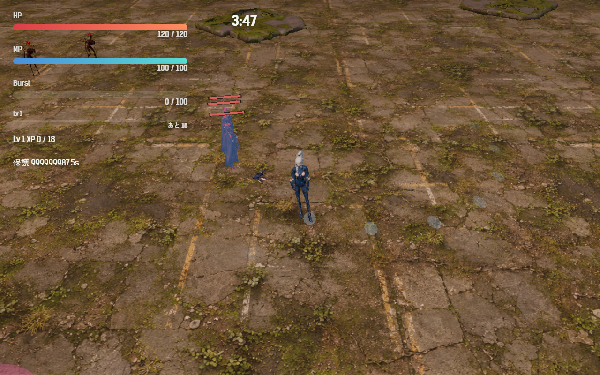
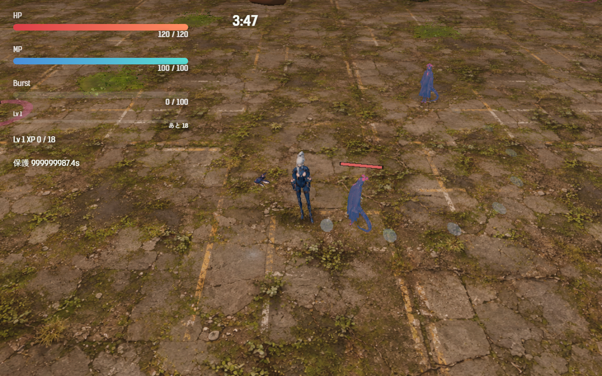

# 2026-11-20（サイクル 29）

## 今日やったこと
- 開始時、main にユーザーのまだ push していないコミット 2 つ（追い手を 2.9 で止める修正とそのマージ、11-19）があり、origin/main（影法師を止める・群れ鳥の一掃、11-19）と分かれていた。`git pull --rebase=false` で取り込み（衝突なし）、今日の push に一緒に入る。
- A: **A23 足跡（E8）の手応えの確認**（feedback.md に未反映の項目はなし。A45・A47 は返事待ち、A12・A13 は判断待ちなので、次の未着手の A23）。
  - ボットは止まらず動き続けるので、人の動き方は測れない。そこで、ゲームと同じ `PlayerTrail`・`advanceFootprint` で足跡を動かすシミュレーション `scripts/sim-footprint.mjs` を作った（ブラウザ不要、1 秒で終わる）。人がよくやる動き方 8 種で、30 秒のうちに足跡が触れるかを数える（接触はゲームと同じ距離² 1.55・0.75 秒ごと。自分の弾で足跡を倒すことは入れていない）。
  - 分かったこと（ツキミの速さ 6.72、足跡 1 体、40 回）:

    | 動き方 | 遅れ 2.6 秒（元） | 遅れ 2.0 秒 |
    |---|---|---|
    | その場で撃つ | 40/40 触れる・39 回 | 同じ |
    | 左右に 6 歩ずつ往復 | 40/40・19 回 | 同じ |
    | 円 半径 3 | 40/40・36 回 | 40/40・2 回 |
    | 円 半径 6 | 40/40・3 回 | 0/40 |
    | 円 半径 10 | 孵った直後の 1 回だけ | 同じ |
    | 2 秒走って 2 秒止まる | 0/40 | 40/40・6 回 |
    | まっすぐ逃げる | 0/40 | 0/40 |

    1. **止まっている・狭く往復する人は必ず捕まる**。止まるのが遅れ（2.6 秒）より短ければ一度も触れない。「止まると来る」は分かりやすく働いている。
    2. **「同じ所を回ると挟まれる」（設計の狙い）は、円の一周が遅れとほぼ同じ長さのときだけ起きる**（半径 3 で 2.6 秒が一周 2.8 秒に重なる）。遅れを 2.0 にすると半径 3 でも当たらなくなるほど敏感。
    3. **足跡が何体いても、全員同じ 2.6 秒遅れの所に集まり、後ろに一列に並ぶだけ**だった（3 体でも円 半径 6 は 30 秒で 4.9 回）。前から挟まれることがない。
  - そこで、**遅れを 1 体ごとに 2.6〜5.6 秒に散らす**ようにした（`Config.enemy.footprint.delaySpread: 3`、孵ったときに決める。0 か URL の `?footprintSpread=0` で元どおり）。最短の遅れは 2.6 秒のままなので、「少し止まって撃つ」「まっすぐ逃げる」の安全さは変わらない。速さ（7.6）と出る割合（16%）はそのまま。
  - 足跡 3 体のシミュレーション（30 回、30 秒で触れた回数の平均）:

    | 動き方 | 散らばり 0（元） | 1.5 | 2 | **3（今日の値）** |
    |---|---|---|---|---|
    | 円 半径 3 | 104 | 37 | 38 | 71 |
    | 円 半径 6 | 4.9 | 6.4 | 6.7 | **31** |
    | 円 半径 10 | 1.0 | 1.0 | 1.0 | 1.0 |
    | 2 秒走って 2 秒止まる | 0.4 | 0.4 | — | 0.1 |
    | まっすぐ逃げる | 0.1 | 0.1 | — | 0.1 |
    | 円 半径 6＋時々鳥 | 16 | 15 | — | 16 |

    半径 6 くらいまでの小さな円を回ると、遅れの長い足跡が前に来て挟まれる。大きく動けば今までどおり振り切れる。鳥で飛ぶと道が途切れて見失う（時々鳥の行）。
  - ブラウザ（第2章、半径 5 の円を歩かせ、足跡 3 体を置いて 9 秒後）: 散らばりありは 3 体が 3.4〜4.5 の距離（円の上で自分の近く）に来た。元（散らばりなし）は 2 体が 10 離れた円の反対側（半周後ろ）に重なり、1 体だけ 1.7 の所にいた。1 回ずつの撮影なので、数の比較はシミュレーションの表を見る。
    - 散らばりあり: 
    - 元: 
  - テスト `tests/footprints.test.js` に 2 件（1 体ごとの遅れが範囲に入る・遅れの長い足跡は同じ道のもっと後ろを歩く）。
- B（金・音声）: **B3-10 バーストを撃てるようになったときの一言（3人分）**。B3-6 の手順（手本の声を `refs`、各 3 シード → 文字起こし → 声の高さ）で作った。
  - 台詞（仮。判断待ち 1）: ツキミ「準備、できました。」（1.97 秒）／アカメ「……いける。」（0.42 秒）／キイチゴ「よーし、たまった！」（1.92 秒）。ファイルは `assets/audio/voice/<キャラ>/burst_ready_01.mp3`、候補 9 本は `assets_src/voice/2026-11-20-burst-ready/`。選んだ理由は asset-ledger.md の「2026-11-20」。
  - ゲージが満タンになり再使用の待ちも無くなった瞬間に鳴る。戦闘時間 30 秒に 1 回まで。**B3-10 は「台詞は判断待ちに出してから」なので、`Config.audio.burstReadyVoice: false`（鳴らない）で入れた**。URL の `?burstReadyVoice=1` で鳴らして試せる。
  - 生成 9 本は読み込み込みで約 2 分。`ffmpeg` が PATH に無かったので、Irodori 同梱のものを使った（asset-pipeline.md に追記）。

## 確認結果
- npm test: 135 件すべて通過。npm run build: 通過。
- プレイ確認（開発サーバー 5183、Playwright・Edge。ページのエラーなし。終わったあとサーバーは止めた）:
  - A23: 上の 2 枚。
  - B3-10: `?burstReadyVoice=1` でゲージを満タンにすると `burstReady` が 1 回鳴り、ファイル（`/assets/audio/voice/kiichigo/burst_ready_01.mp3`）の読み込みエラーなし。URL なし（既定）では鳴らない。
- 数値（ボット、ツキミ、`--speed 6`）:
  - 第1章 5 回: **5/5 勝**、撃破 201.5 秒、被ダメージ 70.4（前回 11-19: 5/5、209.5 秒、81.8）。
  - 第2章 各 6 回: 散らばりあり 4/6 勝・被ダメージ 119・足跡は 1 戦 6〜26 体孵って触れたのは計 1 回／`?footprintSpread=0` 3/6 勝・被ダメージ 164・触れたのは 0 回。ボットは動き続けるので足跡にはほぼ触れず、勝ち負けの差はぶれ（負けはすべて時間切れ）。

## 判断待ち（ユーザーへ）
1. **バーストを撃てるようになったときの一言（B3-10、新）**: ツキミ「準備、できました。」／アカメ「……いける。」／キイチゴ「よーし、たまった！」でよいか。よければ `Config.audio.burstReadyVoice` を true にする（今は鳴らない）。試すときは URL に `?burstReadyVoice=1`。被弾が続いたときの声も作るか。
2. **足跡の遅れの散らばり（A23、新）**: 遅れを 1 体ごとに 2.6〜5.6 秒にしたので、小さな円を回ると前から挟まれる。第2章を遊んで、理不尽に感じたら `Config.enemy.footprint.delaySpread` を 0（元）か 1.5 に下げる（backlog A48）。
3. **前回からの判断待ち（回答がないので保留）**: 渇きの母の取り合い（A47）、難しさを少し戻すか（A45）、拾うアイテムの手作りの見た目（B1-1）、鳥の急降下の変更（A20）、メッセージの優先度（A46）、引き継ぎ強化のアイコン（B4-2）、ほか前回までの項目。`.claude/launch.json` が今も以前の worktree を向いているので、今日も Bash で開発サーバーを起動した。

## 次にやること
- A: 次の未着手は A24（水門の母の手応えの確認）。A45・A47 の返事が来たらそちらを先に。
- B（土・動画/SNS）: 今週の変更（影法師を止めた第6章、群れ鳥の一掃、拾うアイテム）のプレイ動画と投稿文の案を `promo/2026-11-21/` に（投稿はしない）。
