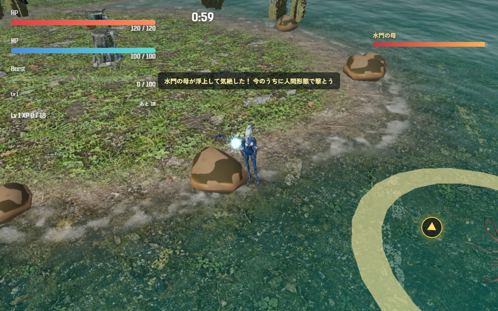
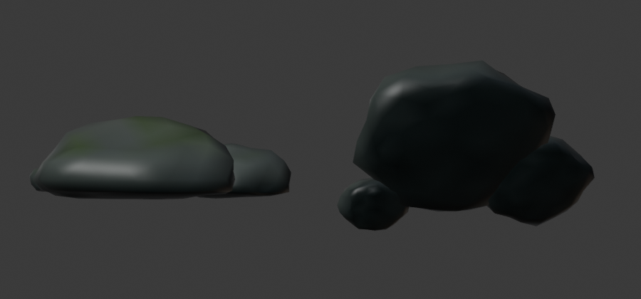
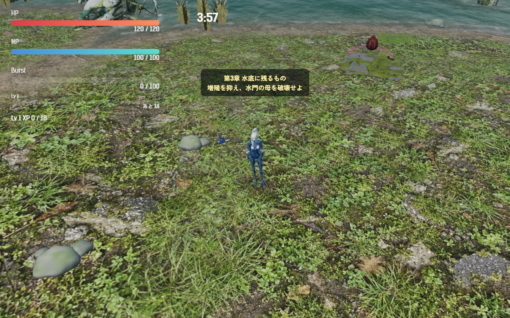
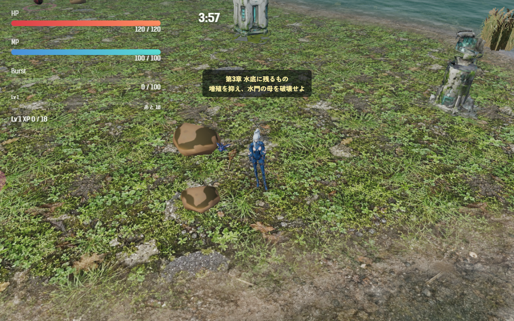

# 2026-11-23（サイクル 30）

## 今日やったこと
- 開始時: main、origin と同じ（Already up to date）。ユーザーの未登録ファイル（`videos/`・`exports/`・`assets/promo/cards/` など）には触っていない。11-21・22 の devlog は無い（その 2 日はサイクルが走っていない）。feedback.md に未反映の項目はなし。
- A: **A24 水門の母（E9）の手応えの確認**（A45・A47 は返事待ちなので、次の未着手の A24）。
  - 今の数字（母卵の HP 150、第3章の被ダメージ 0.65 倍）でボット（ツキミ・第3章、6 回）を回すと **2/6 勝**。負けた 4 回はすべて時間切れで、浮上（気絶）は 1 戦 3〜4 回起きているのに、気絶の 7 秒でボスの HP がほとんど減っていなかった（例: 150 → 139 → 136 で終了）。
  - 原因: **人間形態の自動射撃は敵にしか当たらない弾**で、母を狙わない。母に当たるのは卵用の射撃（届く距離 6、近くの普通の卵に取られがち）とバーストだけだった。浮上のメッセージは「今のうちに人間形態で撃とう」なのに、撃っても効かない状態。
  - 直し: **気絶している水門の母が距離 10 以内にいる間は、自動射撃が母を優先して狙う**ようにした（`Config.boss.floodgateMother.stunFocus`。false か URL の `?stunFocus=0` で元どおり）。母に向けた弾は卵に当たる弾として飛び、威力は `stunFocusAutoScale` 倍。
  - 倍率の決め方（ボット、ツキミ・第3章）:

    | 設定 | 勝ち | 出現から撃破まで | 浮上の回数 |
    |---|---|---|---|
    | 元（stunFocus なし） | 2/6 | 31・40 秒 | 3〜4 回 |
    | 0.5 倍＋卵用の射撃も母へ | 6/6 | 13〜21 秒 | ほぼ 1 回で倒れる（強すぎ） |
    | **0.25 倍（今日の値）、卵用の射撃はそのまま** | **7/10**（6 回で 4、4 回で 3） | 13〜54 秒 | 1〜4 回（多くは 2〜4 回） |

    0.25 倍なら「噛んで浮かせ、撃って削り、また潜ったら噛む」を 2〜3 回くり返す形になる。卵用の射撃も母に向ける切り替え（`stunFocusEggShot`）は残してあるが false。
  - ブラウザでの確認（Playwright で第3章、母から 8 離れた陸に立たせて 3 回噛ませた）: 浮上のメッセージが出て、弾が母の方へ飛ぶ。6.5 秒で HP 150 → 122（ボットの気絶 1 回分と同じくらい）。
    
  - **見つけた課題（A49）**: 距離 8 だと、母は画面の外（右下の矢印だけ）になる。撃っている相手が見えない。カメラの動きにかかわるので判断待ちへ。
- B（月・3D）: **B1-6 水の章の岸と島の石**。Tripo の 8 体は 11-09 に組み込み済みで、届いている GLB はもう無い。Forge の元絵を作るより、モックの置き換えを進めた。
  - 岸と島に置く岩（茶色に緑の斑の `obj_008_rtp.glb`）が地面から浮いて見えたので、Blender のスクリプトで手作りした（`scripts/blender/build_shore_rocks.py`。ノイズで曲げた球 3 個の寄せ集め、960 三角形、頂点色で濡れた帯・灰緑の石・苔）。生成ツールは使っていない。
  - 最初は石が白く飛んだ。glTF の頂点色はリニア値なので、sRGB のつもりの色をそのまま入れると明るすぎる。`c ** 2.2` で変換して直した（asset-pipeline.md に追記）。
  - `Config.visuals.handmadeShoreRocks: true`。false か URL の `?shoreRocks=0` で元の岩に戻る。記録は asset-ledger.md の「2026-11-23 水の章の岸と島の石」。

    | Blender の確認画像 | ゲーム内（新） | ゲーム内（元） |
    |---|---|---|
    |  |  |  |

## 確認結果
- npm test: 135 件すべて成功。npm run build: 成功（いつものチャンクの大きさの警告のみ）。
- プレイ確認: 上のスクリーンショット 3 枚（第3章、Playwright で撮影）。ページのエラーなし。
- 数値: ボット（ツキミ・第3章、`--speed 6`）は上の表。岩を差し替えたあとの 4 回も 3/4 勝・エラーなし（fps 31〜49）。

## 判断待ち（ユーザーへ）
1. **水門の母の気絶中に自動射撃が母を狙う（A24、新）**: 0.25 倍でボットは 7/10 勝・浮上 2〜4 回。強すぎ／弱すぎなら `Config.boss.floodgateMother.stunFocusAutoScale` を変える（0.5 だとほぼ 1 回の浮上で倒れる）。比べるときは URL に `?stunFocus=0`。
2. **気絶中の母が画面の外になる（A49、新）**: 気絶の 7 秒だけカメラを母の方へ寄せる案でよいか（カメラの動きが変わるので確認したい）。
3. **岸の石（B1-6、新）**: 手作りの灰緑の石で置き換えた。少しつるっとして見えるので、気になれば Tripo で岩を作る案もある（1 体 120 クレジット）。元に戻すなら `?shoreRocks=0`。
4. **前回からの判断待ち（回答がないので保留）**: バーストの一言（B3-10）、足跡の遅れの散らばり（A48）、渇きの母の取り合い（A47）、難しさを少し戻すか（A45）、拾うアイテムの見た目（B1-1）、ほか。`.claude/launch.json` が今も以前の worktree を向いているので、今日も Bash で開発サーバーを起動した。

## 次にやること
- A: 次の未着手は A22（追い手の手応えの確認）。A45・A47・A49 の返事が来たらそちらを先に。
- B（火・効果音）: B2 の続き（メニューのカーソル移動、群れ鳥が気づいたときの鳴き声・羽音）。
