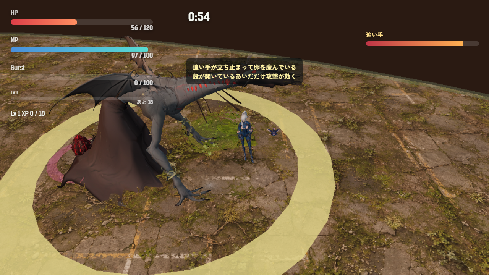
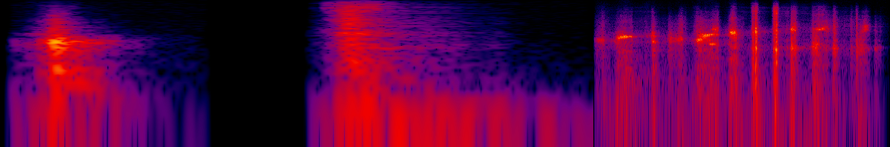
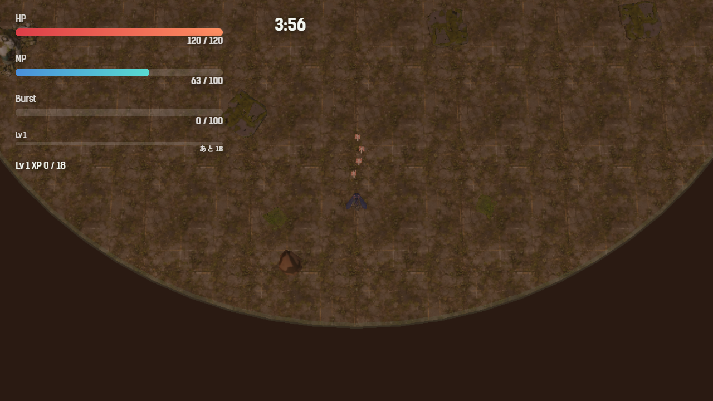

# 2026-11-24（サイクル 31）

## 今日やったこと
- 開始時: main、origin と同じ（Already up to date）。ユーザーの未登録ファイル（`videos/`・`exports/`・`assets/promo/cards/` など）には触っていない。feedback.md に未反映の項目はなし。
- A: **A22 追い手（E7、第2章のボス）の手応えの確認**（A45・A47・A49 は返事待ちなので、次の未着手の A22）。
  - ボットに `--pursuerTiming 1` を足した（既定は off）。殻が閉じている間は距離 9 へ緩く下がって雑魚と卵を減らし、殻が開いたら（卵を産んで立ち止まったら）距離 4 へ強く寄って撃つ。鳥の急降下も、殻が開いているときだけ。あわせて、ボスの HP が殻の開いている間・閉じている間にどれだけ減ったか（`hpLostOpen`/`hpLostClosed`）と、殻が開いている間に距離 6 以内にいた秒数を集計に足した。
  - ボット（ツキミ・第2章、`--speed 6`、各 6 回、同じシード）:

    | 動き方 | 勝ち | 出現から撃破まで | ボスの HP が減ったうち、殻が開いている間の割合 | 殻が開いた時間のうち、届く距離にいた秒数 |
    |---|---|---|---|---|
    | 元（距離 5 を保つ） | 2/6 | 7・26 秒 | 2〜6 割（負けの回） | 開いた 2〜28 秒中 1〜3 秒 |
    | 殻が開いたら寄る（寄る強さは元のまま） | 3/6 | 14〜23 秒 | 6〜8 割 | 27〜30 秒中 1〜3 秒 |
    | **殻が開いたら 4 倍の強さで寄る（今日の既定）** | **5/6** | 13〜41 秒 | **6〜10 割（4 回は 9 割以上）** | 4〜27 秒中 0〜4 秒 |

  - 分かったこと:
    1. **「止まった瞬間に撃つ」は強く効く**。殻が開いている間に寄るだけで勝ちが 2/6 → 5/6 になった。今の数字（開く 3.5 秒・1.8 倍、閉じている間 0.5 倍）で、狙う遊びが成り立っている。
    2. 元のボットが勝てなかったのは、追い手が **出現時に 60〜120 離れた所に出て**、まわりの敵に押されてボスから 10〜20 離れたままだったから（負けた回は殻が開いた 26〜28 秒のうち、届く距離にいたのは 1〜2 秒）。卵用の射撃は 6 までしか届かない。
    3. 閉じた殻に当たったときの手応えは灰色の火花だけ。音などで示すかは、人が遊んでから（A50 として残した。判断待ち 2）。
  - ブラウザでの確認（Playwright、第2章でボスの出現まで時計を進め、追い手から 4.5 離れた所に立たせて産卵を待った）: 金の輪・「殻が開いているあいだだけ攻撃が効く」が出て、0.9 秒で HP 150 → 129。
    
- B（火・効果音）: **B2-1 の続き。メニューのカーソル移動・会話のページ送り・群れ鳥が気づいたときの鳴き声と羽音**（Stable Audio 3、3 音 × 4 本）。
  - `menu_cursor.wav`（0.15 秒、柔らかいクリック）: ゲームパッドか Tab・矢印キーでメニューのカーソルが動いたとき。画面を開いたときの自動のフォーカスでは鳴らない。
  - `text_advance.wav`（0.14 秒、小さなタイプの音）: 会話で次のページへ進んだとき（1 文字ごとではない）。
  - `swarmbird_alert.wav`（1.65 秒、鳥の鋭い鳴き声と羽ばたき）: 群れ鳥が鳥形態のプレイヤーに気づいたとき（群れで 1 回、2.5 秒に 1 回まで）。
  - `Config.audio.menuSfx: false` でメニューの 2 つ、`Config.audio.newSfx: false` で 3 つとも鳴らない（元どおり）。候補・選んだ理由は asset-ledger.md の「2026-11-24」。周波数の絵（左からカーソル・文字送り・群れ鳥）:
    
  - 2 秒で作ったクリックは中に 2〜4 回鳴っていたので、1 回分だけ切り出した。0.4 秒より短い音は `normalize-sfx.mjs` で測れなかった（-70 LUFS と出て +50 dB かかる）ので、測るときだけ無音を足すようにした（既存のファイルの値は変わらない）。手順は asset-pipeline.md に追記。

## 確認結果
- npm test: 135 件すべて成功。npm run build: 成功（いつものチャンクの大きさの警告のみ）。
- プレイ確認（開発サーバー 5183、終わったら止めた）:
  - 会話でページを 2 回送ると `text_advance.wav` が 2 回、キャラ選びで Tab を押すと `menu_cursor.wav` が 1 回鳴った（ブラウザの画面で、再生されたファイル名を記録して確認）。
  - 第2章で群れ鳥のそばで鳥に変身すると、3.5 秒後に群れが追ってきて `swarmbirdAlert` が呼ばれた。ページのエラーなし。
    
- 数値: 上の A22 の表（ボット、ツキミ・第2章、各 6 回）。
- 失敗と対処: ボットが走っている間に `assets/audio/sfx/` に音を書いたら、開発サーバーがページを読み込み直してその回のボットが落ちた（2 本目の 6 回が 1 回で止まった）。回し直した。asset-pipeline.md に注意を書いた。

## 判断待ち（ユーザーへ）
1. **ボットの既定に「追い手の殻が開いたら寄る」を入れてよいか（A51、新）**: 第2章の勝ちが 2/6 → 5/6 になる。過去の第2章の数字と比べにくくなるので確認したい。入れない場合も `--pursuerTiming 1` で使える。
2. **追い手の閉じた殻に当たったときの手応え（A50、新）**: 今は灰色の火花だけ。閉じた殻に当たったときだけ鈍い「カン」という音を作るか。
3. **新しい効果音 3 つ（B2-1、新）**: 耳での確認はまだ。うるさければ `Config.audio.menuSfx: false`（メニューの 2 つ）。会話の文字送りを 1 文字ごとの小さな音にしたい場合は言ってほしい（今はページを送ったときだけ）。
4. **前回からの判断待ち（回答がないので保留）**: 水門の母の気絶中に射撃が母を狙う倍率（A24）、気絶中の母が画面の外になる（A49）、岸の石（B1-6）、バーストの一言（B3-10）、足跡の遅れの散らばり（A48）、渇きの母の取り合い（A47）、難しさを少し戻すか（A45）、ほか。`.claude/launch.json` が今も以前の worktree を向いているので、今日も Bash で開発サーバーを起動した。

## 次にやること
- A: 次の未着手は A26（鳴きの手応えの確認）。A45・A47・A49・A51 の返事が来たらそちらを先に。
- B（水・イラスト）: B4 の続き（キービジュアル B4-3 か、第1章の一枚絵 B4-4）。
