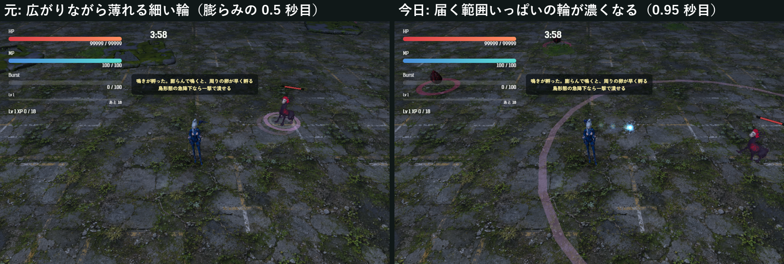
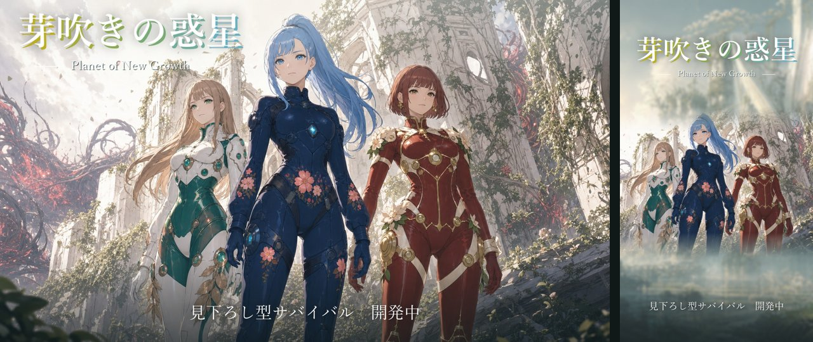

# 2026-11-25（サイクル 32）

## 今日やったこと
- 開始時: main、origin と同じ（Already up to date）。ユーザーの未登録ファイル（`videos/`・`exports/`・`assets/promo/cards/` など）には触っていない。feedback.md に未反映の項目はなし。
- A: **A26 鳴き（E10、第4章の新種）の手応えの確認**（A45・A47・A49・A51 は返事待ちなので、次の未着手の A26）。
  - ボットに `--crierHunt 1` を足した（既定は off）。ボスが出ていない間、25 以内の鳴きへ向かい、8 以内に入ったら（MP 3 割以上）鳥になって急降下する。人が「鳴きを見つけて潰しに行く」動きの代わり。あわせて、鳴き 1 体ごとに孵ってから倒れるまでの秒数（`criers.lifetimes`）を集計に足した。
  - ボット（ツキミ・第4章、`--speed 6`、各 6 回、同じシード）:

    | 動き方 | 勝ち | 被ダメージ（平均） | 鳴き（体） | 倒れた鳴きの寿命（中央値） | 1 体あたり鳴いた回数 | 早めた卵（延べ） | 急降下で潰した |
    |---|---|---|---|---|---|---|---|
    | 元（鳴きを気にしない） | **6/6** | 109 | 34（倒れたのは 19） | 37 秒 | 8.3 | 1807 | 7 |
    | 鳴きを潰しに行く（`--crierHunt 1`） | 4/6（負けの 2 回は 240 秒の時間切れ） | 110 | 44（倒れたのは 27） | **21 秒** | 6.4 | 1813 | 6 |

  - 分かったこと:
    1. **第4章はもうボットが全勝する**（11-16 の難しさの見直しのあと）。10-31 の確認のときは全敗で、鳴きの重さが測れなかった。
    2. 鳴きを潰しに行くと寿命は半分（37 → 21 秒）になるが、早めた卵の数・被ダメージは変わらず、寄り道のぶん勝ちが減った。**今の数字では鳴きを放っておいても困らない**。潰しに行く理由を作るなら、出る割合（10%）か早める秒（3）を上げる必要がある（判断待ち 2）。
    3. 潰すのはほとんど人の姿の射撃（HP 44 なので近づくうちに倒れる）。鳥の急降下で潰したのは 6 体だけ。
    4. 予兆の輪が見えにくい理由が分かった: 元の輪は中心から広がりながら薄れるので、届く範囲（半径 9）いっぱいに広がる頃には消えている。
  - **予兆の輪を直した**: 膨らみ始めから、届く範囲いっぱいの太い輪（幅 0.35）を出し、鳴くまでの 1.4 秒で濃くしていく（`Config.enemy.crier.fixedSwellRing: true`、false で元の輪。濃さ・太さは `swellRingOpacity`・`swellRingWidth`）。鳴いた瞬間の輪はそのまま。
    
    - 左は膨らみの 0.5 秒目で、輪はまだ鳴きの足元の小さな輪。右は 0.95 秒目で、範囲いっぱいの輪がプレイヤーの横を通っている（鳴きは画面の右端）。
- B（水・イラスト）: **空き RAM が 4.3 GB で Forge の基準（10 GB）を下回ったので生成はせず、B4-3 キービジュアルの下書きを既存の絵から組んだ**。
  - 三人の宣材 `assets/promo/three-soldiers.png` に、タイトル画面の文字（「芽吹きの惑星」と「Planet of New Growth」）を游明朝で描き直して重ねた。16:9 はタイトルを左上の空に（中央に置くと真ん中の人物の顔に重なった）、9:16 は `world-awakening.png` をぼかした背景の上に三人を切り出して置いた。下の一行は物語の言葉を避けて「見下ろし型サバイバル　開発中」にした。
  - 置き場所: `promo/2026-11-25/keyvisual-16x9-draft.jpg`（1920×1080）、`keyvisual-9x16-draft.jpg`（1080×1920）。jpg は git に入らないので、縮小版をここに貼る。スクリプトは `scripts/assets/compose-keyvisual.py`、記録は asset-ledger.md の「2026-11-25」。
    
  - 自分の目で見た評価: 16:9 は使える形。9:16 は人物の下の霧が広く間延びしていて、もう一手要る。

## 確認結果
- npm test: 135 件すべて成功。npm run build: 成功（いつものチャンクの大きさの警告のみ）。
- プレイ確認（開発サーバー 5183、終わったら止めた）: 第4章で鳴きを置いて膨らませ、新旧の輪を撮った（上の画像）。ページのエラーなし。`.claude/launch.json` は今も以前の worktree を向いているので、今日も Bash で開発サーバーを起動し、Playwright で撮った。
- 数値: 上の A26 の表（ボット、ツキミ・第4章、各 6 回）。結果は `tmp/bot/bot-tsukimi-stage4-*.json`。

## 判断待ち（ユーザーへ）
1. **キービジュアルの下書き（B4-3、新）**: (a) 16:9 の形で進めてよいか、(b) タイトルのロゴだけのデータ（透明の PNG など）があれば差し替えたい（今はフォントで似せて描き直したもの）、(c) 下の一行を物語の言葉（キャッチコピー）にするなら文案がほしい、(d) 游明朝をストアや広告の画像に使ってよいか（Windows 付属のフォント）。
2. **鳴きを重くするか（A52、新）**: 今の第4章では、鳴きを放っておいても被ダメージも勝ちも変わらない。人が遊んでみて物足りなければ、出る割合 10% → 15%、早める秒 3 → 4 などに上げる。
3. **前回からの判断待ち（回答がないので保留）**: ボットの既定に追い手の殻の動きを入れるか（A51）、閉じた殻の「カン」という音（A50）、新しい効果音 3 つ（B2-1）、水門の母の気絶中の倍率（A24）と画面の外（A49）、岸の石（B1-6）、バーストの一言（B3-10）、足跡の遅れ（A48）、渇きの母の取り合い（A47）、難しさを少し戻すか（A45）。第4章もボットが全勝するようになったので、A45 の「下げすぎかもしれない」は強まった。

## 次にやること
- A: 次の未着手は A27（手の手応えの確認）。A45・A47・A49・A51 の返事が来たらそちらを先に。
- B（木・3D）: Tripo の GLB の整形は 8 体とも済んでいるので、元絵の準備か、届いた GLB があれば整形。
