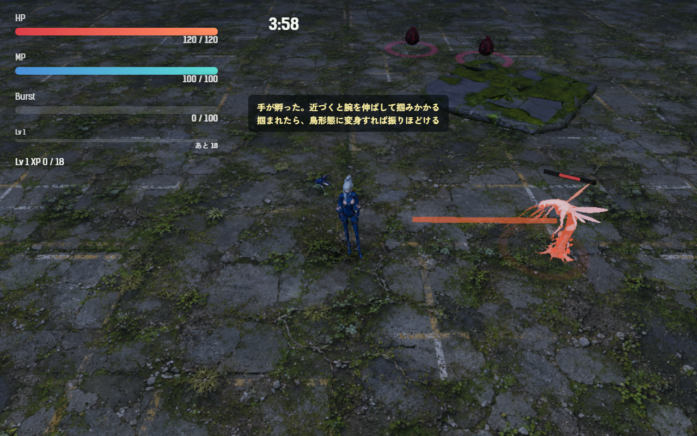

# 2026-11-27（サイクル 33）

## 今日やったこと
- 開始時: main、origin と同じ（Already up to date）。ユーザーの未登録ファイル（`videos/`・`exports/`・`assets/promo/cards/` など）には触っていない。feedback.md に未反映の項目はなし。
- A: **A27 手（E11、第4章の新種）の手応えの確認**（A45・A47・A49・A51 は返事待ちなので、次の未着手の A27）。
  - まず今のまま、ボット（ツキミ・第4章、`--speed 6`、6 回）で測った: 6 戦とも勝ち（被ダメージ 44〜260）。手は 1 戦 3〜6 体孵ったが、**予兆 2 回・掴み 0 回**。手は自動射撃のノックバック（1 発ごとに外向きに 4）で押し返され続け、届く距離 5 まで入れない。
  - **手を押し返されにくくした**: 近づいている間のノックバックを 0.35 倍、腕を伸ばしている（予兆の）間と掴んでいる間は 0 倍（`Config.enemy.hand.approachKnockbackScale: 0.35`・`windupKnockbackScale: 0`。1 / 1 で元どおり。URL の `?handKnock=1` でも元に戻せる）。
  - 確認用のスクリプトで、止まって撃つプレイヤー（ツキミ）の 6 離れた所に手を 1 体ずつ置いて比べた（10 回ずつ、HP は減らないようにした）:

    | 設定 | 予兆 | 掴み | 掴む前に倒れた |
    |---|---|---|---|
    | 元（`?handKnock=1`） | 2 | **0** | 2 |
    | 今日 | 10 | **10** | 0 |

  - 今日の設定でもう一度ボット 6 回: 5/6 勝（負けの 1 回は 240 秒の時間切れ）。手は予兆 4 回・**掴み 0 回**（4 回とも空振り）。ボットは動き続けるので、0.8 秒の予兆の間に届く距離（5＋0.4）の外へ歩いて出てしまう。被ダメージの大半は群れ鳥と弾で、手の変更とは関係が薄い（同じシードでも敵の出方が変わるので、勝ちの差は比べられない）。
  - つまり「止まっていれば掴まれる、動いていれば避けられる」になった。人が遊んで、強すぎないか・変身で振りほどく場面が生まれるかを見たい（A53、判断待ち 1）。
    
    - 右の赤い手から腕（半透明の棒）が伸びている所。新種が孵ったときの説明（「近づくと腕を伸ばして掴みかかる／掴まれたら、鳥形態に変身すれば振りほどける」）も出ている。
- B（金・音声）: **B3-10 の残り「被弾が続いたときの一言」を 3 人分作った**（台詞は仮。11-20 のバーストの一言と同じく、承認まで鳴らない）。
  - Irodori-TTS 4.1、手本の声あり、各 3 シード（計 9 本、2 分 22 秒）。文字起こしと声の高さ・画像で 1 本ずつ選び、-16 dB にそろえて mp3 にした。

    | キャラ | 台詞（仮） | ファイル | 長さ |
    |---|---|---|---|
    | ツキミ | いけない、離れないと……！ | `assets/audio/voice/tsukimi/hurt_streak_01.mp3` | 2.0 秒 |
    | アカメ | ……しつこい。 | `assets/audio/voice/akame/hurt_streak_01.mp3` | 0.7 秒 |
    | キイチゴ | ちょっと、痛いってば！ | `assets/audio/voice/kiichigo/hurt_streak_01.mp3` | 2.3 秒 |

  - 鳴る条件: 3 秒以内に 4 回目の被弾で、その回の被弾の声の代わりに鳴る。戦闘時間 30 秒に 1 回まで。HP が 3 割を切ったときの一言のほうが先。`Config.audio.hurtStreakVoice: false`（鳴らない）、URL の `?hurtStreakVoice=1` で試せる。回数・秒は `hurtStreakHits`・`hurtStreakWindow`・`hurtStreakVoiceCooldown`。
  - 選んだ理由と落とした候補は asset-ledger.md の「2026-11-27」。キイチゴは抑揚の大きい候補の先頭に雑音があったので、0.6 秒目から切り出した。

## 確認結果
- npm test: 135 件すべて成功。npm run build: 成功（いつものチャンクの大きさの警告だけ）。
- プレイ確認（開発サーバー 5183、終わったら止めた）: 第4章で手を置き、予兆と掴みを確かめた（上の画像）。被弾の一言は 3 人とも `?hurtStreakVoice=1` で 5 回の被弾が「被弾・被弾・被弾・**一言**・被弾」になり、既定（オフ）では 5 回とも被弾の声だけ。ページのエラーなし。`.claude/launch.json` は今も以前の worktree を向いているので、今日も Bash で開発サーバーを起動し、Playwright で確かめた。
- 数値（ボット、ツキミ・第4章、`--speed 6`、各 6 回）: 元 6/6 勝・手の予兆 2・掴み 0 → 今日 5/6 勝・予兆 4・掴み 0。結果は `tmp/bot/bot-tsukimi-stage4-*.json`。

## 判断待ち（ユーザーへ）
1. **手の強さ（A53、新）**: 手は止まっていれば必ず掴むようになった（前は射撃に押し返されてほぼ届かなかった）。遊んでみて強すぎれば、近づく間の倍率 0.35 を上げる（`?handKnock=1` で元の動きと比べられる）。
2. **被弾が続いたときの一言（B3-10、新）**: 台詞（ツキミ「いけない、離れないと……！」、アカメ「……しつこい。」、キイチゴ「ちょっと、痛いってば！」）でよいか。`?hurtStreakVoice=1` で聞ける。よければ 11-20 のバーストの一言（`?burstReadyVoice=1`）と一緒に鳴るようにする。
3. **前回からの判断待ち（回答がないので保留）**: キービジュアルの下書き（B4-3）、鳴きを重くするか（A52）、ボットの既定に追い手の殻の動きを入れるか（A51）、閉じた殻の「カン」という音（A50）、新しい効果音 3 つ（B2-1）、水門の母の気絶中の倍率（A24）と画面の外（A49）、岸の石（B1-6）、足跡の遅れ（A48）、渇きの母の取り合い（A47）、難しさを少し戻すか（A45）。

## 次にやること
- A: 次の未着手は A29（群れの母の手応えの確認）。第4章はボットが勝てるようになったので、今度は姉妹を倒す数が測れるはず。A45・A47・A49・A51 の返事が来たらそちらを先に。
- B（土・動画/SNS）: ハイライト動画の場面選び（B6-6、ボットが勝てるようになった）か、紹介カード（B6-3）。
