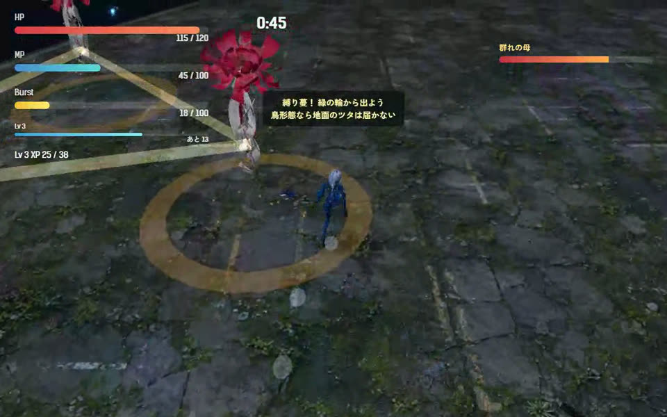
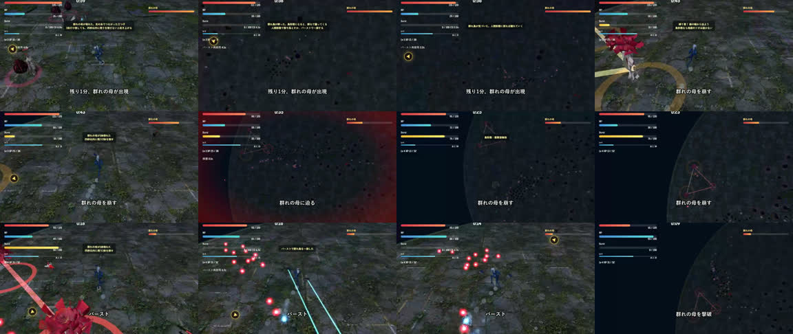

# 2026-11-28（サイクル 34）

## 今日やったこと
- 開始時: main、origin と同じ（Already up to date）。ユーザーの未登録ファイル（`videos/`・`exports/`・`assets/promo/cards/` など）には触っていない。feedback.md に未反映の項目はなし。
- A: **A29 群れの母（E12、第4章のボス）の手応えの確認**（A45・A47・A49・A51 は返事待ちなので、次の未着手の A29）。
  - 確かめるための仕掛けを 2 つ足した:
    1. 群れの母が、姉妹の倒れた時刻・起き上がった時刻・壊れた時刻を覚える（`swarm.downTimes`・`reviveTimes`・`finishAt`）。ボットの結果の `swarm` に、これと残りの HP が出る。テストを 1 件追加。
    2. URL の `?swarmRevive=秒`・`?swarmReviveHp=割合` で、起き上がりまでの秒と起き上がりの HP を変えて比べられる（既定の数字は変えていない）。
  - ボット（ツキミ・第4章、`--speed 6`、各 6 回、同じシード）:

    | 起き上がりまで | 起き上がりの HP | 勝ち | 起き上がり（6 戦の合計） | 被ダメージ（平均） |
    |---|---|---|---|---|
    | **25 秒（今）** | 0.3 | 6/6・6/6（2 回測った） | 2・1 回 | 122・144 |
    | 15 秒 | 0.3 | 4/6（負けは 2 回とも時間切れ） | 4 回 | 177 |
    | 10 秒 | 0.3 | 2/6 | 15 回 | 184 |
    | 10 秒 | 0.6（11-16 より前の値） | 4/6 | 12 回 | 236 |

  - 分かったこと:
    1. **今の 25 秒では、群れの母の仕組み（1 体ずつ倒すと起き上がる）がほぼ見えない**。姉妹 1 体の HP は 45（母卵 150 × 0.3）で、ボスは出てから 14〜57 秒で倒れる。1 体目が倒れてから最後の 1 体までは多くが 0.6〜7 秒で、25 秒の猶予に引っかからない。12 戦で起き上がったのは 2 戦・計 3 回だけ。
    2. 15 秒にすると、ボットが姉妹から押し離された回だけ起き上がりが起き（4 回）、勝ちは 4/6。「まとめて落とさないと戻る」が見えて、まだ勝てる強さ。
    3. ボットは近い姉妹から順に狙うだけで「均等に削る」動きはしない。人なら 10〜15 秒でもまとめて落とせるはず。
    4. バーストで 2 体同時に倒れた回は無かった（倒れた時刻の差は最短 0.6 秒）。
  - 数字は変えていない（11-16 にユーザーの指示「ボットがクリアできるくらいまで」で 10 → 25 秒にしたもの）。戻すかは判断待ち 1。

    
    - 第4章の録画（下の B）から切り出した 1 コマ。姉妹（赤い花の体）が光の糸でつながっている。手前の黄色い輪は縛り蔓の予兆。

- B（土・動画/SNS）: **B6-6 ハイライトの場面選びを、ボスが画面に映る場面を優先するように直した**。
  - ボットの録画に、ボスが近い（13 以内）・姉妹が倒れた（白蓮の花弁が割れた）・勝った瞬間、の印と、そのときの姿（人／鳥）を足した。`cut-highlights.mjs` はこれを先に選び、ボスの場面がある録画では卵への急降下（高い鳥のカメラで画面が暗く、卵が点になる）を外す。同じ種類の中では人の姿の場面を先に使う。字幕のボスの名前は `--boss 群れの母` で変えられる。
  - 第4章をボスの少し前（`--start 165`）から 2 回録った（2 回とも勝ち）。直す前の選び方では、26 秒のうち最初の 8 秒が暗い急降下の場面だった。直したあとは 6 場面（出現・姉妹が倒れる 2 回・迫る・バースト・撃破）。
    
  - 置き場所（動画は git に入らない）: 採用候補 `promo/2026-11-28/b/highlight-9x16.mp4`・`highlight-16x9.mp4`（約 26 秒、音なし）、直す前の版 `promo/2026-11-28/highlight-*.mp4`、録画の元 `promo/2026-11-28/raw/`。投稿文の案は `promo/2026-11-28/post.md`（**投稿はしていない**）。
  - 自分の目で見た評価: ボスの場面が増えて、何と戦っているか分かるようになった。ただ、撃破の瞬間はボットが鳥で急降下して終えるので高いカメラになり、遠く小さく見える。「出現」の 2 場面も鳥のカメラで暗い。

## 確認結果
- npm test: 136 件すべて成功（1 件追加）。npm run build: 成功（いつものチャンクの大きさの警告だけ）。
- プレイ確認（開発サーバー 5183、終わったら止めた）: ボットの録画 2 本（実時間、第4章）で群れの母の出現・倒れる・撃破を見た（上の画像）。`?swarmRevive=10` では起き上がりが倒れてから 10 秒後に起きることを、ボットの結果の時刻で確かめた。ページのエラーなし。`.claude/launch.json` は今も以前の worktree を向いているので、今日も Bash で開発サーバーを起動した。
- 数値: 上の A29 の表。結果は `tmp/bot/bot-tsukimi-stage4-*.json`。
- 気づいたこと: 衝撃波の警告の文字が、群れの母のときも「母卵の衝撃波」と出る（A54 に追加）。

## 判断待ち（ユーザーへ）
1. **群れの母の起き上がりまでの秒（A55、新）**: 今の 25 秒では仕組みがほぼ見えない（ボットは 12 戦で起き上がり計 3 回）。15 秒にすると、ボットで 4/6 勝・起き上がりが見える。15 秒にしてよいか（`?swarmRevive=15` で試せる）。A45（難しさを少し戻すか）と一緒に決めても良い。
2. **衝撃波の警告の名前（A54、新）**: 群れの母・白蓮の核のときも「母卵の衝撃波」と出る。ボスの名前に変えるか、物語では皆「母卵」なのでこのままか。
3. **ハイライト動画（B6-6、新）**: `promo/2026-11-28/b/` の 2 本と `post.md` の案。使うなら投稿はお任せします。撃破の瞬間を人の姿の近いカメラで撮りたければ、録画のときだけボットが最後を人の姿で撃つ動きを足す。
4. **前回からの判断待ち（回答がないので保留）**: 手の強さ（A53）、被弾が続いたときの一言（B3-10）、キービジュアルの下書き（B4-3）、鳴きを重くするか（A52）、ボットの既定に追い手の殻の動きを入れるか（A51）、閉じた殻の「カン」という音（A50）、新しい効果音 3 つ（B2-1）、水門の母の気絶中の倍率（A24）と画面の外（A49）、岸の石（B1-6）、足跡の遅れ（A48）、渇きの母の取り合い（A47）、難しさを少し戻すか（A45）。

## 次にやること
- A: 次の未着手は A28（ボットに「人が遊ぶ動き」を足す）。A45・A47・A51・A55 の返事が来たらそちらを先に。
- B（日・振り返り）: 動くアバターか素材の手直しの隔週の番を確かめて進め、週の振り返りを書く。
